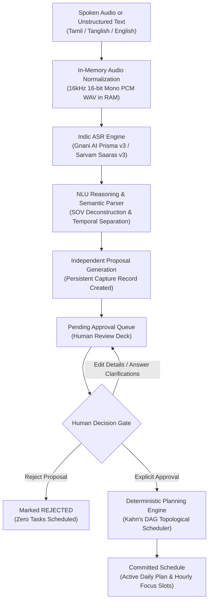
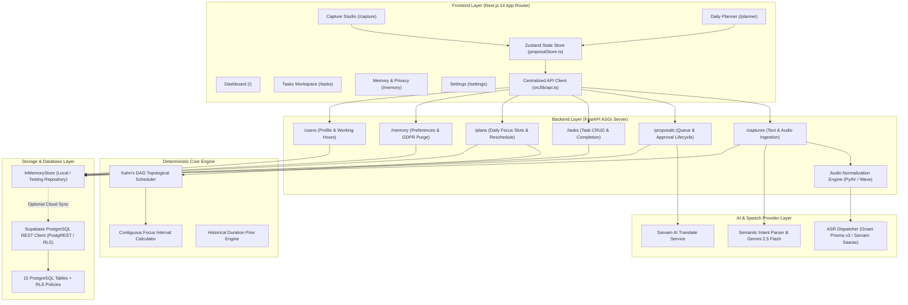

<p align="center">
  
</p>

# THOZHI (தோழி)

### Multilingual AI-Powered Intent-to-Action Personal Planning Assistant

[](https://www.python.org/)
[](https://fastapi.tiangolo.com/)
[](https://nextjs.org/)
[](https://www.typescriptlang.org/)
[](https://pytest.org/)
[-336791?logo=postgresql&logoColor=white)](https://supabase.com/)
[](https://vachana.ai/)

> **Core Operating Invariant: "The AI proposes. The user decides."**
> *Zero silent task creation. Zero unconfirmed schedule modifications. Zero raw audio retention.*

---

## Table of Contents

- [The Problem](#the-problem)
- [What is THOZHI?](#what-is-thozhi)
- [How THOZHI Works](#how-thozhi-works)
- [Core Features](#core-features)
  - [1. Multilingual Voice and Text Capture](#1-multilingual-voice-and-text-capture)
  - [2. Tamil, Tanglish, and English Understanding](#2-tamil-tanglish-and-english-understanding)
  - [3. Dynamic Display Language Translation](#3-dynamic-display-language-translation)
  - [4. Intent and Commitment Classification](#4-intent-and-commitment-classification)
  - [5. Sovereign Task and Deadline Extraction](#5-sovereign-task-and-deadline-extraction)
  - [6. Human-in-the-Loop Clarification and Editable Proposals](#6-human-in-the-loop-clarification-and-editable-proposals)
  - [7. Persistent Capture History](#7-persistent-capture-history)
  - [8. Independent Proposal Approval Queue](#8-independent-proposal-approval-queue)
  - [9. Task Management and Lifecycle Tracking](#9-task-management-and-lifecycle-tracking)
  - [10. Deterministic DAG Planning and Scheduling](#10-deterministic-dag-planning-and-scheduling)
  - [11. Capacity and Deadline Conflict Detection](#11-capacity-and-deadline-conflict-detection)
  - [12. Task Dependencies and Project Organization](#12-task-dependencies-and-project-organization)
  - [13. System Alerts and Feedback](#13-system-alerts-and-feedback)
  - [14. Sovereign Contextual Memory and Duration Priors](#14-sovereign-contextual-memory-and-duration-priors)
  - [15. Privacy, Data Sovereignty, and GDPR Controls](#15-privacy-data-sovereignty-and-gdpr-controls)
- [System Architecture](#system-architecture)
- [Repository Structure](#repository-structure)
- [Technology Stack](#technology-stack)
- [Installation and Local Development](#installation-and-local-development)
  - [Prerequisites](#prerequisites)
  - [1. Clone Repository](#1-clone-repository)
  - [2. Backend Setup](#2-backend-setup)
  - [3. Frontend Setup](#3-frontend-setup)
  - [4. Docker Deployment](#4-docker-deployment)
- [Environment Variables](#environment-variables)
- [Automated Testing](#automated-testing)
- [Security and Privacy](#security-and-privacy)
- [Current Limitations](#current-limitations)
- [Contributing](#contributing)
- [License and Acknowledgements](#license-and-acknowledgements)

---

## The Problem

Every day, people manage responsibilities, deadlines, meetings, and ideas scattered across spoken conversations, messaging apps, and unstructured thoughts. Transforming this mental backlog into a realistic, actionable daily plan requires substantial cognitive effort.

This challenge is magnified in multilingual and code-switching communities:
- **Rigid Interfaces:** Traditional productivity tools demand manual form-filling, rigid English date pickers, and strict categorization that disrupts natural thought flow.
- **Language Exclusion:** Colloquial speech in **Tamil** and **Tanglish** (Tamil-English code-mixing) is routinely misclassified or rejected by English-centric assistants.
- **The LLM Hallucination Trap:** Generic conversational AI tools frequently fabricate deadlines, guess arbitrary task durations, schedule meetings without availability checks, or silently clutter calendars with unverified assumptions.

---

## What is THOZHI?

**THOZHI (தோழி)** — meaning *"companion"* or *"friend"* in Tamil — is a multilingual AI-powered personal planning assistant. It transforms natural, unstructured monologue (voice or text) into structured commitments, verified deadlines, and deterministic focus schedules while keeping the human firmly in control.

THOZHI operates under an inviolable principle:

$$\mathbf{The\ AI\ proposes.\ The\ user\ decides.}$$

Unlike conversational bots that silently add tasks to your schedule or take irreversible actions, THOZHI treats every AI extraction as a **draft proposal**. Only when a human explicitly reviews, edits, and approves an item does it enter the user's active schedule.

---

## How THOZHI Works

The end-to-end intent-to-action workflow is strictly structured and non-destructive:



1. **Capture:** The user speaks or types freely in Tamil, Tanglish, or English.
2. **Process:** Voice input is normalized in transient RAM and transcribed via Gnani AI Prisma v3. Raw audio is purged immediately upon transcription.
3. **Reason:** NLU reasoning deconstructs the monologue into structured actions, objects, and temporal constraints without fabricating missing durations or priorities.
4. **Propose:** An independent proposal is added to the pending queue alongside targeted clarification questions for any ambiguities.
5. **Decide:** The user reviews the proposal, answers questions, modifies fields, and makes individual or batch approval decisions.
6. **Schedule:** Approved tasks are scheduled deterministically using topological sorting and contiguous interval math into the active daily timeline.

---

## Core Features

### 1. Multilingual Voice and Text Capture
- **Voice Thought Stream:** Browser-based audio recording via the MediaRecorder API (`MicButton.tsx`) supporting variable sample rates and formats.
- **Transient Audio Normalization:** Server-side in-memory normalization (`core/audio.py`) converting arbitrary audio containers (WebM, OGG, MP4, AAC) into standard 16kHz 16-bit mono PCM WAV buffers.
- **Unstructured Text Capture:** Monologue text area with quick-fill template chips for Tamil deadlines, Tanglish submissions, and English sprints.

### 2. Tamil, Tanglish, and English Understanding
- **Primary Speech Recognition:** Authenticated integration with **Gnani AI Prisma v3** (`prisma-v3.0` model), purpose-built for Indic acoustic nuances and code-mixing.
- **Commercial Failover:** Automatic failover dispatcher (`ASRDispatcher`) falling back to Sarvam AI Saaras v3 when configured.
- **Subject-Object-Verb (SOV) Deconstruction:** Semantic parser (`providers/nlu/semantic_parser.py`) engineered to parse Tamil and Tanglish sentence structures, extracting core verbs (actions) and direct objects without trailing suffixes.

### 3. Dynamic Display Language Translation
- **Decoupled Input & Display:** Users can speak naturally in Tamil or Tanglish and independently choose their display language (**English**, **தமிழ் (Tamil)**, or **Original**).
- **On-Demand Translation:** Powered by Sarvam AI Translate (`providers/translation/sarvam.py`). Translates intent summaries, item titles, descriptions, and clarification questions on the fly without re-recording or re-submitting audio.
- **Display Language Memory:** Automatically applies the user's preferred display language preference from sovereign memory on new captures.

### 4. Intent and Commitment Classification
Categorizes spoken monologue into 10 structured intent classes:
- `TASK`: Action the user needs to perform.
- `COMMITMENT`: Fixed promise, scheduled call, or external meeting with others.
- `CONDITIONAL_INTENTION`: Contingent intention (e.g., *"If it doesn't rain, I will go to the library"*), preserving condition triggers.
- `IDEA` / `WISH`: Exploratory thoughts captured without premature scheduling.
- `QUESTION`: Queries requiring user follow-up or research.
- `REMINDER`: Time-sensitive prompts without heavy work blocks.
- `COMPLETED`: Retrospective mentions of finished tasks, filtered out from scheduling.
- `CANCELLED`: Explicit cancellations of existing commitments.
- `INFORMATIONAL`: Contextual notes without action items.

### 5. Sovereign Task and Deadline Extraction
- **Zero Temporal Debris:** Strips dates, times, days, and relative adverbials out of task titles. Deadlines belong strictly in dedicated temporal fields.
- **Deadline Normalization:** Converts relative phrases (*"tomorrow evening 6 PM"*, *"naalaikku kaalaila 10 manikku"*, *"Friday 4 PM kulla"*) into standardized ISO-8601 UTC timestamps.
- **Zero Duration Fabrication:** If the user does not state a duration, the system leaves `estimated_duration_min` as null and flags `duration_source="UNSPECIFIED"`. It never silently defaults to arbitrary 30-minute blocks.
- **Zero Priority Fabrication:** Urgency is only assigned when explicitly spoken (e.g., *"romba mukkiyam"*, *"critical"*). Otherwise, priority remains unspecified until user review.

### 6. Human-in-the-Loop Clarification and Editable Proposals
- **Targeted Clarification Prompts:** Automatically generates multiple-choice clarification chips when deadlines or durations are ambiguous (e.g., *"Did you mean 5:00 PM today or 9:00 AM tomorrow?"*).
- **Inline Proposal Editing:** Users can edit titles, adjust durations, select priority levels, and toggle individual item approvals directly in the review deck before committing.

### 7. Persistent Capture History
- **Independent Capture Records:** Every voice recording and text submission creates a permanent `Capture` record with a unique UUID, timestamp, detected language, and lifecycle status (`GET /api/v1/captures`).
- **Interactive Capture Stream:** Clickable capture cards in `/capture` display original transcripts, language badges, and translation previews. Clicking any past card reloads its exact proposal into the review card.
- **Non-Destructive Clear:** The "Clear History" action clears visible stream logs while strictly preserving all committed tasks and pending proposals.

### 8. Independent Proposal Approval Queue
- **No Silent Overwrites:** Recording a second or third voice capture **never** replaces or discards an earlier pending proposal. All pending proposals accumulate safely in the queue (`GET /api/v1/proposals?status=PENDING_REVIEW`).
- **Granular Decisions:** Users can approve Proposal A, reject Proposal B, and leave Proposal C pending.
- **Idempotency & Replay Protection:** Approval payloads require client-generated UUIDs (`idempotency_key`), preventing duplicate task creation on network retries or double-clicks.
- **Dedicated Reject Endpoint:** Explicitly reject proposals (`POST /api/v1/proposals/{id}/reject`) without generating tasks.

### 9. Task Management and Lifecycle Tracking
- **Task Views:** Dedicated task workspace (`/tasks`) and dashboard widget (`/`) listing active commitments.
- **Status Filtering:** Filter tasks by `PENDING`, `IN_PROGRESS`, and `COMPLETED`.
- **Completion Workflow:** Mark tasks complete or reopen them with one click (`POST /api/v1/tasks/{id}/complete`, `POST /api/v1/tasks/{id}/reopen`).

### 10. Deterministic DAG Planning and Scheduling
- **Kahn's Topological Sort Scheduler:** Mathematically sequences tasks honoring strict prerequisite dependencies.
- **Cycle Detection:** Detects cyclic dependency loops (e.g., Task A $\rightarrow$ Task B $\rightarrow$ Task A) and rejects them deterministically (`SchedulingCycleException` with HTTP 422).
- **Contiguous Free Interval Math:** Calculates available time slots by subtracting calendar busy events and protected lunch blocks from user working hours (`09:00 - 18:00`).

### 11. Capacity and Deadline Conflict Detection
- **Capacity Budgeting:** Computes scheduled workload against total daily capacity (`CapacityBar.tsx`).
- **Conflict Warnings:** Detects `OVERCAPACITY` and `DEADLINE_EXCEEDED` when task durations exceed available focus intervals.
- **One-Click Rescheduling:** Proposes optimal postponement dates and slot allocations for displaced tasks during schedule shocks.

### 12. Task Dependencies and Project Organization
- **DAG Edges:** Link prerequisites to dependent tasks (`POST /api/v1/tasks/dependencies`) enforcing execution order.
- **Organization Views:** Structured task management by priority, deadline, and scheduled status. *(Note: The `/projects` view is currently a Stage-2 UI preview).*

### 13. System Alerts and Feedback
- **Real-Time Banners:** Visual status alerts for committed tasks, rejected proposals, and scheduling capacity deficits.
- **Toast Error Boundaries:** Graceful feedback during network interruptions, invalid payloads, or audio capture errors.

### 14. Sovereign Contextual Memory and Duration Priors
- **Preference Store:** Tenant-isolated preference storage (`GET /api/v1/memory/preferences`) for working hours, deep work windows, and protected breaks.
- **Learned Duration Priors:** Analyzes historical completed tasks to suggest realistic duration buffers for recurring task patterns (e.g., *"Technical reports typically require +45 mins"*).
- **Explicit Consent Gates:** Every preference record enforces active flags and consent levels (`EXPLICIT_USER`, `USER_APPROVED`).

### 15. Privacy, Data Sovereignty, and GDPR Controls
- **Zero Raw Audio Retention:** Spoken audio is held exclusively in volatile RAM during speech-to-text conversion and discarded immediately.
- **Full Data Portability:** Download a complete JSON archive of all tenant captures, proposals, tasks, and preferences (`POST /api/v1/memory/export`).
- **Right to be Forgotten:** Instant, permanent purge of all tenant records across the database (`DELETE /api/v1/memory/purge`).
- **Row-Level Security:** Database migrations enforce strict tenant isolation via PostgreSQL RLS policies.

---

## System Architecture

THOZHI is designed as a decoupled, micro-service-ready architecture separating user interaction, API routing, deterministic planning, and AI provider integrations:



---

## Repository Structure

```
thozhi/
├── .github/
│   └── workflows/
│       └── ci.yml                     # GitHub Actions CI workflow (Python & Next.js)
├── backend/
│   ├── app/
│   │   ├── core/                      # Audio normalization, config, RFC 7807 problem details
│   │   │   ├── audio.py               # In-memory audio normalization to 16kHz mono WAV
│   │   │   ├── config.py              # Pydantic BaseSettings and environment loading
│   │   │   └── errors.py              # Custom typed exception hierarchy
│   │   ├── db/                        # Data repository and database clients
│   │   │   ├── repositories/          # Decoupled Repository Pattern Abstraction
│   │   │   │   ├── base.py            # BaseRepository abstract protocol
│   │   │   │   ├── memory.py          # InMemoryRepository for deterministic tests
│   │   │   │   ├── supabase.py        # SupabaseRepository for PostgreSQL persistence
│   │   │   │   └── factory.py         # Dynamic repository factory
│   │   │   ├── repository.py          # Central backward-compatible store access
│   │   │   └── supabase_client.py     # Asynchronous Supabase PostgREST client with typed errors
│   │   ├── modules/
│   │   │   └── planning/
│   │   │       └── engine.py          # Kahn's topological sort scheduler & interval math
│   │   ├── providers/                 # Pluggable AI and speech providers
│   │   │   ├── asr/                   # Gnani Prisma v3 primary STT & Sarvam failover
│   │   │   ├── nlu/                   # Gemini 2.5 Flash & rule-based SemanticIntentParser
│   │   │   └── translation/           # Sarvam AI machine translation provider
│   │   ├── routers/                   # FastAPI route controllers
│   │   │   ├── captures.py            # Audio and text monologue ingestion endpoints
│   │   │   ├── memory.py              # Sovereign memory preferences and GDPR endpoints
│   │   │   ├── plans.py               # Schedule generation and rescheduling endpoints
│   │   │   ├── proposals.py           # Approval queue, item editing, rejection endpoints
│   │   │   ├── tasks.py               # Task CRUD, completion, and dependencies
│   │   │   └── users.py               # User profile and timezone settings
│   │   ├── schemas/                   # Pydantic v2 data validation schemas
│   │   └── main.py                    # FastAPI application initialization & middleware
│   ├── tests/                         # Comprehensive Pytest test suite (129 tests)
│   ├── Dockerfile                     # Multi-stage Python 3.11 container definition
│   └── requirements.txt               # Backend Python dependencies
├── frontend/
│   ├── public/
│   │   ├── brand/                     # Official raster & vector brand logos and icons
│   │   └── manifest.json              # Web app manifest
│   ├── src/
│   │   ├── app/                       # Next.js 14 App Router routes
│   │   │   ├── capture/page.tsx       # Thought Capture Studio & persistent stream
│   │   │   ├── memory/page.tsx        # Sovereign memory & GDPR privacy portal
│   │   │   ├── planner/page.tsx       # Daily timeline & reschedule suggestions
│   │   │   ├── settings/page.tsx      # User profile, working hours, and display language
│   │   │   ├── tasks/page.tsx         # Active task workspace & completion toggles
│   │   │   ├── layout.tsx             # Root layout with Sidebar and TopNav
│   │   │   └── page.tsx               # Main dashboard with timeline & capacity bar
│   │   ├── components/                # Reusable UI components
│   │   │   ├── brand/BrandLogo.tsx    # Responsive logo component
│   │   │   ├── capture/MicButton.tsx  # Browser audio recording component
│   │   │   ├── layout/Sidebar.tsx     # Navigation sidebar
│   │   │   ├── layout/TopNav.tsx      # Top bar with profile initials & status
│   │   │   ├── proposal/ProposalReviewCard.tsx # Human approval review deck
│   │   │   └── ui/CapacityBar.tsx     # Visual focus capacity progress indicator
│   │   ├── hooks/                     # Custom React hooks (useUserProfile)
│   │   ├── lib/                       # Centralized API client & utilities
│   │   │   ├── api.ts                 # Typed fetch wrappers for backend endpoints
│   │   │   └── utils.ts               # Tailwind CSS class merging utilities
│   │   ├── store/
│   │   │   └── proposalStore.ts       # Zustand multi-capture and proposal queue store
│   │   └── types/
│   │       └── index.ts               # Shared TypeScript domain interfaces
│   ├── Dockerfile                     # Multi-stage Node.js standalone container definition
│   ├── package.json                   # Frontend dependencies and npm scripts
│   ├── tailwind.config.ts             # Tailwind CSS theme configuration
│   └── tsconfig.json                  # TypeScript compiler configuration
├── supabase/
│   └── migrations/                    # PostgreSQL DDL migrations
│       ├── 001_initial_schema.sql     # Baseline 14-table schema, enums, and indexes
│       ├── 002_rls_policies.sql       # Row-Level Security tenant policies
│       └── 003_schema_alignment.sql   # Schema alignment for queue lifecycle & multi-language
├── docker-compose.yml                 # Multi-container local orchestration
├── .env.example                       # Environment variable template
└── README.md                          # Project documentation
```

---

## Technology Stack

| Domain | Technology | Version | Purpose |
|---|---|:---:|---|
| **Frontend Framework** | [Next.js](https://nextjs.org/) | `14.2.35` | React framework with App Router & standalone output |
| **UI Library** | [React](https://react.dev/) | `^18.0.0` | Declarative user interface components |
| **Language** | [TypeScript](https://www.typescriptlang.org/) | `^5.0.0` | End-to-end type safety |
| **Styling** | [Tailwind CSS](https://tailwindcss.com/) | `^3.4.1` | Neo-Brutalism theme (`#080B11`, Blue Grid, Cyber Amber) |
| **State Management** | [Zustand](https://zustand.docs.pmnd.rs/) | `^5.1.0` | Multi-capture stream & proposal approval queue store |
| **Iconography** | [Lucide React](https://lucide.dev/) | `^1.70.0` | UI icon set |
| **Backend Framework** | [FastAPI](https://fastapi.tiangolo.com/) | `>=0.110.0` | High-performance Python ASGI web framework |
| **ASGI Server** | [Uvicorn](https://www.uvicorn.org/) | `>=0.28.0` | Lightning-fast ASGI production server |
| **Data Validation** | [Pydantic](https://docs.pydantic.dev/) | `>=2.6.0` | Schema validation and settings management |
| **HTTP Client** | [HTTPX](https://www.python-httpx.org/) | `>=0.27.0` | Asynchronous HTTP requests to AI providers |
| **Audio Processing** | [PyAV](https://pyav.org/) (`av`) | `>=11.0.0` | In-memory audio normalization to 16kHz mono WAV |
| **Primary Speech Engine** | [Gnani AI Prisma v3](https://vachana.ai/) | `prisma-v3.0` | Indic speech-to-text recognition (ta-IN, en-IN) |
| **Failover Speech Engine**| [Sarvam AI Saaras v3](https://sarvam.ai/) | `saaras:v3` | Indic speech recognition failover |
| **NLU Reasoning** | [Google Gemini API](https://ai.google.dev/) | `gemini-2.5-flash` | Multilingual intent extraction and reasoning |
| **Machine Translation** | [Sarvam AI Translate](https://sarvam.ai/) | `sarvam-translate:v1` | Dynamic transcript translation (Tamil $\leftrightarrow$ English) |
| **Database** | [PostgreSQL (Supabase)](https://supabase.com/) | `15+` | Relational storage with Row-Level Security (RLS) |
| **Testing** | [Pytest](https://docs.pytest.org/) | `>=8.0.0` | Automated test suite (125 tests) |
| **Containerization** | [Docker](https://www.docker.com/) | Multi-stage | Alpine Node.js runner + Python 3.11-slim container |

---

## Installation and Local Development

### Prerequisites

- **Python:** Version `3.11` or higher
- **Node.js:** Version `18.18` or higher
- **Package Managers:** `pip` and `npm`
- **Git:** Installed and configured
- **Docker & Docker Compose:** *(Optional, for containerized execution)*

---

### 1. Clone Repository

```bash
git clone https://github.com/mohamed-kaif-1/Thozhi.git
cd Thozhi
```

---

### 2. Backend Setup

1. **Create and activate a virtual environment:**

   ```bash
   # Linux / macOS
   python3 -m venv venv
   source venv/bin/activate

   # Windows (PowerShell)
   python -m venv venv
   .\venv\Scripts\Activate.ps1
   ```

2. **Install dependencies:**

   ```bash
   pip install -r backend/requirements.txt
   ```

3. **Configure environment:**

   ```bash
   cp .env.example .env
   ```

   *(Open `.env` and configure your API keys if live speech and AI reasoning are desired. If left blank, the application will run using synthetic development mock providers).*

4. **Run FastAPI backend:**

   ```bash
   python -m uvicorn backend.app.main:app --reload --port 8000
   ```

   - **API Base:** [http://localhost:8000](http://localhost:8000)
   - **Interactive Swagger Documentation:** [http://localhost:8000/docs](http://localhost:8000/docs)
   - **Health Check:** [http://localhost:8000/health](http://localhost:8000/health)

---

### 3. Frontend Setup

1. **Open a new terminal window and navigate to `frontend/`:**

   ```bash
   cd frontend
   ```

2. **Install npm dependencies:**

   ```bash
   npm install
   ```

3. **Start Next.js development server:**

   ```bash
   npm run dev
   ```

   - **Web Application:** [http://localhost:3000](http://localhost:3000)
   - **Capture Studio:** [http://localhost:3000/capture](http://localhost:3000/capture)
   - **Daily Planner:** [http://localhost:3000/planner](http://localhost:3000/planner)

---

### 4. Docker Deployment

To spin up the entire application (FastAPI backend + Next.js frontend) in isolated Docker containers:

```bash
docker compose up --build -d
```

To stop containers:

```bash
docker compose down
```

---

## Environment Variables

Copy `.env.example` to `.env` in the project root. The table below outlines all available configuration options:

| Variable | Required | Default Value | Description |
|---|:---:|---|---|
| `GNANI_API_KEY` | Optional | `""` | API key for Gnani AI Prisma v3 Indic speech-to-text. |
| `GNANI_API_URL` | Optional | `https://api.vachana.ai` | Gnani API endpoint URL (`X-API-Key-ID` header authentication). |
| `SARVAM_API_KEY` | Optional | `""` | API key for Sarvam AI Saaras v3 ASR and Sarvam Translate. |
| `SARVAM_API_URL` | Optional | `https://api.sarvam.ai` | Sarvam API base URL. |
| `GEMINI_API_KEY` | Optional | `""` | Google Gemini API key for `gemini-2.5-flash` NLU extraction. |
| `SUPABASE_URL` | Optional | `""` | Supabase project URL for PostgreSQL persistence. |
| `SUPABASE_KEY` | Optional | `""` | Supabase API key (Anon public key or Service-Role backend secret). |
| `SUPABASE_JWT_SECRET` | Optional | `""` | JWT secret for verifying Supabase Auth bearer tokens. |
| `NEXT_PUBLIC_API_URL`| **Yes** | `http://localhost:8000/api/v1` | Public API endpoint URL accessed by the Next.js client. |
| `ENVIRONMENT` | No | `development` | Runtime mode (`development`, `test`, `production`). |
| `CORS_ORIGINS` | No | `["http://localhost:3000"]` | JSON array of permitted CORS client origins. |

### Supabase Credential Architecture
- **Supabase Anon / Publishable Key (`SUPABASE_ANON_KEY`):** Public client-facing key. Strictly restricted by Row-Level Security (RLS) policies. Safe for browser usage.
- **Supabase Service-Role / Secret Key (`SUPABASE_SERVICE_ROLE_KEY`):** Administrative backend secret. Bypasses all RLS policies. **MUST NEVER be exposed to frontend code, git commits, or `NEXT_PUBLIC_*` client variables.**
- **User JWT (`Authorization: Bearer <user_jwt>`):** Ephemeral session token issued upon user authentication. PostgREST extracts `request.jwt.claim.sub` to dynamically enforce `current_user_id() = user_id`.

> **Note on Offline Hermetic Execution:** If `GNANI_API_KEY`, `SARVAM_API_KEY`, or `GEMINI_API_KEY` are left blank or set to mock keys, THOZHI automatically activates deterministic offline provider fallbacks and semantic rule engines, allowing complete test execution, CI automation, and UI exploration without live network calls.

---

## Automated Testing

THOZHI includes a 129-test automated backend test suite covering intent extraction, scheduling algorithms, multi-capture queue lifecycles, translation invariants, and multi-tenant security:

```bash
# Run all 129 backend tests
python -m pytest backend/tests -v
```

```
================= 129 passed, 2 warnings in 48.51s ==================
```

### Targeted Test Suites

```bash
# 1. Capture history, multiple proposals & approval queue regression (12 tests)
python -m pytest backend/tests/test_capture_proposal_queue_regression.py -v

# 2. Sovereign semantic intent extraction & SOV parsing regression (32 tests)
python -m pytest backend/tests/test_extraction_regression.py -v

# 3. Kahn's DAG topological scheduler & cycle detection regression (16 tests)
python -m pytest backend/tests/test_scheduling_regression.py -v

# 4. Multilingual translation & display language invariants (5 tests)
python -m pytest backend/tests/test_translation.py -v

# 5. Indic synthetic scenarios & GDPR purge evaluation (16 tests)
python -m pytest backend/tests/test_stage8_ai_evaluation.py -v

# 6. Supabase Row-Level Security & multi-tenant isolation tests (4 tests)
python -m pytest backend/tests/test_supabase_rls_security.py -v
```

### Frontend Typecheck & Production Build Verification

Verify that all 18 Next.js pages compile and statically generate without TypeScript or ESLint errors:

```bash
npm run build --prefix frontend
```

---

## Security, Privacy and Data Sovereignty

1. **Zero Raw Audio Retention:** Spoken audio is held exclusively in volatile RAM during speech recognition. The backend never writes audio to disk or permanent databases, and audio buffers are destroyed immediately upon transcription response.
2. **Strict Human-in-the-Loop:** No task or calendar entry is created without human approval. The AI generates draft proposals; only explicit user commits write tasks to the active schedule.
3. **No Fabricated Provenance or Consent:** Task durations are recorded with explicit provenance (`USER_EXPLICIT`, `LEARNED_PRIOR`, `MODEL_ESTIMATE`, or `UNSPECIFIED`). Consent is never inferred or defaulted to true for legacy data; explicit user confirmation is strictly required.
4. **Replay Attack & Deduplication Protection:** All proposal approvals require client-generated UUID idempotency keys (`idempotency_key`), eliminating duplicate task creation on network retries.
5. **Row-Level Security (RLS):** Database migrations (`002_rls_policies.sql`) define strict PostgreSQL RLS policies enforcing tenant data isolation via `current_user_id() = user_id`.
6. **Deterministic Scheduling Guardrails:** The calendar scheduler uses deterministic interval mathematics and Kahn's algorithm. The LLM does not allocate time slots, eliminating non-deterministic calendar collisions.
7. **Sovereign Data Portability & GDPR Purge:** Users can download their complete history as a JSON archive (`POST /api/v1/memory/export`) or permanently wipe all personal records with one click (`DELETE /api/v1/memory/purge`).

---

## Implementation Status & Current Limitations

| Feature / Domain | Status | Technical Details |
|---|:---:|---|
| **Voice & Text Ingestion** | **Implemented** | RAM-only audio processing, Gnani Prisma v3 ASR, Sarvam failover |
| **Intent & SOV Extraction** | **Implemented** | Subject-Object-Verb deconstruction, temporal extraction, Gemini Flash NLU |
| **Approval Queue Lifecycle** | **Implemented** | Independent multi-capture streams, draft proposals, item editing, rejection |
| **DAG Topological Scheduling** | **Implemented** | Kahn's algorithm, cycle prevention, interval arithmetic busy subtraction |
| **Repository Pattern** | **Implemented** | `BaseRepository` abstraction with `InMemoryRepository` & `SupabaseRepository` |
| **Supabase PostgreSQL DDL** | **Implemented** | Migrations `001`, `002`, and rectified `003` with RLS policies |
| **Dynamic Translation** | **Implemented** | Tamil $\leftrightarrow$ English $\leftrightarrow$ Tanglish display language toggle |
| **Supabase Cloud Sync** | **Partially Implemented** | PostgREST client & repositories implemented; live sync activates on valid cloud URL/key |
| **Secondary Navigation Routes** | **Prototype** | `/calendar`, `/assistant`, `/goals`, `/projects`, `/notifications` rendered on client-side mocks |
| **External OAuth Calendar Sync** | **Planned** | Google Calendar & Microsoft Outlook bidirectional sync scheduled for post-MVP |

---

## Contributing

Contributions to THOZHI are welcome! Follow this standard workflow:

1. **Fork** the repository.
2. **Create a feature branch:**
   ```bash
   git checkout -b feature/your-feature-name
   ```
3. **Commit your changes:**
   ```bash
   git commit -m "feat: describe your change cleanly"
   ```
4. **Verify tests pass:**
   ```bash
   python -m pytest backend/tests -q
   npm run build --prefix frontend
   ```
5. **Push to your fork and submit a Pull Request.**

---

## License and Acknowledgements

### License
This project is proprietary software. All rights reserved.

### Acknowledgements
- **[Gnani AI](https://vachana.ai/):** For the Prisma v3 Indic speech recognition platform.
- **[Sarvam AI](https://sarvam.ai/):** For Saaras v3 Indic speech failover and Sarvam Translate.
- **[Google DeepMind / Gemini API](https://ai.google.dev/):** For multilingual natural language reasoning infrastructure.
- **[Supabase](https://supabase.com/):** For managed PostgreSQL and Row-Level Security infrastructure.
