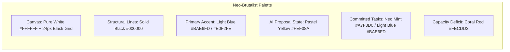

# 01 — THOZHI Design System & Visual Identity Specification

## Stage 2: UI/UX Design — Phase 2.1: Design System (Neo-Brutalism Theme)
- **Project:** THOZHI (தோழி)
- **Theme Paradigm:** **Neo-Brutalism** (Stark White, Solid Black Borders, Crisp Light Blue Accents, Mathematical Canvas Grid)
- **Visual Values:** High Contrast · Tactile Physical Buttons · Unambiguous State Separation
- **Platform:** Mobile-First Responsive Web Application (PWA)
- **Reference Standards:** WCAG 2.1 Level AAA Contrast Compliance · Unicode Tamil Typography

---

## 1. Brand Identity & Product Philosophy

### 1.1 Brand Meaning
**THOZHI (தோழி)** translates to *"companion"* or *"trusted friend"* in Tamil. 
Under the **Neo-Brutalism** visual identity, THOZHI represents honesty, clarity, and bold tactile interaction. There are no fuzzy drop shadows, deceptive micro-interactions, or confusing low-contrast states. Every container, button, and proposed item is distinctly bordered in stark black with bold, offset drop shadows.

### 1.2 Core Visual Values
1. **Geometric Truthfulness:** Solid black borders (`2px` and `3px`) establish crisp boundaries for every card and interaction target.
2. **Tactile Physics:** Buttons translate on hover (`-2px, -2px`) and active press (`+2px, +2px`) into the canvas, giving tactile physical feedback to user decisions.
3. **Mathematical Background Grid:** The canvas is grounded with a subtle `24px x 24px` Cartesian grid representing temporal order and structure.
4. **Agency Signifiers:** AI-generated proposals stand out in bold warning yellows and light blues with clear black pill badges.

---

## 2. Color Palette & Semantic Tokens (Neo-Brutalism)

### 2.1 Semantic Token Specifications
| Token Name | Hex Code | Tailwind Token | Semantic Usage |
| :--- | :--- | :--- | :--- |
| `bg-canvas` | `#FFFFFF` | `bg-white` | White canvas overlaid with subtle 24px linear black grid. |
| `neo-black` | `#000000` | `border-black`, `text-black` | Universal 2px/3px borders, drop shadows, and high-contrast typography. |
| `neo-blue` | `#BAE6FD` | `bg-neo-blue` | Primary interactive buttons, logo mark, approved commitment badges. |
| `neo-blue-light` | `#E0F2FE` | `bg-neo-blue-light` | Hover states, subtle button wells, secondary highlight strips. |
| `neo-yellow` | `#FEF08A` | `bg-neo-yellow` | Proposal review banner, uncertainty flag pills. |
| `neo-red` | `#FECDD3` | `bg-neo-red` | Active microphone recording indicator, capacity deficit alerts. |
| `neo-shadow` | `#000000` | `shadow-[3px_3px_0px_0px_#000]` | Hard offset shadow for buttons, cards, and input fields. |
| `neo-shadow-lg` | `#000000` | `shadow-[6px_6px_0px_0px_#000]` | Primary container shadow (Proposal deck, Capture section). |

---

## 3. Typography & Bilingual Type Scale

Neo-Brutalism pairs bold sans-serif with high-legibility Tamil fonts and monospace time indicators.

### 3.1 Typeface Selection
- **Latin Sans-Serif:** `Inter`, `system-ui`, `sans-serif` (Bold weights: 700, 900).
- **Tamil Font Family:** `Noto Sans Tamil`, `Anek Tamil`, `sans-serif`.
- **Monospace (Time/Numbers):** `JetBrains Mono`, `ui-monospace`, `monospace`.

### 3.2 Type Hierarchy
| Role | Size / Leading | Weight | Usage |
| :--- | :--- | :--- | :--- |
| `Brand Heading` | `1.5rem / 1.2` | Black (900) | Top navigation logo, primary section titles. |
| `Card Heading` | `1.125rem / 1.3` | Black (900) | Proposal intent summary, task group headers. |
| `Item Title` | `0.9375rem / 1.4` | Bold (700) | Editable task titles, monologue excerpts. |
| `Pill / Badge` | `0.6875rem / 1.2` | Black (900) | Modality tags (`COMMITMENT`, `TASK`), status indicators. |

---

## 4. Neo-Brutalist Component Specifications

### 4.1 Capture Mic Button
- **Default State:** `w-24 h-24 rounded-2xl bg-neo-blue border-[3px] border-black shadow-[6px_6px_0px_0px_#000]`.
- **Active Recording State:** `bg-neo-red border-[3px] border-black shadow-[6px_6px_0px_0px_#000]` with live timer pill.
- **Engine Badge:** Hard black pill: `bg-white border-2 border-black shadow-[2px_2px_0px_0px_#000]`.

### 4.2 Proposal Review Card
- **Container:** `bg-white border-[3px] border-black shadow-[6px_6px_0px_0px_#000] rounded-xl p-6`.
- **Items:** Individual white cards with `border-2 border-black shadow-[3px_3px_0px_0px_#000]` and inline duration / priority selectors.
- **Action Buttons:** Tactile commit buttons in `bg-neo-blue border-2 border-black shadow-[3px_3px_0px_0px_#000]`.

### 4.3 Capacity Meter
- **Container:** `bg-white border-2 border-black shadow-[4px_4px_0px_0px_#000] rounded-xl p-5`.
- **Bar:** Inset black container with solid colored fill (`bg-neo-blue` for normal, `bg-neo-red` for overload).
