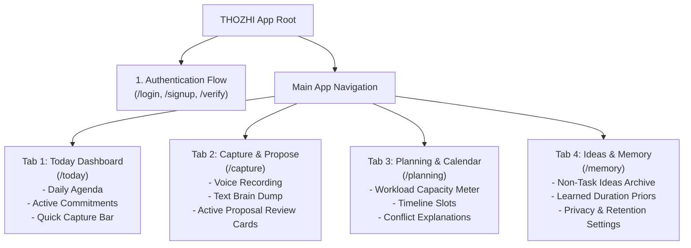

# 02 — THOZHI Information Architecture & Navigation Model

## Stage 2: UI/UX Design — Phase 2.2: Information Architecture
- **Project:** THOZHI (தோழி)
- **Document Stage:** Stage 2 — Information Architecture Specification
- **Navigation Model:** Mobile Bottom Navigation Bar / Desktop Left Sidebar
- **Target Experience:** Single-thumb mobile navigation with zero buried sub-menus.

---

## 1. Global Sitemap & Navigation Hierarchy

THOZHI organizes personal planning into four top-level tabs designed to minimize context switching:

---

## 2. Detailed Screen Architectures

### 2.1 Screen 1: Today Dashboard (`/today`)
- **Primary Goal:** Provide instant situational awareness of today's commitments without cognitive friction.
- **Visual Zones:**
  1. **Greeting & Date Anchor:** e.g., *"Good morning, Karthi · Friday, Nov 8"*.
  2. **Capacity Glance Bar:** Horizontal mini-bar showing available vs. planned hours (e.g., *"4h planned / 6h open"*).
  3. **Overdue / Rollover Alert (Conditional):** Amber card appearing only if yesterday had uncompleted items: *"2 tasks from yesterday were uncompleted. [Review & Move to Today]"*.
  4. **Active Today Task List:**
     - Checkbox + Title + Time slot + Priority tag.
     - Single-tap to complete (triggers subtle strike-through animation).
     - Swipe right to mark done; swipe left to postpone to tomorrow.
  5. **Floating Action Button (FAB):** Bottom right mic button for instant voice capture from anywhere.

---

### 2.2 Screen 2: Capture & Proposal Review (`/capture`)
- **Primary Goal:** Transform verbal/written thoughts into structured proposals and enforce the human approval gate.
- **Visual Zones:**
  1. **Dual Ingestion Header:**
     - Toggle between `Voice` mode (prominent mic button) and `Text` mode (expanding auto-grow textarea).
  2. **Transcript Preview (Post-ASR):**
     - Displays raw transcribed text with highlighted entities (Tamil script + English terms).
     - Single-tap to edit transcript if ASR misheard a name before generating tasks.
  3. **Proposal Review Deck:**
     - Displays extracted items as individual cards.
     - Each card displays: Modality badge, Proposed title, Deadline, Duration, Dependencies.
     - Amber alert box if mathematical capacity conflict detected.
  4. **Approval Control Dock (Sticky Bottom):**
     - Button 1: *"Approve All (2 tasks)"* (Solid Emerald).
     - Button 2: *"Review Individually"* (Outline).
     - Button 3: *"Discard All"* (Ghost Red).

---

### 2.3 Screen 3: Planning & Capacity (`/planning`)
- **Primary Goal:** Visualize timeline feasibility, resolve conflicts, and understand temporal trade-offs.
- **Visual Zones:**
  1. **Date Picker Strip:** Horizontal rolling 7-day strip (Mon, Tue, Wed, Thu, Fri, Sat, Sun).
  2. **Capacity Analytics Box:**
     - Working Hours: `09:00 AM – 06:00 PM` (9.0h).
     - Fixed Calendar Events: `2.5h`.
     - Free Available Space: `6.5h`.
     - Planned Tasks: `7.0h`.
     - **Deficit Flag:** `-0.5h (Overloaded)`.
  3. **Time-Blocked Agenda:**
     - Vertical timeline from 09:00 to 18:00.
     - Blue blocks: Fixed meetings.
     - Emerald blocks: Approved tasks allocated by greedy bin-packing.
     - Red dotted blocks: Conflicting tasks that cannot fit.
  4. **Recalculate Button:** Tapping allows re-running schedule optimization after moving a task.

---

### 2.4 Screen 4: Ideas & Memory Settings (`/memory`)
- **Primary Goal:** Give the user sovereign control over saved preferences, ideas backlog, and privacy.
- **Sub-Sections (Tabbed View):**
  1. **Section A: Ideas & Backlog (`/memory/ideas`):**
     - Filterable list of all items tagged `CASUAL_IDEA` or `WISH`.
     - Actions: *"Promote to Task"*, *"Archive"*, *"Delete"*.
  2. **Section B: Learned Duration Preferences (`/memory/priors`):**
     - Opt-in switch: *"Learn from my duration edits"*.
     - Table of learned priors with single-tap [Reset] actions.
     - Prominent button: **"Purge All Learned Preferences"**.
  3. **Section C: Data & Privacy Controls (`/memory/privacy`):**
     - Transcript retention dropdown: `30 days (Default)` / `Immediate Purge on Approval` / `Permanent`.
     - Button: *"Export All My Data (JSON)"*.
     - Button: *"Delete Account & Wipe All Records"* (Requires confirmation typing).

