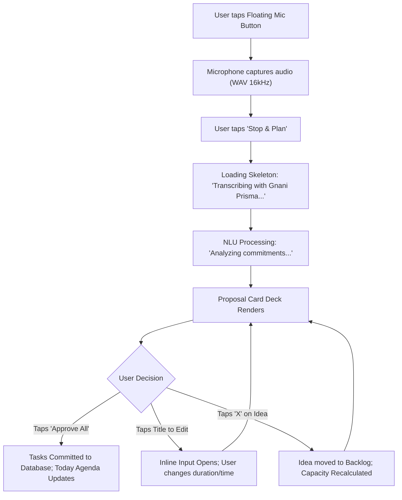

# 03 — THOZHI Wireframes & User Interaction Flows

## Stage 2: UI/UX Design — Phase 2.3: Wireframes & Interaction Flows
- **Project:** THOZHI (தோழி)
- **Document Stage:** Stage 2 — Wireframe Specifications
- **Format:** Textual Wireframe Schematics & Mermaid Flowcharts
- **Platform:** Responsive Mobile Viewport (375px–430px base) & Desktop (1024px)

---

## 1. User Journey 1: Spoken Tanglish Capture to Approval



---

## 2. Textual Screen Wireframes

### 2.1 Wireframe: Today Dashboard Screen (`/today`)
```text
+--------------------------------------------------------+
|  THOZHI (தோழி)                          [தமிழ்]  (User) |
+--------------------------------------------------------+
|                                                        |
|  Good morning, Karthi!                                 |
|  Friday, November 8                                    |
|                                                        |
|  +--------------------------------------------------+  |
|  | CAPACITY: [██████████░░░░░] 4.5h / 6.0h planned   |  |
|  +--------------------------------------------------+  |
|                                                        |
|  TODAY'S COMMITMENTS (3)                               |
|                                                        |
|  [ ] 09:30 AM  Prepare Client Presentation Draft       |
|                ⏱ 60m   •  P1 Critical                  |
|                                                        |
|  [ ] 11:00 AM  US Client Sync Call (Zoom)              |
|                ⏱ 60m   •  Fixed Event                  |
|                                                        |
|  [x] 08:30 AM  Send NDA to Ramesh                      |
|                ⏱ 15m   •  Done 08:42 AM                |
|                                                        |
|                                                        |
|  +--------------------------------------------------+  |
|  | [💡] 1 New Idea captured: "Tech Podcast Launch"  |  |
|  |      [View in Ideas Tab]                         |  |
|  +--------------------------------------------------+  |
|                                                        |
|                                           (  🎙️  )    |
|                                          [Tap to Speak]|
+--------------------------------------------------------+
|  [ Today ]     [ Capture ]    [ Schedule ]   [ Memory ]|
+--------------------------------------------------------+
```

---

### 2.2 Wireframe: Capture & Recording Screen (`/capture`)
```text
+--------------------------------------------------------+
|  < Back                                      Clear [x] |
+--------------------------------------------------------+
|                                                        |
|  Capture Thoughts / எண்ணங்களைப் பதிவு செய்           |
|                                                        |
|  +--------------------------------------------------+  |
|  |                                                  |  |
|  |                    (  🎙️  )                      |  |
|  |                                                  |  |
|  |             00:18 / 01:00                        |  |
|  |             ||| ||||| ||||||| |||| (Pulsing)     |  |
|  |                                                  |  |
|  |             [ Stop & Review Plan ]               |  |
|  |                                                  |  |
|  +--------------------------------------------------+  |
|                                                        |
|  -- OR TYPE YOUR THOUGHTS IN TANGLISH / ENGLISH --     |
|                                                        |
|  +--------------------------------------------------+  |
|  | Naalaiki afternoon 3 PM-ku client meeting        |  |
|  | iruku, so before that deck update panni draft   |  |
|  | anupanum...                                      |  |
|  +--------------------------------------------------+  |
|                                                        |
|  [ ⚡ Generate Plan Proposal ]                          |
+--------------------------------------------------------+
```

---

### 2.3 Wireframe: Proposal Review Card Screen (`/capture/review`)
```text
+--------------------------------------------------------+
|  PROPOSED ACTION PLAN (2 Items)              Reset [x] |
+--------------------------------------------------------+
|  Transcript: "Naalaiki afternoon 3 PM-ku client meeting|
|  iruku, so before that deck update panni draft...      |
|  [Show full transcript v]                              |
|                                                        |
|  +--------------------------------------------------+  |
|  | [COMMITMENT]                 Confidence: 94%     |  |
|  | Title: Prepare client presentation draft         |  |
|  | [✏️ Edit Title]                                   |  |
|  |                                                  |  |
|  | ⏱ Duration: [ 60 mins v ]   📅 Due: Tomorrow 2 PM |  |
|  | 🔗 Prerequisite for: "Attend client meeting"     |  |
|  |                                                  |  |
|  | [ Approve (✓) ]   [ Postpone (⏰) ]   [ Veto (X) ] |  |
|  +--------------------------------------------------+  |
|                                                        |
|  +--------------------------------------------------+  |
|  | [COMMITMENT]                 Confidence: 98%     |  |
|  | Title: Attend US Client Meeting                  |  |
|  | ⏱ Duration: [ 60 mins v ]   📅 Fixed: Tomorrow 3PM|  |
|  |                                                  |  |
|  | [ Approve (✓) ]   [ Postpone (⏰) ]   [ Veto (X) ] |  |
|  +--------------------------------------------------+  |
|                                                        |
|  +--------------------------------------------------+  |
|  | [💡 CASUAL IDEA ROUTED TO BACKLOG]                |  |
|  | "Research and plan tech podcast launch"          |  |
|  | [Keep in Backlog]             [Convert to Task]  |  |
|  +--------------------------------------------------+  |
|                                                        |
|  ====================================================  |
|  [ ✓ APPROVE ALL PROPOSED TASKS (2) ]                  |
|  "The AI proposes. You decide."                        |
+--------------------------------------------------------+
```

---

### 2.4 Wireframe: Schedule Conflict Warning (`/planning`)
```text
+--------------------------------------------------------+
|  PLANNING & CAPACITY — Thursday, Nov 14                |
+--------------------------------------------------------+
|                                                        |
|  ⚠️ SCHEDULE OVERLOAD DETECTED                        |
|  +--------------------------------------------------+  |
|  | Working Capacity: 6.0 hours                      |  |
|  | Planned Tasks:    8.5 hours                      |  |
|  | Capacity Deficit: -2.5 hours                     |  |
|  |                                                  |  |
|  | THOZHI Proposal:                                 |  |
|  | Move "Audit Report" (2.5h) to Friday morning?    |  |
|  | [ Accept Shift ]             [ Keep and Overwork]|  |
|  +--------------------------------------------------+  |
|                                                        |
|  TIMELINE:                                             |
|  09:00 AM  [ Meeting: Sprint Planning            ]     |
|  10:30 AM  [ Task: Client Deck Update            ]     |
|  12:30 PM  [ Lunch / Break                      ]     |
|  01:30 PM  [ Task: Regression Testing Suite     ]     |
|  03:30 PM  [ Task: Audit Report (CANNOT FIT) ❌ ]     |
|  05:00 PM  [ End of Working Hours               ]     |
+--------------------------------------------------------+
```

---

### 2.5 Wireframe: Sovereign Memory Settings (`/memory/settings`)
```text
+--------------------------------------------------------+
|  SOVEREIGN MEMORY & PRIVACY SETTINGS                   |
+--------------------------------------------------------+
|                                                        |
|  LEARNED DURATION PREFERENCES                          |
|  [X] Allow THOZHI to learn from my manual edits        |
|      (Adjusts baseline estimates for recurring tasks)  |
|                                                        |
|  Learned Keywords:                                     |
|  • "Code Review"   -> 45 mins (based on 5 edits) [Reset|
|  • "Client Deck"   -> 90 mins (based on 3 edits) [Reset|
|                                                        |
|  [ 🗑️ Purge All Learned Preferences ]                  |
|                                                        |
|  TRANSCRIPT PRIVACY                                    |
|  Audio Retention:      [ Permanently Zero (Enforced) ] |
|  Transcript Retention: [ 30 Days (Rolling Window)  v ] |
|                                                        |
|  DATA SOVEREIGNTY (DPDP ACT 2023)                      |
|  [ 📥 Export All My Data (JSON) ]                      |
|  [ ⚠️ Delete My Account & Wipe All Records ]           |
+--------------------------------------------------------+
```

