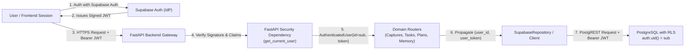

# THOZHI — Phase 2.0: Stage 2 Authentication Architecture Specification

**Document:** `docs/architecture/31_PHASE_2_0_AUTHENTICATION_ARCHITECTURE.md`
**Date:** 2026-11-08
**Author:** Backend Security Engineer & System Architect
**Status:** APPROVED — Specification for Phase 2.0 Implementation

---

## 1. System Vision & The Core Security Guarantee

The primary objective of THOZHI Authentication is to enforce the core security guarantee:

> **Core Security Guarantee:**
> A user can access only their own THOZHI data, and their identity must be derived strictly from a cryptographically verified authentication token — never from an untrusted frontend request parameter, query string, or body attribute.



---

## 2. Cryptographic Token Specification

### 2.1 Identity Provider (IdP)
- **Primary IdP:** Supabase Auth (GoTrue).
- **Algorithm:** HMAC-SHA256 (`HS256`) using `SUPABASE_JWT_SECRET` (minimum 32 bytes).

### 2.2 JWT Payload & Claims Verification Matrix

| Claim | Type | Required | Validation Rule | Purpose |
| :--- | :--- | :--- | :--- | :--- |
| `sub` | `UUID` string | **YES** | Must be a valid RFC 4122 UUID. Missing or invalid UUID raises 401. | The canonical tenant identifier (`user_id`). |
| `aud` | `string` | **YES** | Must match `"authenticated"` (or configured Supabase audience). | Prevents token substitution from unauthorized services. |
| `exp` | `int` (epoch) | **YES** | Current UTC time must be $< exp$. Expired tokens immediately raise 401. | Limits replay and theft exposure window. |
| `iat` | `int` (epoch) | **YES** | Issued-at time in past. | Token freshness verification. |
| `nbf` | `int` (epoch) | NO | Current UTC time must be $\ge nbf$. | Activation timestamp. |
| `role` | `string` | **YES** | Must equal `"authenticated"` (or `"service_role"` for trusted back-channel). | Enforces that anonymous (`anon`) tokens cannot access user data. |
| `email` | `string` | NO | User email address. | Profile display & audit trails. |

### 2.3 Error Handling & HTTP Status Codes (RFC 6750 / RFC 7807)
Any authentication failure fails closed immediately with HTTP `401 Unauthorized` and an appropriate `WWW-Authenticate` response header:
- **Missing Token:**
  `HTTP 401 Unauthorized`
  `WWW-Authenticate: Bearer error="unauthorized", error_description="Authentication token required"`
- **Expired Token:**
  `HTTP 401 Unauthorized`
  `WWW-Authenticate: Bearer error="invalid_token", error_description="The access token has expired"`
- **Invalid Signature / Malformed Token:**
  `HTTP 401 Unauthorized`
  `WWW-Authenticate: Bearer error="invalid_token", error_description="The access token is malformed or signature is invalid"`
- **Invalid Claims (Bad UUID / Untrusted Role):**
  `HTTP 401 Unauthorized`
  `WWW-Authenticate: Bearer error="invalid_token", error_description="Token claims are invalid"`

---

## 3. Backend Dependency Specification (`backend/app/core/auth.py`)

### 3.1 `AuthenticatedUser` Principal Model
```python
from uuid import UUID
from typing import Optional
from pydantic import BaseModel, Field

class AuthenticatedUser(BaseModel):
    id: UUID = Field(..., description="Cryptographically verified tenant user ID from JWT sub claim")
    email: Optional[str] = Field(None, description="User email claim if present")
    role: str = Field("authenticated", description="User role from JWT role claim")
    token: str = Field(..., description="Raw access token for propagation to downstream services")
```

### 3.2 FastAPI Security Dependency: `get_current_user`
```python
from fastapi import Depends, HTTPException, status
from fastapi.security import HTTPBearer, HTTPAuthorizationCredentials
import jwt

security = HTTPBearer(auto_error=False)

async def get_current_user(
    credentials: Optional[HTTPAuthorizationCredentials] = Depends(security)
) -> AuthenticatedUser:
    if not credentials:
        raise HTTPException(
            status_code=status.HTTP_401_UNAUTHORIZED,
            detail="Authentication token required",
            headers={"WWW-Authenticate": 'Bearer error="unauthorized"'}
        )
    raw_token = credentials.credentials
    # Cryptographic decode and claim validation
    ...
```

---

## 4. End-to-End Identity Propagation Architecture

### 4.1 Router Layer Contract
Every protected route handler must declare:
```python
@router.get("", response_model=List[TaskResponse])
async def list_tasks(
    current_user: AuthenticatedUser = Depends(get_current_user),
    target_date: Optional[date] = Query(None),
):
    return store.list_tasks(user_id=current_user.id, target_date=target_date, user_token=current_user.token)
```
- **Rule 1:** No route handler may accept a `user_id` query, form, or body parameter from the client.
- **Rule 2:** `store.default_user_id` is strictly forbidden in protected route handlers.
- **Rule 3:** The user's raw JWT (`current_user.token`) is forwarded to the persistence layer.

### 4.2 Persistence Layer Contract (`SupabaseRepository` & `SupabaseClient`)
```python
# In SupabaseRepository
def list_tasks(self, user_id: UUID, target_date: Optional[date] = None, user_token: Optional[str] = None) -> List[TaskResponse]:
    params = {"user_id": f"eq.{user_id}"}
    if target_date:
        params["scheduled_date"] = f"eq.{target_date.isoformat()}"
    res = self.client.get("tasks", params=params, user_token=user_token)
    ...
```
1. When `user_token` is passed, `SupabaseClient` builds headers:
   - `apikey: SUPABASE_KEY`
   - `Authorization: Bearer <user_token>`
2. PostgREST decodes `user_token`, authenticates the request as role `authenticated`, and sets:
   - `request.jwt.claim.sub` = `<user_id>`
   - `auth.uid()` = `<user_id>`
   - `auth.role()` = `'authenticated'`
3. PostgreSQL Row Level Security (RLS) executes in the context of the user, guaranteeing that any query attempting to access another user's rows returns empty sets or fails with a constraint violation.

### 4.3 Service Role Isolation
- The `SUPABASE_KEY` service role key is NEVER sent as the Bearer token for user-scoped requests.
- The service role is confined strictly to:
  1. Bootstrapping migrations (`001` through `004`).
  2. Isolated administrative maintenance scripts executed directly server-side.
  3. System health checks where no tenant data is queried.

---

## 5. Frontend Session & Request Interception Architecture

### 5.1 Token Storage & Token Management (`frontend/src/lib/auth.ts`)
```typescript
const TOKEN_KEY = "thozhi_auth_token";

export function getAuthToken(): string | null {
  if (typeof window === "undefined") return null;
  return localStorage.getItem(TOKEN_KEY);
}

export function setAuthToken(token: string | null): void {
  if (typeof window === "undefined") return;
  if (token) {
    localStorage.setItem(TOKEN_KEY, token);
  } else {
    localStorage.removeItem(TOKEN_KEY);
  }
}
```

### 5.2 Centralized Request Interceptor (`frontend/src/lib/api.ts`)
Every API call is routed through an authenticated wrapper:
```typescript
async function fetchWithAuth(input: string, init?: RequestInit): Promise<Response> {
  const token = getAuthToken();
  const headers = new Headers(init?.headers || {});

  if (token) {
    headers.set("Authorization", `Bearer ${token}`);
  }

  const response = await fetch(input, { ...init, headers });

  if (response.status === 401) {
    // Graceful session expiry handling
    setAuthToken(null);
    if (typeof window !== "undefined" && !window.location.pathname.startsWith("/login")) {
      window.dispatchEvent(new CustomEvent("thozhi:unauthorized"));
    }
  }

  return response;
}
```

---

## 6. Test Suite and Deterministic Security Harness

To ensure zero regressions across existing unit and integration tests while thoroughly verifying security boundaries:
1. **Cryptographic Test Token Utility (`backend/app/core/auth.py`):**
   A helper function `create_test_jwt(user_id: UUID, role: str = "authenticated", expires_in: int = 3600, secret: Optional[str] = None) -> str` will be implemented.
2. **Deterministic Default Test User:**
   Tests can generate authentic signed JWTs for the default tenant (`00000000-0000-0000-0000-000000000001`), as well as adversary tenants (`00000000-0000-0000-0000-000000000002`).
3. **Dedicated Security Verification Suite (`backend/tests/test_authentication_and_isolation.py`):**
   - Verification of 401 on missing token.
   - Verification of 401 on expired token.
   - Verification of 401 on signature tampering.
   - Verification of 401 on invalid `sub` format.
   - Verification of cross-tenant isolation (User A cannot view or mutate User B's captures, proposals, tasks, or memory).
   - Verification that user-submitted `user_id` query or body parameters cannot override the JWT `sub`.

---

## 7. Stage 2 Approval
This specification provides complete coverage of all Stage 2 requirements.
Proceed to **Stage 3: Backend Authentication Implementation**.
