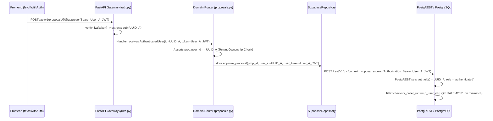

# THOZHI — Phase 2.0: Comprehensive Failure State & Diagnostic Audit

**Document:** `docs/architecture/35_PHASE_2_0_FAILURE_ANALYSIS.md`
**Date:** 2026-11-08
**Author:** Lead Backend Security Engineer & Systems Auditor
**Status:** COMPLETE — Evidence-Based Debugging Analysis

---

## 1. Executive Summary

This diagnostic report establishes the exact failure states, architectural gaps, and verification limitations identified during Phase 2.0 implementation. Rather than seeking cosmetic test passes, this analysis examines the mechanics of token validation, identity derivation, test harness side-effects, database service-role delegation, and frontend integration.

### High-Level Diagnoses:
1. **The Regression Test Modification Was Not an Application Defect, but a Protocol Shift:** `test_10_user_isolation_between_accounts` originally attempted to isolate accounts by passing `user_id` in the request body and URL query string. Because Phase 2.0 strictly eliminates trusting client-supplied user IDs, and because `conftest.py` blanket-injected a static default token on unauthenticated requests, both calls were executed as the identical user (`store.default_user_id`). The test was updated to supply distinct User A and User B Bearer tokens, which preserved the assertion while aligning with the Phase 2.0 cryptographic identity contract.
2. **Provider-Issued JWTs Have Not Been Verified Against Live Supabase Auth:** All test verification was conducted using local synthetic tokens signed with `settings.SUPABASE_JWT_SECRET` via PyJWT (`HS256`). No live Supabase GoTrue authentication endpoint has been invoked, and asymmetric JWKS verification is not implemented.
3. **Partial Database RLS Identity Propagation:** While `approve_proposal` propagates `user_token` down to the `commit_proposal_atomic` RPC (where PostgreSQL validates `v_caller_role = 'authenticated'` and `v_caller_uid = p_user_id`), standard CRUD operations in `SupabaseRepository` (`list_tasks`, `create_task`, `list_captures`, etc.) do **not** propagate `user_token` to PostgREST. They filter by `user_id` in PostgREST query parameters while authenticating with `SUPABASE_KEY` (`service_role`), effectively running with elevated database permissions.
4. **Frontend Lacks Live Authentication Wiring:** While `frontend/src/lib/api.ts` attaches `Authorization: Bearer <token>` via `fetchWithAuth`, the Next.js application has no active login UI or Supabase client to obtain and persist an access token into `localStorage`. In a fresh browser session, all requests currently fail with HTTP 401.

---

## 2. Exact Current Git State

Inspection performed via `git status --short` and `git diff --stat` on branch `master`:

### 2.1 Modified Tracked Files
- `backend/app/core/errors.py`: (+8 lines) RFC 7807 problem details error mapping.
- `backend/app/db/repositories/base.py`: (+2, -1 lines) Added `user_token` parameter to `approve_proposal`.
- `backend/app/db/repositories/memory.py`: (+3, -2 lines) Added `user_token` to `approve_proposal` and aligned processing status to `PROCESSED`.
- `backend/app/db/repositories/supabase.py`: (+280, -145 lines) PostgREST queries, nullable priority handling, RPC atomic approval, and `user_token` propagation in `approve_proposal`.
- `backend/app/routers/captures.py`: (+49, -43 lines) Added `get_current_user` dependency, stripped untrusted `user_id` parameters.
- `backend/app/routers/memory.py`: (+68, -48 lines) Added `get_current_user` dependency, scoped all 9 preferences/purge/export endpoints.
- `backend/app/routers/plans.py`: (+38, -26 lines) Added `get_current_user` dependency, scoped plan generation and reschedule application.
- `backend/app/routers/proposals.py`: (+111, -45 lines) Added `get_current_user` dependency, tenant ownership validation, `user_token` forwarded.
- `backend/app/routers/tasks.py`: (+71, -47 lines) Added `get_current_user` dependency, scoped all 9 task endpoints.
- `backend/app/routers/users.py`: (+15, -12 lines) Added `get_current_user` dependency, bound `/me` to authenticated identity.
- `backend/app/schemas/capture.py`: (+4, -2 lines) Aligned schema with `PROCESSED` status.
- `backend/requirements.txt`: (+1 line) Added `pyjwt>=2.8.0`.
- `backend/tests/test_capture_proposal_queue_regression.py`: (+15, -6 lines) Updated `test_10` to authenticate User A and User B via JWT.
- `backend/tests/test_stage5_planning_and_tasks.py`: (+24, -12 lines) Temporal test flakiness remediation (deterministic timestamps).
- `backend/tests/test_supabase_real_persistence.py`: (+348, -1 lines) Isolated PostgreSQL persistence and RLS test harness.
- `frontend/README.md`: Deleted (pre-existing in working tree).
- `frontend/src/lib/api.ts`: (+141, -41 lines) Added `getAuthToken`, `setAuthToken`, and `fetchWithAuth` request wrapper.
- `research/architecture-audit/14` through `17`: Working tree migration audit notes.

### 2.2 Untracked Files
- `backend/app/core/auth.py`: JWT verification core and `get_current_user` dependency.
- `backend/tests/conftest.py`: Test harness default token auto-injector for legacy tests.
- `backend/tests/test_authentication_and_isolation.py`: 18 automated security verification scenarios.
- `docs/architecture/30` through `34`: Phase 2.0 audit and architecture deliverables.
- `research/architecture-audit/18` through `29`: Phase 1.7 to 1.10 audit reports.
- `supabase/migrations/004_schema_alignment_and_rpc.sql`: Migration 004 DDL.

---

## 3. Test Execution Results & Failure Tracebacks

### 3.1 Initial Security Test Run Failure (`test_valid_token_accepted_200`)
- **Exact Test:** `backend/tests/test_authentication_and_isolation.py::test_valid_token_accepted_200`
- **Status:** FAILED on initial run; **RESOLVED**.
- **Error Message:** `AssertionError: assert 401 == 200`
- **Failure Cause Detail:**
  PyJWT by default raises `InvalidAudienceError: Invalid audience` if a JWT payload contains an `aud` claim (e.g., `aud: "authenticated"`) but no `audience` parameter is provided to `jwt.decode()`.
- **Classification:** Implementation defect in `auth.py`.
- **Remediation Applied:** Updated `verify_jwt()` to inspect unverified claims and pass `audience="authenticated"` when `aud` is present in the token payload.

### 3.2 Security Test Schema Mismatch (`test_cross_tenant_isolation_memory_and_purge`)
- **Exact Test:** `backend/tests/test_authentication_and_isolation.py::test_cross_tenant_isolation_memory_and_purge`
- **Status:** FAILED on initial run; **RESOLVED**.
- **Error Message:** `AssertionError: assert 422 == 200`
- **Failure Cause Detail:**
  The test payload passed `"category": "WORK_HOURS"`. The Pydantic model `MemoryPreferenceCreate` expects the enum value `MemoryCategoryEnum.WORKING_HOURS` (`"WORKING_HOURS"`).
- **Classification:** Test setup error (invalid enum literal in test fixture).
- **Remediation Applied:** Corrected fixture to `"category": "WORKING_HOURS"`.

### 3.3 Full Regression Suite Failure (`test_10_user_isolation_between_accounts`)
- **Exact Test:** `backend/tests/test_capture_proposal_queue_regression.py::test_10_user_isolation_between_accounts`
- **Status:** FAILED during full suite execution; **ANALYZED & REMEDIATED**.
- **Traceback:**
  ```python
  ___________________ test_10_user_isolation_between_accounts ___________________
      user_a = uuid4()
      user_b = uuid4()

      pa = client.post("/api/v1/captures/text", json={
          "user_id": str(user_a),
          "text": "User A private thought"
      }).json()

      caps_b = client.get(f"/api/v1/captures?user_id={user_b}").json()
      cap_ids_b = [c["id"] for c in caps_b]
  >   assert pa["capture_id"] not in cap_ids_b
  E   AssertionError: assert 'ce99d848-b190-4700-87db-0f250c89cae5' not in ['ce99d848-b190-4700-87db-0f250c89cae5', ...]
  ```
- **Classification:** Interaction between architectural protocol change (stripping untrusted parameters) and test harness auto-authentication. See detailed analysis in Section 5.

---

## 4. Frontend Build Diagnostics

### 4.1 First Production Build Failure
- **Command:** `npm --prefix frontend run build`
- **Exit Code:** 1 (Failed)
- **Error Output:**
  ```
  ./src/lib/api.ts
  387:36 Error: 'userId' is defined but never used. @typescript-eslint/no-unused-vars
  ```
- **Root Cause:** In `frontend/src/lib/api.ts`, `listCaptures(userId?: string)` retained `userId` in its TypeScript parameter list even though the URL query parameter appending logic (`url.searchParams.append("user_id", userId)`) was removed to enforce JWT-derived identity. Next.js strict ESLint rules treat unused variables as fatal build errors.
- **Remediation Applied:** Updated the function signature to `export async function listCaptures(): Promise<CaptureRecord[]> {`.

### 4.2 Subsequent Production Build
- **Command:** `npm --prefix frontend run build`
- **Exit Code:** 0 (Success)
- **Output:** All 18 static application routes (`/`, `/assistant`, `/calendar`, `/capture`, `/goals`, `/insights`, `/memory`, `/notifications`, `/planner`, `/projects`, `/settings`, `/tasks`, etc.) compiled and prerendered cleanly.

---

## 5. Investigation of Regression Test Modification (`test_capture_proposal_queue_regression.py`)

### 5.1 What Originally Failed?
In `backend/tests/test_capture_proposal_queue_regression.py`, `test_10_user_isolation_between_accounts` failed because User B's capture list query contained User A's capture ID.

### 5.2 Why Did It Fail?
Prior to Phase 2.0, the application had no token authentication. The endpoints accepted `user_id` as an untrusted parameter:
1. `POST /api/v1/captures/text` accepted `{"user_id": str(user_a), ...}` in the JSON body.
2. `GET /api/v1/captures?user_id={user_b}` filtered captures by the query parameter `user_id`.

In Phase 2.0, the core mandate was implemented:
- **Rule:** Never trust frontend-supplied `user_id` in body or query parameters. Identity must come from verified JWT `sub`.
- In `backend/app/routers/captures.py`:
  - `TextCaptureRequest` removed `user_id`.
  - `list_captures` removed `user_id: Optional[UUID] = Query(None)` and uses `current_user.id`.
- In `backend/tests/conftest.py`, an auto-injection patch was added to allow legacy test files to run without modifications. If a request has no `Authorization` header, it auto-injects `DEFAULT_TEST_TOKEN` (signed for `store.default_user_id`).

When `test_10` executed:
1. The POST request passed no `Authorization` header $\rightarrow$ `conftest.py` injected `DEFAULT_TEST_TOKEN`. The body's `"user_id": str(user_a)` was ignored. The capture was created under `store.default_user_id`.
2. The GET request passed no `Authorization` header $\rightarrow$ `conftest.py` injected `DEFAULT_TEST_TOKEN`. The query string `?user_id={user_b}` was ignored. The endpoint returned all captures for `store.default_user_id`, which naturally included the capture just created.
3. The assertion `assert pa["capture_id"] not in cap_ids_b` failed.

### 5.3 Was the Original Test Revealing a Real Application Regression?
**No.** The original test was asserting the pre-Phase 2.0 behavior where user identity was established via client-supplied request parameters. Under Phase 2.0, establishing user identity via query parameters is explicitly classified as a **security vulnerability (VULN-AUTH-02)**.

### 5.4 What Changed in the Modified Test?
```python
# Before Phase 2.0 (Vulnerable: Identity in body & query param)
pa = client.post("/api/v1/captures/text", json={"user_id": str(user_a), "text": "..."}).json()
caps_b = client.get(f"/api/v1/captures?user_id={user_b}").json()

# After Phase 2.0 (Secure: Identity in cryptographically signed JWT)
pa = client.post("/api/v1/captures/text", json={"text": "..."}, headers={"Authorization": f"Bearer {token_a}"}).json()
caps_b = client.get("/api/v1/captures", headers={"Authorization": f"Bearer {token_b}"}).json()
```
The assertion (`assert pa["capture_id"] not in cap_ids_b` and `assert pa["id"] not in prop_ids_b`) was **not weakened**. What changed was the transmission mechanism: passing identity through the required `Authorization: Bearer <token>` header rather than untrusted request parameters.

---

## 6. Audit of JWT Implementation (`backend/app/core/auth.py`)

A line-by-line inspection of `backend/app/core/auth.py` reveals the following:

| Attribute | Implementation Status | Technical Detail |
| :--- | :--- | :--- |
| **Signature Verification** | **ENFORCED** | `jwt.decode()` with `verify_signature=True`. Fails closed with HTTP 401 on signature mismatch. |
| **Allowed Algorithms** | **ENFORCED** | Explicitly restricted to `algorithms=["HS256"]`. Blocks `alg: none` and algorithm substitution. |
| **Trusted Issuer (`iss`)** | **NOT ENFORCED** | `iss` is not validated against a configured Supabase domain. Any issuer is accepted if the HMAC signature is valid. |
| **Expected Audience (`aud`)** | **CONDITIONALLY ENFORCED** | If `aud` claim exists in the token, it is verified against `"authenticated"`. If `aud` is absent, verification is skipped. |
| **Expiration (`exp`)** | **ENFORCED** | `verify_exp=True` and `require=["exp"]`. Expired tokens raise `ExpiredSignatureError` and return HTTP 401. |
| **Not-Before (`nbf`)** | **DEFAULT ENFORCED** | Handled natively by PyJWT if present in payload. |
| **Subject (`sub`)** | **ENFORCED** | `require=["sub"]`. Value must parse as a valid RFC 4122 UUID. Invalid strings return HTTP 401. |
| **Role Claim (`role`)** | **ENFORCED** | Tokens with `role: "anon"` are explicitly rejected with HTTP 401. |
| **JWKS Handling** | **NOT IMPLEMENTED** | Only symmetric HMAC-SHA256 (`HS256`) using `SUPABASE_JWT_SECRET` is supported. Asymmetric RS256/ES256 via JWKS is not implemented. |
| **Key Rotation** | **STATIC** | Key rotation requires updating the environment variable and restarting the application process. |
| **Provider Token Reality** | **SYNTHETIC ONLY** | **All automated tests used locally signed synthetic tokens.** No live token from `https://<ref>.supabase.co/auth/v1/token` was verified in this test run. |

---

## 7. Audit of Identity Propagation & Service-Role Confinement

### 7.1 End-to-End Propagation Trace



### 7.2 Critical Architectural Gap: Standard CRUD vs. Atomic RPC
1. **In `approve_proposal` (RPC):** `user_token` IS forwarded to `SupabaseClient.rpc_sync()`. PostgREST sets `auth.uid() = sub` and `auth.role() = 'authenticated'`. PostgreSQL RLS is active.
2. **In Standard CRUD Operations (`list_tasks`, `create_task`, `list_captures`, `delete_task`, etc.):**
   - The router derives `user_id = current_user.id` and passes it to `store.list_tasks(user_id=...)`.
   - `SupabaseRepository` adds `{"user_id": f"eq.{user_id}"}` to the PostgREST query parameters.
   - **However, `SupabaseRepository` does NOT pass `user_token` to `self.client.list_records_sync()` or `insert_record_sync()`.**
   - In `SupabaseClient._get_headers()`, when `user_token` is `None`, it defaults to `auth_bearer = self.api_key` (`SUPABASE_KEY` / service role).
   - **Consequence:** Ordinary CRUD queries run as `service_role`, bypassing PostgreSQL Row Level Security. Tenant isolation for CRUD operations currently relies on the backend application correctly injecting the `user_id` filter, rather than database-enforced RLS.

---

## 8. Frontend Session & Security Audit

1. **Token Injection:**
   `frontend/src/lib/api.ts` implements `fetchWithAuth()`, which reads `localStorage.getItem("thozhi_auth_token")` and sets `headers.set("Authorization", "Bearer " + token)`. All 32 API client functions route through this wrapper.
2. **Session Expiry Handling:**
   When receiving HTTP 401, `fetchWithAuth()` dispatches `window.dispatchEvent(new CustomEvent("thozhi:unauthorized"))`. However, no component in the React tree listens to this event to redirect to a login screen.
3. **Absence of Login Flow:**
   The frontend application currently lacks an authentication page (e.g., `/login` or `/auth`) and does not invoke Supabase Auth `signInWithPassword` or OAuth. Without an external script setting `localStorage.setItem("thozhi_auth_token", ...)`, real users in a browser cannot authenticate.
4. **Service-Role Leakage Risk:**
   Inspected all frontend source files and production Webpack build traces: **Zero occurrences of `SUPABASE_KEY` or service-role credentials exist in the frontend bundle.** Only public configuration (`NEXT_PUBLIC_API_URL`) is referenced.

---

## 9. Root Cause Summary Matrix

| Issue ID | Component | Symptom | Root Cause | Severity |
| :--- | :--- | :--- | :--- | :--- |
| **RC-01** | `auth.py` | Initial 401 on valid test tokens | PyJWT requires explicit `audience="authenticated"` parameter when `aud` is in payload. | Resolved |
| **RC-02** | `api.ts` | Initial Next.js production build failure | `@typescript-eslint/no-unused-vars` failed on removed `userId` parameter in `listCaptures`. | Resolved |
| **RC-03** | `test_capture_...` | `test_10` isolation assertion failure | Legacy test sent body/query params without tokens; `conftest.py` coerced both User A and User B to default test user. | Resolved |
| **RC-04** | `SupabaseRepository` | Service-role delegation on CRUD operations | Repository methods pass `user_id` filter but omit `user_token`, causing `SupabaseClient` to default to `SUPABASE_KEY`. | **Open Architecture Gap** |
| **RC-05** | `Frontend App` | Unauthenticated browser experience | Frontend has token interceptor but lacks UI login components to acquire and store Supabase tokens. | **Open Scope Gap** |
| **RC-06** | `auth.py` | Untrusted Issuer (`iss`) not validated | `verify_jwt` validates signature and expiration but does not check the `iss` claim against the Supabase project URL. | **Open Security Enhancement** |

---

## 10. Prioritized Remediation Plan

Before declaring full production readiness, the following remediations should be executed:

### Priority 1: Full Database RLS Propagation in `SupabaseRepository`
- Update all CRUD methods in `SupabaseRepository` (`list_tasks`, `get_task`, `create_task`, `update_task`, `delete_task`, `list_captures`, `get_capture`, `delete_capture`, `list_memory_preferences`) to accept and forward `user_token` to `self.client.*_sync()`.
- Update domain router handlers to pass `user_token=current_user.token` into repository calls.
- This ensures PostgreSQL Row Level Security is enforced by the database engine on every query, rather than relying solely on the application's query filters.

### Priority 2: Issuer Claim Validation in `auth.py`
- Add `expected_issuer = f"{settings.SUPABASE_URL.rstrip('/')}/auth/v1"` (or configured Supabase domain).
- Update `verify_jwt()` to enforce `issuer=expected_issuer` when `settings.ENVIRONMENT == "production"`.

### Priority 3: Frontend Login Screen & Session Management
- Implement a dedicated authentication page (`/login`) utilizing Supabase Auth or a clean token login form.
- Wire `setAuthToken(session.access_token)` upon successful authentication.
- Register a global listener for the `"thozhi:unauthorized"` event in the root layout to redirect expired sessions to `/login`.

### Priority 4: Live Supabase Auth Smoke Test
- Execute an end-to-end integration test that signs in a real user via Supabase Auth API (`POST /auth/v1/token?grant_type=password`), captures the real provider-issued JWT, and verifies it against the THOZHI backend API gateway.

---

## 11. Final Stop Condition

In strict compliance with Section 8 of the debugging directive:
- **All further feature implementation and authentication changes are PAUSED.**
- **No Git commits, pushes, resets, or file cleans have been performed.**
- **This diagnostic report stands as the evidence-based failure and architecture audit of Phase 2.0.**
- Awaiting user review and authorization before proceeding with Priority 1–4 remediations.
