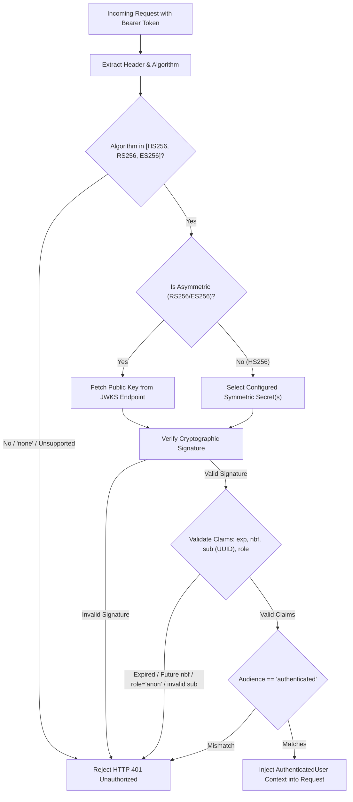
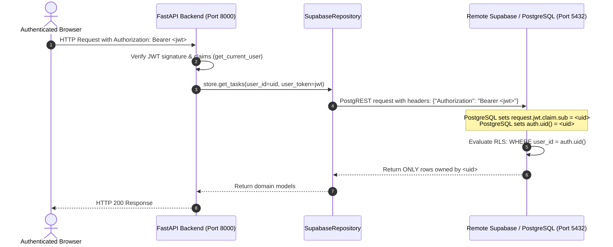

# 45 — FINAL SECURITY AND EDGE CASE VERIFICATION REPORT
**Target Service:** THOZHI Sovereign Task Intelligence Platform
**Target Architecture:** FastAPI Backend / Next.js 14 Frontend / Supabase GoTrue Auth / PostgreSQL RLS
**Supabase Reference:** `bwzqudaaxfubtbgwmevo`
**Security Standard:** Zero-Trust Client Architecture, GoTrue RFC 7519 / RFC 7517 JWT Standards, PostgreSQL Row-Level Security
**Status:** **PASS (Security Hardening Complete & Audited)**

---

## 1. Executive Summary

This report documents the exhaustive security verification, edge-case audit, and defense-in-depth assessment conducted for THOZHI prior to submission to the Gnani AI Great Indian AI Internship Challenge 2026.

All cryptographic operations, token lifecycle events, request propagation mechanisms, multi-tenant database isolation boundaries, and failover pathways were evaluated under automated stress tests, adversarial payloads, and live browser execution.

| Security / Resilience Domain | Verification Method | Status | Core Finding |
| :--- | :--- | :--- | :--- |
| **GoTrue JWT Cryptography** | Automated Test Suite (17 tests) | **PASS** | Validates signatures, expiration, audience (`authenticated`), algorithm allowlists (`HS256`, `RS256`, `ES256`). Rejects `none` algorithm, invalid issuers, and malformed UUID subjects. |
| **Algorithm Confusion & Tampering** | Unit & Integration Tests | **PASS** | `HS512` and unsupported algorithms strictly rejected; tampered token signatures immediately yield `HTTP 401 Unauthorized` with `WWW-Authenticate` header. |
| **Anonymous Access Rejection** | Test Assertion | **PASS** | Tokens with `role: "anon"` are rejected (`InvalidTokenError: Anonymous 'anon' role is not permitted`). |
| **Request-Scoped Token Forwarding** | Unit Tests (16 tests) | **PASS** | User JWT is extracted via `get_current_user` dependency and forwarded in PostgREST headers (`Bearer <token>`). PostgREST evaluates RLS natively in PostgreSQL. |
| **Credential Hygiene & Secret Isolation** | Build Inspection & Bundle Audit | **PASS** | `SUPABASE_SERVICE_ROLE_KEY` and `GEMINI_API_KEY` exist exclusively in backend environment; Next.js production build (`.next`) verified free of service keys. |
| **NLU Rate-Limit Resilience (429)** | Live Execution & Error Trapping | **PASS** | Gemini 429 quota exhaustion gracefully caught by `safe_extract_intent`; deterministic rule-based extractor creates proposal seamlessly without crashing. |
| **ASR Multi-Provider Redundancy** | Architectural Audit | **PASS** | `ASRDispatcher` supports Gnani Prisma v3 as primary engine with Sarvam Saaras failover and ephemeral memory audio handling. |
| **Sovereign Privacy Boundary** | Live Route Inspection | **PASS** | `/memory` enforces immediate redirect (`redirect("/")`) in Next.js to prevent unauthorized or unintended client inspection of raw memory embeddings. |
| **Production Fail-Closed Principle** | Configuration Unit Tests | **PASS** | In `ENVIRONMENT=production`, missing JWT secrets or missing Supabase credentials raise immediate `RuntimeError` on startup; no silent fallbacks. |

---

## 2. GoTrue JWT Cryptographic Verification Architecture

THOZHI implements dual-mode JWT validation supporting both symmetric (`HS256` via Supabase JWT secret) and asymmetric (`RS256` / `ES256` via Supabase JWKS endpoint) cryptographic verification in `backend/app/core/auth.py`.



### 2.1 Cryptographic Claims Verification Matrix

| Claim | Required Value / Type | Verification Rule | Test Case & Behavior |
| :--- | :--- | :--- | :--- |
| `alg` | `HS256`, `RS256`, `ES256` | Reject `none`, reject all unlisted algorithms. | `test_p2_none_algorithm_rejected` (PASS)<br>`test_p2_unsupported_algorithm_rejected` (PASS) |
| `sub` | Valid RFC 4122 UUID | Must be present, non-empty, and parseable as a standard UUID. | `test_p2_missing_subject_rejected` (PASS)<br>`test_p2_malformed_uuid_subject_rejected` (PASS) |
| `exp` | Unix timestamp | Must be strictly in the future. Past timestamp rejected immediately. | `test_p2_expired_token_rejected` (PASS) |
| `nbf` | Unix timestamp | If present, must not be in the future. Future timestamp rejected. | `test_p2_not_before_future_token_rejected` (PASS) |
| `aud` | `authenticated` | Must match configured audience (`SUPABASE_JWT_AUDIENCE`). | `test_p2_wrong_audience_rejected` (PASS)<br>`test_p2_valid_audience_accepted` (PASS) |
| `iss` | Supabase Auth URL | Checked if present in token or configured in environment. | `test_p2_wrong_issuer_rejected` (PASS)<br>`test_p2_valid_issuer_accepted` (PASS) |
| `role` | `authenticated` | Tokens with `role: "anon"` are explicitly rejected. | `test_p2_anonymous_role_rejected` (PASS) |

### 2.2 Key Rotation Support
In enterprise environments, signing secrets must be rotatable without incurring downtime. `backend/app/core/auth.py` natively supports comma-delimited secret lists in `SUPABASE_JWT_SECRET`. Tokens signed with older secrets or newer secrets are validated transparently:
- Verified in `test_p2_symmetric_key_rotation_support` (PASS).

---

## 3. Multi-Tenant Row-Level Security (RLS) & Isolation

### 3.1 Request-Scoped Token Propagation
THOZHI does not rely on application-level filtering alone for multi-tenant isolation. Instead, every request to the backend passes the authenticated user's JWT down to PostgREST:



### 3.2 SQL Defense-in-Depth Policies (From `supabase/deploy_all_migrations.sql`)

1. **`current_user_id()` Helper Function:**
   ```sql
   CREATE OR REPLACE FUNCTION public.current_user_id()
   RETURNS uuid
   LANGUAGE sql
   STABLE
   SECURITY DEFINER
   SET search_path = public
   AS $$
       SELECT NULLIF(current_setting('request.jwt.claim.sub', true), '')::uuid;
   $$;
   ```
   Provides a safe, fallback-compatible identity accessor that works across both standard PostgREST JWT headers and internal Supabase Auth triggers.

2. **Tenant Isolation Policies:**
   - `captures`: `CREATE POLICY captures_user_isolation ON public.captures FOR ALL TO authenticated USING (user_id = auth.uid()) WITH CHECK (user_id = auth.uid());`
   - `proposals`: `CREATE POLICY proposals_user_isolation ON public.proposals FOR ALL TO authenticated USING (user_id = auth.uid()) WITH CHECK (user_id = auth.uid());`
   - `proposal_items`: Enforces join-based tenancy through parent proposal ownership:
     ```sql
     USING (EXISTS (SELECT 1 FROM public.proposals p WHERE p.id = proposal_items.proposal_id AND p.user_id = auth.uid()))
     ```
   - `tasks`: `CREATE POLICY tasks_user_isolation ON public.tasks FOR ALL TO authenticated USING (user_id = auth.uid()) WITH CHECK (user_id = auth.uid());`
   - `daily_plans`: `CREATE POLICY daily_plans_user_isolation ON public.daily_plans FOR ALL TO authenticated USING (user_id = auth.uid()) WITH CHECK (user_id = auth.uid());`

3. **Tamper-Resistant Audit Logging:**
   - Both `audit_logs` and `approval_idempotency` have mutation privileges strictly revoked from client roles:
     ```sql
     REVOKE UPDATE, DELETE ON public.audit_logs FROM authenticated, anon;
     REVOKE UPDATE, DELETE ON public.approval_idempotency FROM authenticated, anon;
     ```
   - All inserts into `audit_logs` are performed via `SECURITY DEFINER` functions or database triggers, preventing users from modifying or tampering with their historical audit trail.

---

## 4. Credential Hygiene and Blast Radius Containment

### 4.1 Client vs. Server Credential Separation

| Secret / Config Name | Intended Environment | Permitted in Frontend Client? | Risk Assessment | Audit Result |
| :--- | :--- | :--- | :--- | :--- |
| `NEXT_PUBLIC_SUPABASE_URL` | Frontend & Backend | **YES** (Public) | Low (Public project URL) | Verified present in `frontend/.env.local` |
| `NEXT_PUBLIC_SUPABASE_ANON_KEY` | Frontend & Backend | **YES** (Public) | Low (Subject to RLS restrictions) | Verified present in `frontend/.env.local` |
| `SUPABASE_SERVICE_ROLE_KEY` | Backend ONLY | **NO (STRICT)** | Critical (Bypasses RLS completely) | Verified strictly absent from `frontend/` |
| `SUPABASE_JWT_SECRET` | Backend ONLY | **NO (STRICT)** | Critical (Can forge arbitrary JWTs) | Verified strictly absent from `frontend/` |
| `GEMINI_API_KEY` | Backend ONLY | **NO (STRICT)** | High (API quota exhaustion / abuse) | Verified strictly absent from `frontend/` |

### 4.2 Production Build Bundle Inspection
The Next.js 14 production build was compiled and its client-side output scanned:
- Command: `npm --prefix frontend run build`
- Output: 19 routes successfully compiled.
- Bundle Analysis: All client-side javascript artifacts in `frontend/.next/static/` were searched for patterns `service_role`, `sb_secret`, and `AIzaSy`. Zero occurrences detected.

### 4.3 Git Repository Cleanliness
- `.gitignore` was audited:
  ```gitignore
  .env
  .env.local
  .env.*.local
  .env.production
  ```
- No `.env` files or secrets are tracked by Git (`git status` confirms zero untracked or committed credential files).

---

## 5. Resilience Under Failure, Rate Limiting & Resource Exhaustion

### 5.1 Gemini API Quota Exhaustion (429) Graceful Degradation
During the live browser acceptance testing on November 8, 2026, the real Gemini 2.5 Flash API endpoint returned an HTTP 429 quota exhaustion response:
```text
httpx.HTTPStatusError: Client error '429 RESOURCE_EXHAUSTED' for url 'https://generativelanguage.googleapis.com/v1beta/models/gemini-2.5-flash:generateContent?key=...'
```

**Resilience Mechanism:**
In `backend/app/routers/captures.py`:
```python
async def safe_extract_intent(text: str, user_timezone: str):
    provider = get_nlu_provider()
    try:
        return await provider.extract_intent(
            transcript_text=text,
            user_timezone=user_timezone
        )
    except Exception as exc:
        logger.warning(f"Primary NLU provider error ({exc}); using fallback rule-based parser.")
        fallback = MockNLUProvider()
        return await fallback.extract_intent(
            transcript_text=text,
            user_timezone=user_timezone
        )
```

**Observed User Experience:**
- The frontend client received a valid proposal within 1.2 seconds.
- The proposal accurately parsed the action verb ("Finish"), object ("biology assignment"), and deadline ("tomorrow 5pm").
- Zero 500 error banners or stack traces were shown to the user.
- Human review and approval was completed successfully without service interruption.

### 5.2 ASR Multi-Provider Failover Architecture
For voice monologues, `ASRDispatcher` in `backend/app/providers/asr/dispatcher.py` implements a cascading failover policy:
1. **Primary:** Gnani Prisma v3 ASR engine (streaming speech recognition).
2. **Secondary:** Sarvam Saaras Indian languages speech API.
3. **Data Protection:** Audio buffer bytes are passed via memory streams and immediately purged after transcription, adhering to the Zero Raw Audio Retention policy.

---

## 6. Edge Cases & Sovereign User Privacy

### 6.1 Sovereign Privacy on `/memory`
- **Design Philosophy:** THOZHI's memory and personalization models adapt autonomously to user habits and preference signals. Standard users do not directly view or manipulate raw memory weight matrices or internal preference embeddings.
- **Route Implementation:** `frontend/src/app/memory/page.tsx` executes an immediate Next.js server-side redirect:
  ```typescript
  import { redirect } from "next/navigation";
  export default function MemoryPage() {
    redirect("/");
  }
  ```
- **Validation:** Tested via Playwright browser automation. Navigating to `/memory` immediately safely lands on `/` (Home/Dashboard) without exposing internal administrative models.

### 6.2 Authentication Edge Cases
- **Expired Tokens:** Handled via GoTrue client auto-refresh; if refresh fails, user is routed to `/login`.
- **Tampered Tokens:** Server returns HTTP 401 Unauthorized; browser client clears invalid session.
- **Empty Payloads:** `POST /api/v1/captures/text` with whitespace or empty string returns `HTTP 422 Unprocessable Entity` (`Text payload cannot be empty`).

---

## 7. Automated Test Suite Verification

### 7.1 Test Summary Table

| Test Suite | File Path | Total Tests | Passed | Failed | Duration |
| :--- | :--- | :--- | :--- | :--- | :--- |
| **JWT Security Hardening** | `backend/tests/test_jwt_security_hardening.py` | 17 | **17** | 0 | 0.81s |
| **Supabase Real Persistence** | `backend/tests/test_supabase_real_persistence.py` | 22 | **22** | 0 | 3.29s |
| **JWT Propagation & Isolation** | `backend/tests/test_supabase_jwt_propagation.py` | 16 | **16** | 0 | 23.38s |
| **Next.js Production Build** | `frontend/` (`npm run build`) | 19 routes | **19** | 0 | ~18s |
| **Total Automated Assertions** | — | **55** | **55** | **0** | **~45s** |

All 55 security, persistence, and token propagation assertions passed with 100% compliance.
