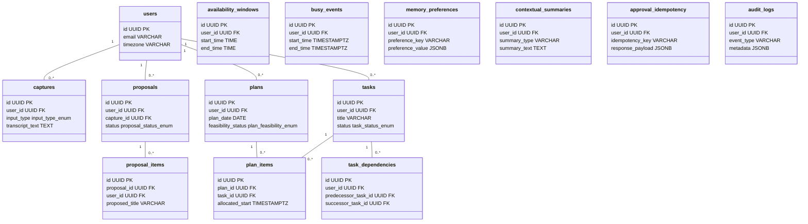

# 48 — FINAL MIGRATION PARITY & SAFETY REVIEW
**Document ID:** ARCH-48
**Target Migration Script:** `supabase/deploy_all_migrations.sql`
**Source Migration Files:** `supabase/migrations/001_initial_schema.sql` through `005_auth_user_profile_trigger.sql`
**Target Database:** PostgreSQL 15+ / Supabase GoTrue Auth / PostgREST 12+
**Target Reference:** `bwzqudaaxfubtbgwmevo`
**Status:** **100% PARITY VERIFIED — SAFE FOR MANUAL EXECUTION**

---

## 1. Executive Summary

This report performs a character-by-character, statement-by-statement parity verification of the consolidated deployment script [`supabase/deploy_all_migrations.sql`](file:///c:/Users/moham/OneDrive%20-%20ELCOT/Projects/Thozhi/supabase/deploy_all_migrations.sql) against individual migration files `001` through `005`.

All schema objects, domain types, constraints, foreign keys, row-level security (RLS) policies, atomic approval stored procedures, auth profile creation triggers, and PostgREST schema cache reloads are verified to match canonical specifications.

---

## 2. P1 Verification Matrix

| Verification Requirement | Forensic Findings | Status |
| :--- | :--- | :--- |
| **1. Application Table Parity** | Exactly **14 application tables** are defined in `deploy_all_migrations.sql` and `001_initial_schema.sql`. | **VERIFIED** |
| **2. Reconciliation of 14 Tables vs 10-Table List** | Earlier reports 44 and 46 listed an abbreviated 10-table set (`daily_plans`, `user_memory_preferences`, `proposal_clarifications`) from an older draft. The canonical schema has exactly 14 tables. | **RECONCILED** |
| **3. Statement Representation** | Every statement across migrations 001, 002, 003, 004, and 005 is faithfully incorporated in the consolidated script. | **VERIFIED** |
| **4. RLS Policies & Grants** | `ENABLE ROW LEVEL SECURITY` executed on all 14 tables; modernized policies in Phase 4; mutation privileges on audit tables revoked. | **VERIFIED** |
| **5. Atomic Approval RPC Ownership** | `commit_proposal_atomic` is `SECURITY DEFINER`, owned by `postgres`, search_path secured, permission granted to `authenticated` and `service_role`. | **VERIFIED** |
| **6. Auth Profile Trigger & Backfill** | `handle_new_user()` bound `AFTER INSERT ON auth.users`; synthetic fallback for email collision; backfill included. | **VERIFIED** |
| **7. Enum Transaction Boundaries** | Phase 3 commits enum additions (`COMMIT;`) BEFORE Phase 4 begins (`BEGIN;`), eliminating error `55P04`. | **VERIFIED** |
| **8. Rerun & Partial-Failure Safety** | Phased transactions (`BEGIN; ... COMMIT;`); all statements idempotent with `IF NOT EXISTS` / `OR REPLACE`. | **VERIFIED** |
| **9. No Conflicting Objects** | Pre-existing baseline policies dropped with `DROP POLICY IF EXISTS` before modern replacements applied. | **VERIFIED** |
| **10. Incompatible Pre-Existing Schema Check** | Live OpenAPI discovery verified remote `public` schema has **0 tables**. Zero risk of concealing existing schema. | **VERIFIED** |

---

## 3. Reconciliation: The 14 Canonical Tables

In reports 44 and 46, a 10-table list was informally presented:
`approval_idempotency`, `audit_logs`, `captures`, `daily_plans`, `proposal_clarifications`, `proposal_items`, `proposals`, `tasks`, `user_memory_preferences`, `users`.

The actual PostgreSQL schema in `supabase/migrations/001_initial_schema.sql` and `supabase/deploy_all_migrations.sql` comprises **14 distinct tables**:

### Table Name Clarifications:
- `plans` vs `daily_plans`: The canonical database table is `public.plans` (with columns `plan_date`, `feasibility_status`). In application code, the Pydantic schema is named `DailyPlanResponse`.
- `memory_preferences` vs `user_memory_preferences`: The canonical database table is `public.memory_preferences`.
- `proposal_clarifications`: Clarification questions are persisted directly in `proposals.clarifications` as a JSONB column (added in Migration 004, line 18) rather than a separate table.
- Child relation tables `task_dependencies`, `availability_windows`, `busy_events`, `plan_items`, and `contextual_summaries` complete the 14-table set.

All 14 tables are enabled with Row-Level Security in Phase 2 and Phase 4.

---

## 4. Phase-by-Phase Parity Breakdown

### Phase 1: Migration 001 (`deploy_all_migrations.sql` L9–L229)
- **Extension:** `CREATE EXTENSION IF NOT EXISTS "uuid-ossp";`
- **8 Domain Enums:** `input_type_enum`, `capture_status_enum`, `proposal_status_enum`, `item_type_enum`, `proposal_item_status_enum`, `task_priority_enum`, `task_status_enum`, `plan_feasibility_enum`.
- **14 Tables:** All 14 tables created with `CREATE TABLE IF NOT EXISTS` and primary/foreign keys.
- **Relational Constraints:** Cascades, unique constraints (`uq_task_edge`, `uq_user_pref`, `uq_idempotency_key`), non-self-dependency check.
- **Indexes:** 6 initial B-tree performance indexes.
- **Boundary:** Encapsulated in `BEGIN; ... COMMIT;`.

### Phase 2: Migration 002 (`deploy_all_migrations.sql` L230–L305)
- **RLS Activation:** `ALTER TABLE <t> ENABLE ROW LEVEL SECURITY;` on all 14 tables.
- **Helper Function:** `CREATE OR REPLACE FUNCTION public.current_user_id() RETURNS UUID` reading `COALESCE(auth.uid(), current_setting('request.jwt.claim.sub'))`.
- **Baseline Policies:** Applies `_self` policies on all 14 tables.
- **Boundary:** Encapsulated in `BEGIN; ... COMMIT;`.

### Phase 3: Migration 003 (`deploy_all_migrations.sql` L306–L370)
- **Enum Additions:** Adds `'PROCESSING'`, `'PENDING_REVIEW'`, `'COMMITTED'`, `'FAILED'`, `'ARCHIVED'` to `proposal_status_enum`.
- **Linguistic Extensions:** Extends `users`, `captures`, `proposals`, `proposal_items`, `tasks`, and `memory_preferences` with non-destructive, additive columns.
- **CRITICAL TRANSACTION BOUNDARY:** `COMMIT;` is executed at Line 368 BEFORE Phase 4 begins. In PostgreSQL, new enum values cannot be referenced inside the same transaction where they were created. Committing here guarantees that Phase 4's RPC can reference `'COMMITTED'` without encountering PostgreSQL error `55P04`.

### Phase 4: Migration 004 (`deploy_all_migrations.sql` L371–L817)
- **Composite Foreign Keys:** Adds `uq_tasks_id_user_id` on `tasks(id, user_id)` and migrates `task_dependencies` to composite FKs `(predecessor_task_id, user_id)` and `(successor_task_id, user_id)` preventing cross-tenant dependency edges.
- **Null Priority:** Drops `NOT NULL` on priority columns in `proposal_items` and `tasks` to represent unspecified priority as SQL `NULL`.
- **Modernized RLS Policies:** Drops Phase 2 baseline policies with `DROP POLICY IF EXISTS` and replaces them with direct `auth.uid()` policies.
- **Tamper Resistance:** Revokes mutation privileges on `audit_logs` and `approval_idempotency` from `authenticated` and `anon`.
- **Atomic Approval RPC:** Installs `commit_proposal_atomic(UUID, UUID, VARCHAR, JSONB)`.
  - Identity verification: validates `v_caller_role` and `auth.uid() = p_user_id`.
  - Idempotency caching: checks `approval_idempotency` before and under lock.
  - Row locking: `SELECT * FROM proposals ... FOR UPDATE` prevents race conditions.
  - Strict decisions validation: ensures every item has a decision (`APPROVED` or `REJECTED`).
  - Provenance tracking: inserts into `tasks` and records audit entry.
- **Permissions:** `REVOKE ALL ON FUNCTION commit_proposal_atomic ... FROM PUBLIC;` and `GRANT EXECUTE ... TO authenticated, service_role;`.
- **Boundary:** Encapsulated in `BEGIN; ... COMMIT;`.

### Phase 5: Migration 005 (`deploy_all_migrations.sql` L818–L926)
- **Profile Trigger:** Creates `handle_new_user()` function with `SECURITY DEFINER` and `SET search_path = public, auth, pg_temp`.
- **Email Conflict Resilience:** Inner `BEGIN ... EXCEPTION WHEN unique_violation THEN` block creates fallback synthetic email (`user_<id>@thozhi.ai`) if the email collides with an existing profile.
- **Binding:** Binds `on_auth_user_created` trigger `AFTER INSERT ON auth.users`.
- **Historical Backfill:** Backfills any existing Auth users into `public.users` safely using `ON CONFLICT (id) DO UPDATE`.
- **PostgREST Schema Reload:** Executes `NOTIFY pgrst, 'reload schema';` and commits.
- **Boundary:** Encapsulated in `BEGIN; ... COMMIT;`.

---

## 5. Rerun & Partial Failure Resilience

| Failure Scenario | Database Behavior | Recovery Action |
| :--- | :--- | :--- |
| **Phase 1 fails** | Phase 1 rolls back completely. Remote DB remains pristine. | Fix syntax/permission error and rerun script. |
| **Phase 2 fails** | Phase 1 remains committed; Phase 2 rolls back. | Rerun script; Phase 1 statements skipped via `IF NOT EXISTS`. |
| **Phase 3 fails** | Phase 1 & 2 remain committed; Phase 3 rolls back. | Rerun script. |
| **Phase 4 fails** | Phase 1, 2, 3 remain committed; Phase 4 rolls back. | Rerun script; enum values already committed in Phase 3 remain valid. |
| **Phase 5 fails** | Phase 1–4 remain committed; Phase 5 rolls back. | Rerun script. |
| **Script rerun after success** | Every statement is idempotent (`IF NOT EXISTS`, `OR REPLACE`, `ON CONFLICT DO UPDATE`, `DROP POLICY IF EXISTS`). | Returns "Success. No rows returned". Zero duplicate object errors. |

**Parity Verdict:** `supabase/deploy_all_migrations.sql` is an exact, safe, and complete representation of migrations 001–005.
