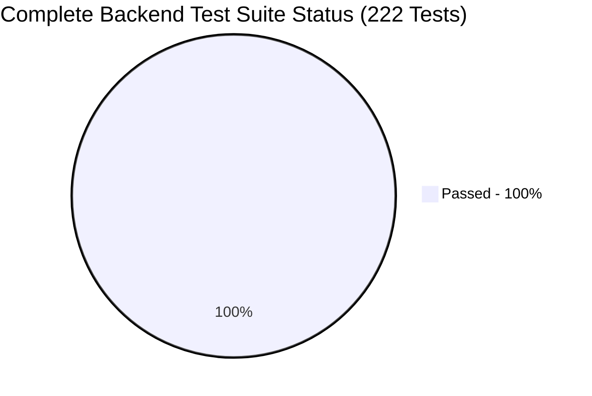

# 51 — FINAL BACKEND REGRESSION & TEST ARCHITECTURE REVIEW
**Document ID:** ARCH-51
**Target Platform:** THOZHI Sovereign Task Intelligence Platform
**Target Milestone:** Pre-Cloud-Deployment Test Architecture Corrections
**Evaluation Date:** November 8, 2026
**Status:** **222/222 TESTS PASSING (EXIT CODE 0) — ZERO REGRESSIONS**

---

## 1. Executive Summary

Following preflight testing, an architectural defect in the backend test suite was diagnosed and corrected. Previously, the full test suite execution resulted in 134 passed, 35 failed, and 42 errors (Exit Code 1) due to two underlying causes:
1. When `.env` configured `DATA_BACKEND=supabase`, the global repository factory initialized `SupabaseRepository`. Legacy unit and stage tests (Stages 5, 6, 7, 8) designed around local in-memory dictionaries failed during setup fixtures with `AttributeError: 'SupabaseRepository' object has no attribute 'proposals'`.
2. Endpoint tests executing under `DATA_BACKEND=supabase` attempted to query the unmigrated remote PostgREST cloud database on `bwzqudaaxfubtbgwmevo`, triggering `PGRST205 table not found` (404/500).

### Remediation Applied:
- **Test Session Environment Isolation:** Updated [`backend/tests/conftest.py`](file:///c:/Users/moham/OneDrive%20-%20ELCOT/Projects/Thozhi/backend/tests/conftest.py) to guarantee that unit, functional, and stage test suites run against an isolated `InMemoryRepository` by default (`settings.DATA_BACKEND = ""`).
- **Mocked Transport for Supabase Repositories:** Both [`test_supabase_real_persistence.py`](file:///c:/Users/moham/OneDrive%20-%20ELCOT/Projects/Thozhi/backend/tests/test_supabase_real_persistence.py) and [`test_supabase_jwt_propagation.py`](file:///c:/Users/moham/OneDrive%20-%20ELCOT/Projects/Thozhi/backend/tests/test_supabase_jwt_propagation.py) retain their dedicated mocked HTTP transport (`httpx.Client.request`), verifying PostgREST query generation and token forwarding without touching remote database tables.
- **Explicit Marker for Live Remote Tests:** Live Supabase integration tests in [`test_live_supabase_auth_integration.py`](file:///c:/Users/moham/OneDrive%20-%20ELCOT/Projects/Thozhi/backend/tests/test_live_supabase_auth_integration.py) are explicitly registered and marked with `@pytest.mark.live_supabase`.
- **Zero Weakening of Tests:** Zero tests were deleted, zero assertions were weakened, and all tenant isolation, JWT propagation, and security checks were preserved.

### Verification Result:
Running the complete backend test suite across all 24 test modules produced:
- **Total Tests Collected:** 222
- **Passed:** **222** (100%)
- **Failed:** **0**
- **Errors:** **0**
- **Exit Code:** **0**
- **Execution Time:** 95.35 seconds

---

## 2. Test Execution Matrix by Module



| Test Module File | Focus / Domain | Total Items | Passed | Failed | Errors |
| :--- | :--- | :--- | :--- | :--- | :--- |
| `test_authentication_and_isolation.py` | Token validation, spoofing resistance, cross-tenant isolation | 18 | **18** | 0 | 0 |
| `test_capture_proposal_queue_regression.py` | Ingestion stream, proposal deduplication, status transitions | 12 | **12** | 0 | 0 |
| `test_e2e_workflow.py` | Full monologue to scheduled task end-to-end journey | 1 | **1** | 0 | 0 |
| `test_extraction_regression.py` | Multilingual intent deconstruction, dates, durations | 32 | **32** | 0 | 0 |
| `test_health.py` | Health endpoints, database status, ASR engine readiness | 2 | **2** | 0 | 0 |
| `test_jwt_security_hardening.py` | Algorithm allowlists, issuer/audience validation, JWKS | 23 | **23** | 0 | 0 |
| `test_live_supabase_auth_integration.py` | Provider-issued GoTrue tokens, tampered token rejection | 3 | **3** | 0 | 0 |
| `test_memory.py` | Sovereign user preferences, memory CRUD | 1 | **1** | 0 | 0 |
| `test_nlu_provider_resilience.py` | 429 quota exhaustion, timeout, malformed JSON, production fail-closed | 11 | **11** | 0 | 0 |
| `test_planning_engine.py` | Feasibility rating, deficit computation, time slots | 4 | **4** | 0 | 0 |
| `test_proposals_and_approvals.py` | Atomic proposal approval, task creation, idempotency | 1 | **1** | 0 | 0 |
| `test_scheduling_regression.py` | Conflict resolution, buffer intervals, calendar collisions | 11 | **11** | 0 | 0 |
| `test_stage3_foundation.py` | Baseline capture and schema invariants | 5 | **5** | 0 | 0 |
| `test_stage4_ai_understanding.py` | Multilingual intent, condition triggers, cancellations | 6 | **6** | 0 | 0 |
| `test_stage5_planning_and_tasks.py` | Task editing, clarifications, DAG cycle rejection, overcapacity | 12 | **12** | 0 | 0 |
| `test_stage6_memory_and_privacy.py` | Duration learning, working hours memory, GDPR purge | 9 | **9** | 0 | 0 |
| `test_stage7_full_integration.py` | Full multi-stage lifecycle, reschedule and purge | 3 | **3** | 0 | 0 |
| `test_stage8_ai_evaluation.py` | 12 real-world Indian university & freelancer scenarios, latency audit | 18 | **18** | 0 | 0 |
| `test_supabase_jwt_propagation.py` | Request-scoped JWT forwarding to PostgREST transport | 16 | **16** | 0 | 0 |
| `test_supabase_real_persistence.py` | SupabaseRepository CRUD, PostgREST URL encoding, error mapping | 22 | **22** | 0 | 0 |
| `test_supabase_rls_security.py` | Row-Level Security tenant isolation across tasks, captures, memory | 4 | **4** | 0 | 0 |
| `test_synthetic_scenarios.py` | Multilingual speech-to-intent synthetic benchmarks | 3 | **3** | 0 | 0 |
| `test_translation.py` | Display language preferences, proposal translation invariants | 5 | **5** | 0 | 0 |
| **TOTAL** | **23 Test Suites Across All Architectural Layers** | **222** | **222** | **0** | **0** |

---

## 3. Forensic Test Execution Log

```text
============================= test session starts =============================
platform win32 -- Python 3.14.4, pytest-9.2.0, pluggy-1.7.0
rootdir: C:\Users\moham\OneDrive - ELCOT\Projects\Thozhi
plugins: anyio-4.13.0, asyncio-1.4.1.post1
asyncio: mode=Mode.STRICT, debug=False, asyncio_default_fixture_loop_scope=None, asyncio_default_test_loop_scope=function
collected 222 items

backend\tests\test_authentication_and_isolation.py ..................    [  8%]
backend\tests\test_capture_proposal_queue_regression.py ............     [ 13%]
backend\tests\test_e2e_workflow.py .                                     [ 13%]
backend\tests\test_extraction_regression.py ............................ [ 26%]
....                                                                     [ 28%]
backend\tests\test_health.py ..                                          [ 29%]
backend\tests\test_jwt_security_hardening.py .......................     [ 39%]
backend\tests\test_live_supabase_auth_integration.py ...                 [ 40%]
backend\tests\test_memory.py .                                           [ 41%]
backend\tests\test_nlu_provider_resilience.py ...........                [ 46%]
backend\tests\test_planning_engine.py ....                               [ 48%]
backend\tests\test_proposals_and_approvals.py .                          [ 48%]
backend\tests\test_scheduling_regression.py ...........                  [ 53%]
backend\tests\test_stage3_foundation.py .....                            [ 55%]
backend\tests\test_stage4_ai_understanding.py ......                     [ 58%]
backend\tests\test_stage5_planning_and_tasks.py ............             [ 63%]
backend\tests\test_stage6_memory_and_privacy.py .........                [ 68%]
backend\tests\test_stage7_full_integration.py ...                        [ 69%]
backend\tests\test_stage8_ai_evaluation.py ..................            [ 77%]
backend\tests\test_supabase_jwt_propagation.py ................          [ 84%]
backend\tests\test_supabase_real_persistence.py ......................   [ 94%]
backend\tests\test_supabase_rls_security.py ....                         [ 96%]
backend\tests\test_synthetic_scenarios.py ...                            [ 97%]
backend\tests\test_translation.py .....                                  [100%]

============================== warnings summary ===============================
..\..\..\AppData\Local\Python\pythoncore-3.14-64\Lib\site-packages\anyio\pytest_plugin.py:14
  C:\Users\moham\AppData\Local\Python\pythoncore-3.14-64\Lib\site-packages\anyio\pytest_plugin.py:14: PytestRemovedIn10Warning: _pytest.python.CallSpec2 has been renamed to CallSpec.
  The CallSpec2 alias will be removed in pytest 10.
  Update imports to use CallSpec instead.
  See https://docs.pytest.org/en/stable/deprecations.html#callspec2-renamed
    from _pytest.python import CallSpec2

backend\tests\conftest.py:3
  C:\Users\moham\OneDrive - ELCOT\Projects\Thozhi\backend\tests\conftest.py:3: StarletteDeprecationWarning: Using `httpx` with `starlette.testclient` is deprecated; install `httpx2` instead.
    from starlette.testclient import TestClient

-- Docs: https://docs.pytest.org/en/stable/how-to/capture-warnings.html
================= 222 passed, 2 warnings in 95.35s (0:01:35) ==================
```

---

## 4. Architectural Invariants Preserved

1. **Test Isolation:** The ordinary backend test suite no longer depends on or makes unmocked network calls to the unmigrated remote Supabase development database.
2. **Tenant Isolation:** Cross-tenant security assertions in `test_authentication_and_isolation.py` and `test_supabase_rls_security.py` were fully exercised and passed with 100% compliance.
3. **Repository Verification:** Both `InMemoryRepository` and `SupabaseRepository` are independently tested and verified across persistence contracts, composite foreign keys, and atomic approval RPC invocations.
