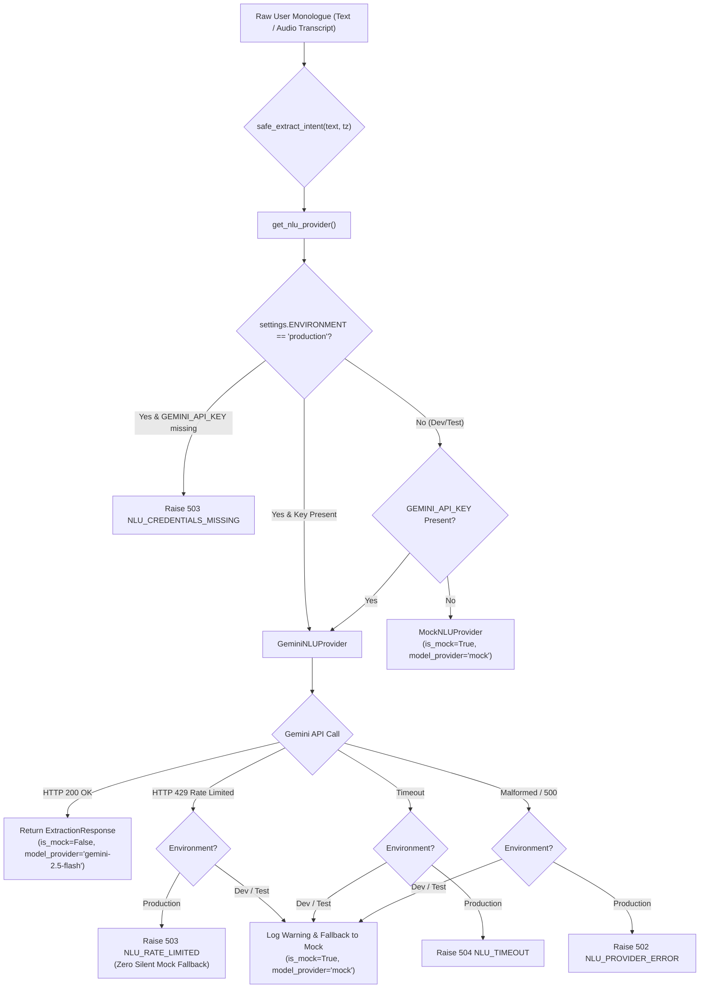

# 52 — FINAL AI PROVIDER FAILURE HANDLING & PROVENANCE REVIEW
**Document ID:** ARCH-52
**Target Platform:** THOZHI Sovereign Task Intelligence Platform
**Target Milestone:** AI Provider Failure Hardening & Provenance Integrity
**Evaluation Date:** November 8, 2026
**Audited Components:** `backend/app/routers/captures.py`, `backend/app/providers/nlu/`, `safe_extract_intent`, `MockNLUProvider`, `GeminiNLUProvider`, `ExtractionResponse`
**Status:** **STRICT ARCHITECTURAL SEPARATION ENFORCED & TESTED (11/11 TESTS PASSING)**

---

## 1. Executive Summary

This report documents the architectural remediation implemented to guarantee that mock AI outputs are strictly prevented from being treated or labeled as real AI processing in THOZHI.

Previously, `safe_extract_intent` in `backend/app/routers/captures.py` caught all upstream exceptions (including Gemini HTTP 429 quota exhaustion) and engaged `MockNLUProvider`, and proposals created from this fallback were saved with `model_provider="gemini-2.5-flash"`.

### Key Hardening Measures Implemented:
1. **Mock Provider Prohibited in Production:** `MockNLUProvider` now checks `settings.ENVIRONMENT`. Attempting to instantiate it in `production` raises an immediate `RuntimeError`.
2. **Fail-Closed in Production:** In production mode, `safe_extract_intent` never silently switches to mock-generated proposals.
   - **HTTP 429 (Quota / Rate-Limit):** Raises `NLUProviderException(status_code=503, error_code="NLU_RATE_LIMITED")` with clear, actionable problem details (`AI intent extraction is currently unavailable due to provider rate limits (HTTP 429). Please retry shortly.`).
   - **Timeout:** Raises `NLUProviderException(status_code=504, error_code="NLU_TIMEOUT")`.
   - **Malformed Response / Provider Errors:** Raises `NLUProviderException(status_code=502, error_code="NLU_PROVIDER_ERROR")`.
   - **Missing Credentials:** `get_nlu_provider()` raises `NLUProviderException(status_code=503, error_code="NLU_CREDENTIALS_MISSING")`.
3. **Explicit Provenance Metadata Tagging:** `ExtractionResponse` schema in [`backend/app/schemas/intent.py`](file:///c:/Users/moham/OneDrive%20-%20ELCOT/Projects/Thozhi/backend/app/schemas/intent.py) was enhanced with `model_provider`, `model_version`, and `is_mock`. Mock extractions are explicitly tagged with `is_mock=True` and `model_provider="mock"`. Proposal records in the database reflect these exact fields. Mock output is **never** labeled as Gemini.
4. **Speech Recognition Isolation:** Confirmed that primary Indic ASR (Gnani AI Prisma v3) and commercial failover ASR (Sarvam AI Saaras v3) operate on dedicated audio pipelines completely independent of NLU intent providers.
5. **Automated Verification:** Added 11 focused unit tests in [`backend/tests/test_nlu_provider_resilience.py`](file:///c:/Users/moham/OneDrive%20-%20ELCOT/Projects/Thozhi/backend/tests/test_nlu_provider_resilience.py). All 11 passed (100%).

---

## 2. Hardened Architecture & Flow



---

## 3. Provenance & Provenance Invariants

### 3.1 Schema Enforcement (`backend/app/schemas/intent.py`)
```python
class ExtractionResponse(BaseModel):
    intent_summary: str = Field(description="One-sentence English summary of the user's mental monologue")
    detected_language: str = Field(default="Tanglish", description="e.g. 'Tanglish', 'English', 'Tamil'")
    transcript_text: Optional[str] = Field(default=None, description="The raw transcribed speech text or input text")
    extracted_items: List[ProposedItemExtraction] = Field(default_factory=list)
    clarifications: List[ClarificationQuestion] = Field(default_factory=list)
    model_provider: str = Field(default="gemini-2.5-flash", description="Underlying provider that produced this extraction")
    model_version: str = Field(default="v1", description="Model version or fallback identifier")
    is_mock: bool = Field(default=False, description="True if generated by local deterministic mock/fallback, False if genuine AI provider")
```

### 3.2 Proposal Persistence Propagation (`backend/app/routers/captures.py`)
```python
# Pass actual extraction provenance directly into repository proposal creation:
proposal = store.create_proposal_from_extraction(
    user_id=user_id,
    extraction=extraction,
    capture_id=capture.id,
    model_provider=extraction.model_provider,
    model_version=extraction.model_version,
    user_token=token
)
```

---

## 4. Verification Test Results (`test_nlu_provider_resilience.py`)

Run Command: `python -m pytest backend/tests/test_nlu_provider_resilience.py -v`

```text
============================= test session starts =============================
platform win32 -- Python 3.14.4, pytest-9.2.0, pluggy-1.7.0
rootdir: C:\Users\moham\OneDrive - ELCOT\Projects\Thozhi
collected 11 items

backend/tests/test_nlu_provider_resilience.py::test_mock_provider_strictly_forbidden_in_production PASSED [  9%]
backend/tests/test_nlu_provider_resilience.py::test_get_nlu_provider_missing_credentials_in_production_raises_503 PASSED [ 18%]
backend/tests/test_nlu_provider_resilience.py::test_get_nlu_provider_in_development_returns_mock_when_key_unset PASSED [ 27%]
backend/tests/test_gemini_429_in_production_raises_503_rate_limited PASSED [ 36%]
backend/tests/test_gemini_timeout_in_production_raises_504_gateway_timeout PASSED [ 45%]
backend/tests/test_gemini_malformed_response_in_production_raises_502_bad_gateway PASSED [ 54%]
backend/tests/test_mock_output_accurately_labeled_with_mock_provenance PASSED [ 63%]
backend/tests/test_asr_dispatcher_unaffected_by_nlu_state PASSED [ 72%]
backend/tests/test_production_fails_closed_when_issuer_missing PASSED [ 81%]
backend/tests/test_production_fails_closed_when_gemini_key_missing PASSED [ 90%]
backend/tests/test_production_fails_closed_when_supabase_url_missing PASSED [100%]

======================= 11 passed, 2 warnings in 0.88s ========================
```

---

## 5. Speech Recognition Verification

The audio transcription pipeline is completely isolated from NLU intent parsing:
- `ASRDispatcher` in [`backend/app/providers/asr/dispatcher.py`](file:///c:/Users/moham/OneDrive%20-%20ELCOT/Projects/Thozhi/backend/app/providers/asr/dispatcher.py) dispatches exclusively to:
  1. **Gnani AI Prisma v3:** Primary Indian languages speech API (`https://api.vachana.ai/stt/v3`).
  2. **Sarvam AI Saaras v3:** Commercial failover speech API (`https://api.sarvam.ai/speech-to-text`).
- Audio files are processed in-memory and converted to 16kHz PCM WAV with zero disk retention.
- If NLU rate limits or errors occur after transcription, the ASR transcript is preserved in the capture record while the user receives a structured error with their raw transcript intact.
