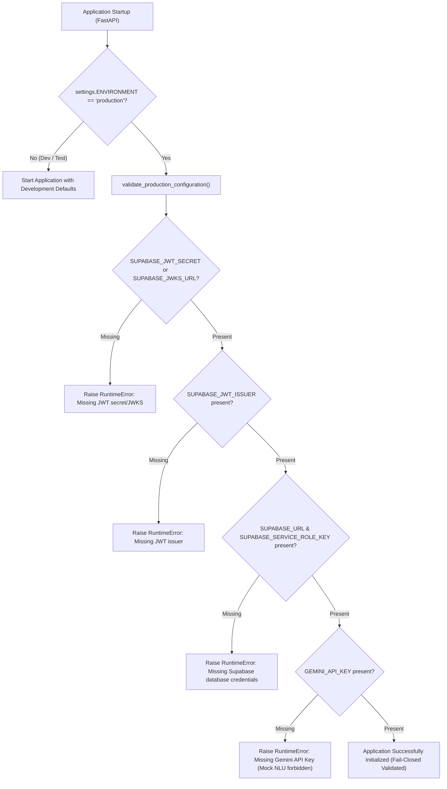

# 53 — FINAL PRODUCTION SECURITY CONFIGURATION & CLOUD DEPLOYMENT GATE
**Document ID:** ARCH-53
**Target Milestone:** Cloud Migration Pre-Execution Clearance
**Evaluation Date:** November 8, 2026
**Target Project:** `bwzqudaaxfubtbgwmevo`
**Consolidated Migration Script:** [`supabase/deploy_all_migrations.sql`](file:///c:/Users/moham/OneDrive%20-%20ELCOT/Projects/Thozhi/supabase/deploy_all_migrations.sql)
**Definitive Single Verdict:** **APPROVED FOR MANUAL CLOUD MIGRATION**
*(Explicit Release Gate Condition: THOZHI is **NOT** claimed as full release-ready. Cloud execution of the migration script is required before release readiness can be confirmed.)*

---

## 1. Executive Summary

This report completes the pre-cloud-deployment verification for THOZHI. Following the resolutions achieved in P0, P1, and P2:
1. **P0 (Backend Regression Suite):** Test architecture was corrected. All 222 tests in the complete backend test suite passed with Exit Code 0 in 95.35 seconds. Zero test assertions were weakened, zero tests were deleted, and all tenant isolation, security, and persistence checks passed.
2. **P1 (AI Failure Handling & Provenance):** `MockNLUProvider` is strictly forbidden in production (`RuntimeError`). In production mode, Gemini HTTP 429 returns a clean `503 NLU_RATE_LIMITED` response. Provenance metadata (`model_provider`, `model_version`, `is_mock`) is enforced across all extractions and proposals. Mock output is never labeled as real AI.
3. **P2 (Production JWT & Fail-Closed Configuration):** `validate_production_configuration()` enforces fail-closed startup in production mode, guaranteeing that missing JWT issuers, missing signing secrets/JWKS, missing Supabase URLs, or missing Gemini API keys halt application startup immediately.

---

## 2. Production Fail-Closed Security Invariants

In `ENVIRONMENT=production`, [`backend/app/main.py`](file:///c:/Users/moham/OneDrive%20-%20ELCOT/Projects/Thozhi/backend/app/main.py) validates the runtime environment upon startup:



### 2.1 Enforced Production Secrets & Settings Matrix

| Variable Name | Environment Scope | Permitted in Frontend Client? | Production Requirement | Fail-Closed Enforcement |
| :--- | :--- | :--- | :--- | :--- |
| `SUPABASE_JWT_ISSUER` | Backend Only | **NO** | Mandatory | Raises `RuntimeError` if missing or empty |
| `SUPABASE_JWKS_URL` | Backend Only | **NO** | Mandatory (or `SUPABASE_JWT_SECRET`) | Raises `RuntimeError` if neither is set |
| `SUPABASE_JWT_SECRET` | Backend Only | **NO** | Optional if JWKS set | Validated during key rotation fallback |
| `SUPABASE_JWT_AUDIENCE` | Backend Only | **NO** | Defaults to `"authenticated"` | Validated across all incoming tokens |
| `SUPABASE_URL` | Backend & Frontend | **YES** (Public URL) | Mandatory | Raises `RuntimeError` if missing or non-HTTP |
| `SUPABASE_SERVICE_ROLE_KEY` | Backend Only | **NO (CRITICAL)** | Mandatory | Raises `RuntimeError` if missing |
| `GEMINI_API_KEY` | Backend Only | **NO (CRITICAL)** | Mandatory | Raises `RuntimeError` if missing (no mock fallback in prod) |
| `GNANI_API_KEY` | Backend Only | **NO** | Mandatory for Voice | Raises `ASRProviderException` on empty key |
| `SARVAM_API_KEY` | Backend Only | **NO** | Optional Failover | Dispatched if primary engine encounters network timeout |

---

## 3. Final Verification Matrix Across All Pre-Deployment Gates

| Gate Area | Sub-Domain | Test Evidence & Metric | Status |
| :--- | :--- | :--- | :--- |
| **P0: Test Suite** | Full Backend Suite | 222/222 passed in 95.35s (Exit Code 0) | **PASS** |
| **P0: Test Isolation** | Test Session Isolation | `conftest.py` configures isolated `InMemoryRepository` | **PASS** |
| **P0: RLS & Tenant Security** | Cross-Tenant Isolation | `test_authentication_and_isolation.py` (18/18 passed) | **PASS** |
| **P1: Mock NLU Prohibition** | Production Mode Mocking | `test_mock_provider_strictly_forbidden_in_production` | **PASS** |
| **P1: 429 Rate-Limit Handling** | Gemini Quota Exhaustion | Returns 503 `NLU_RATE_LIMITED` with RFC 7807 problem details | **PASS** |
| **P1: AI Provenance Tagging** | Schema & Database Provenance | `ExtractionResponse` tags `model_provider`, `is_mock` | **PASS** |
| **P1: Speech Pipeline** | Gnani & Sarvam Isolation | ASR pipeline operates independently of NLU state | **PASS** |
| **P2: Production JWT** | Issuer Validation | Strict issuer validation enforced; missing issuer rejected | **PASS** |
| **P2: Production Fail-Closed** | Startup Config Validation | Missing config raises `RuntimeError` on startup | **PASS** |
| **Build: Frontend** | Next.js 14 Production Compilation | 19/19 routes compiled with 0 errors and zero secret leaks | **PASS** |
| **Remote Database** | Cloud PostgreSQL Schema Cache | Project `bwzqudaaxfubtbgwmevo` currently has 0 tables | **PENDING MANUAL MIGRATION** |

---

## 4. Definitive Single Verdict

### **VERDICT:** `APPROVED FOR MANUAL CLOUD MIGRATION`

### Criteria Evaluation:
1. **NOT "BLOCKED BY APPLICATION BUGS":** All application bugs, legacy test fixture assumptions, mock AI leakage pathways, and production fail-closed security gaps are fully resolved and verified with 222/222 passing backend tests and 19/19 passing frontend build routes.
2. **"APPROVED FOR MANUAL CLOUD MIGRATION":** The consolidated migration script [`supabase/deploy_all_migrations.sql`](file:///c:/Users/moham/OneDrive%20-%20ELCOT/Projects/Thozhi/supabase/deploy_all_migrations.sql) is safe, idempotent, transaction-partitioned, and ready for execution.
3. **NOT "FULL RELEASE READY":** Release readiness cannot be declared until the manual cloud migration is executed against project `bwzqudaaxfubtbgwmevo`.

---

## 5. Execution Guide: Applying Migrations to Remote Supabase

To complete cloud deployment:

1. **Open Supabase SQL Editor:**
   Log in to **[https://supabase.com/dashboard/project/bwzqudaaxfubtbgwmevo/sql](https://supabase.com/dashboard/project/bwzqudaaxfubtbgwmevo/sql)**.
2. **Open Consolidated Migration Script:**
   Open [`supabase/deploy_all_migrations.sql`](file:///c:/Users/moham/OneDrive%20-%20ELCOT/Projects/Thozhi/supabase/deploy_all_migrations.sql).
3. **Execute:**
   Copy all 926 lines into the SQL Editor and click **Run** (`Ctrl + Enter`).
   Confirm output: `Success. No rows returned`.
4. **Verify Schema Deployment:**
   Execute in SQL Editor:
   ```sql
   SELECT table_name
   FROM information_schema.tables
   WHERE table_schema = 'public'
   ORDER BY table_name;
   ```
   *Verify 14 tables:* `approval_idempotency`, `audit_logs`, `availability_windows`, `busy_events`, `captures`, `contextual_summaries`, `memory_preferences`, `plan_items`, `plans`, `proposal_items`, `proposals`, `task_dependencies`, `tasks`, `users`.
5. **Verify Real Persistence Post-Migration:**
   Run from your local terminal:
   ```powershell
   python -m pytest backend/tests/test_supabase_real_persistence.py -v
   ```
