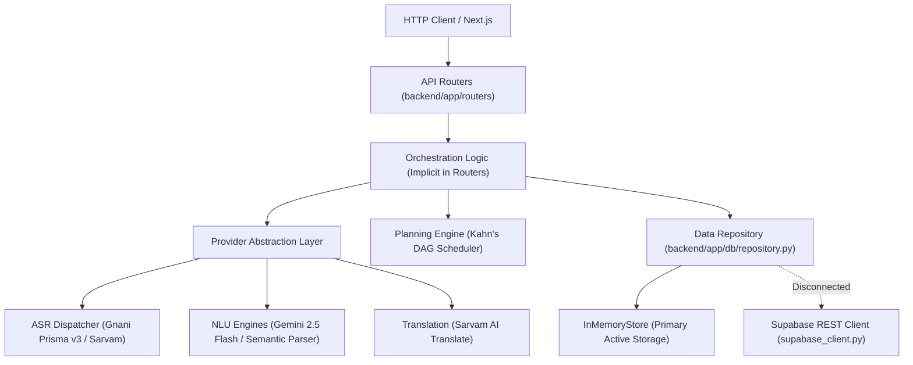

# THOZHI — Backend Architecture & Layering Audit

## 1. Executive Summary

- **Module:** FastAPI Application Core (`backend/app/`)
- **Python Version:** 3.11+ / 3.14 compatible
- **API Spec:** OpenAPI 3.1 with RFC 7807 Problem Details
- **Architecture Style:** Layered Provider-Router Architecture with In-Memory Repository
- **Overall Health:** Functionally sound (125/125 passing tests), but exhibits packaging omissions and architectural persistence disconnects.

---

## 2. Component-by-Component Architectural Audit



---

## 3. Detailed Backend Findings

### Finding BA-01: Missing `__init__.py` Files Creating Implicit Namespace Packages
- **Severity:** `P1 — High`
- **Exact File Paths:**
  - `backend/app/core/__init__.py` (Missing)
  - `backend/app/schemas/__init__.py` (Missing)
  - `backend/app/providers/__init__.py` (Missing)
  - `backend/app/providers/asr/__init__.py` (Missing)
  - `backend/app/providers/nlu/__init__.py` (Missing)
  - `backend/app/modules/__init__.py` (Missing)
  - `backend/app/modules/planning/__init__.py` (Missing)
- **Evidence:** Only `backend/app/`, `backend/app/db/`, `backend/app/providers/translation/`, `backend/app/routers/`, and `backend/tests/` contain `__init__.py`.
- **Actual Problem:** Python treats folders without `__init__.py` as PEP 420 implicit namespace packages. While modern CPython executes them, static analysis tools (MyPy, Pyright, Flake8), Docker packaging, and certain pytest discovery runners can experience path resolution anomalies.
- **Recommended Correction:** Add standard empty `__init__.py` files to all subpackages to make them regular Python packages.
- **Code Change Necessary:** Yes (Safe cleanup).

---

### Finding BA-02: Supabase REST Client Disconnected from Main Data Repository
- **Severity:** `P1 — High`
- **Exact File Paths:**
  - [`backend/app/db/supabase_client.py`](file:///c:/Users/moham/OneDrive%20-%20ELCOT/Projects/Thozhi/backend/app/db/supabase_client.py)
  - [`backend/app/db/repository.py`](file:///c:/Users/moham/OneDrive%20-%20ELCOT/Projects/Thozhi/backend/app/db/repository.py)
  - [`backend/app/main.py:45`](file:///c:/Users/moham/OneDrive%20-%20ELCOT/Projects/Thozhi/backend/app/main.py#L45)
- **Evidence:**
  - `supabase_client.py` defines full CRUD methods (`list_records`, `insert_record`, `update_record`, `delete_record`, `check_health`).
  - `repository.py` implements a 1,156-line `InMemoryStore` maintaining dictionaries (`self.tasks`, `self.captures`, `self.proposals`, `self.users`).
  - Not a single function in `repository.py` calls `supabase_client` or persists data to PostgreSQL.
  - The only reference to `supabase_client` in the entire application is the `/health` endpoint pinging Supabase URL.
- **Actual Problem:**
  - Server restarts wipe all user data, captured streams, tasks, proposals, and preferences.
  - The application gives the impression of Supabase integration, but is functionally operating purely on RAM.
- **Recommended Correction:**
  - Define an abstract repository interface (`RepositoryProtocol`).
  - Retain `InMemoryRepository` for ultra-fast local testing and offline CI execution.
  - Implement `SupabaseRepository` that writes to Supabase PostgreSQL when `SUPABASE_URL` and `SUPABASE_KEY` are provided in `.env`.
  - Provide a factory: `store = SupabaseRepository() if settings.SUPABASE_KEY else InMemoryRepository()`.
- **Code Change Necessary:** Requires explicit architecture approval before implementation.

---

### Finding BA-03: Business & Orchestration Logic Leaking into Routers
- **Severity:** `P2 — Medium`
- **Exact File Path:** [`backend/app/routers/captures.py:27-49`](file:///c:/Users/moham/OneDrive%20-%20ELCOT/Projects/Thozhi/backend/app/routers/captures.py#L27-L49)
- **Evidence:**
  ```python
  async def safe_extract_intent(text: str, user_timezone: str):
      provider = get_nlu_provider()
      try:
          return await provider.extract_intent(...)
      except Exception as exc:
          fallback = MockNLUProvider()
          return await fallback.extract_intent(...)

  async def apply_user_display_language_preference(user_id: UUID, proposal: ProposalResponse) -> ProposalResponse:
      for pref in store.memory_preferences.values():
          if pref.get("user_id") == user_id and pref.get("preference_key") == "preferred_display_language":
              ...
              return await store.translate_proposal(proposal.id, target_lang)
  ```
- **Actual Problem:**
  - API Routers should strictly handle HTTP serialization, query parameter validation, and status code dispatch.
  - Orchestrating NLU failover, instantiating mock providers, and iterating over memory preferences directly inside `captures.py` violates separation of concerns.
- **Recommended Correction:**
  - Extract orchestration logic into a dedicated service layer: `backend/app/services/intent_service.py` and `backend/app/services/capture_service.py`.
- **Code Change Necessary:** Yes.

---

### Finding BA-04: Monolithic Repository Class (`repository.py` - 1,156 Lines)
- **Severity:** `P2 — Medium`
- **Exact File Path:** [`backend/app/db/repository.py`](file:///c:/Users/moham/OneDrive%20-%20ELCOT/Projects/Thozhi/backend/app/db/repository.py)
- **Evidence:** `repository.py` handles 14 distinct domain responsibilities in a single class:
  1. User profiles & auth seeding
  2. Capture stream CRUD & lifecycle updates
  3. Proposal extraction persistence & item patching
  4. Clarification questions & answers
  5. Multi-language translation caching
  6. Task CRUD & duplicate title protection
  7. Task dependency DAG edges
  8. Working hours & availability windows
  9. Calendar busy events & blocking intervals
  10. Daily plan generation & capacity calculations
  11. Schedule proposal commitment & idempotency key deduplication
  12. Memory preferences (retrieval, toggle, delete)
  13. Historical duration priors calculation
  14. Sovereign data export & GDPR purge
- **Actual Problem:** Single Responsibility Principle (SRP) violation. A monolithic file creates high merge contention and makes adding permanent database persistence difficult.
- **Recommended Correction:** Decompose into domain repositories under `backend/app/db/repositories/`:
  - `user_repo.py`, `capture_repo.py`, `proposal_repo.py`, `task_repo.py`, `plan_repo.py`, `memory_repo.py`.
  - Expose a unified facade `store` that retains 100% backward compatibility for all existing routers and tests.
- **Code Change Necessary:** Requires architectural restructuring plan.

---

### Finding BA-05: Missing Audio Dependency in `requirements.txt` (`av` / PyAV)
- **Severity:** `P2 — Medium`
- **Exact File Path:** [`backend/app/core/audio.py:31`](file:///c:/Users/moham/OneDrive%20-%20ELCOT/Projects/Thozhi/backend/app/core/audio.py#L31), `backend/requirements.txt`
- **Evidence:** `audio.py` imports `av` to resample and transcode incoming browser audio (WebM, OGG, MP4) to 16kHz mono PCM WAV. However, `av` is not declared in `requirements.txt`.
- **Actual Problem:** In a fresh environment installing only `requirements.txt`, PyAV will not be present. Audio transcoding will fail silently and fall back to raw buffers, which can cause Gnani Prisma v3 rejection for non-WAV browser recordings.
- **Recommended Correction:** Add `av>=11.0.0` to `backend/requirements.txt`.
- **Code Change Necessary:** Yes.
