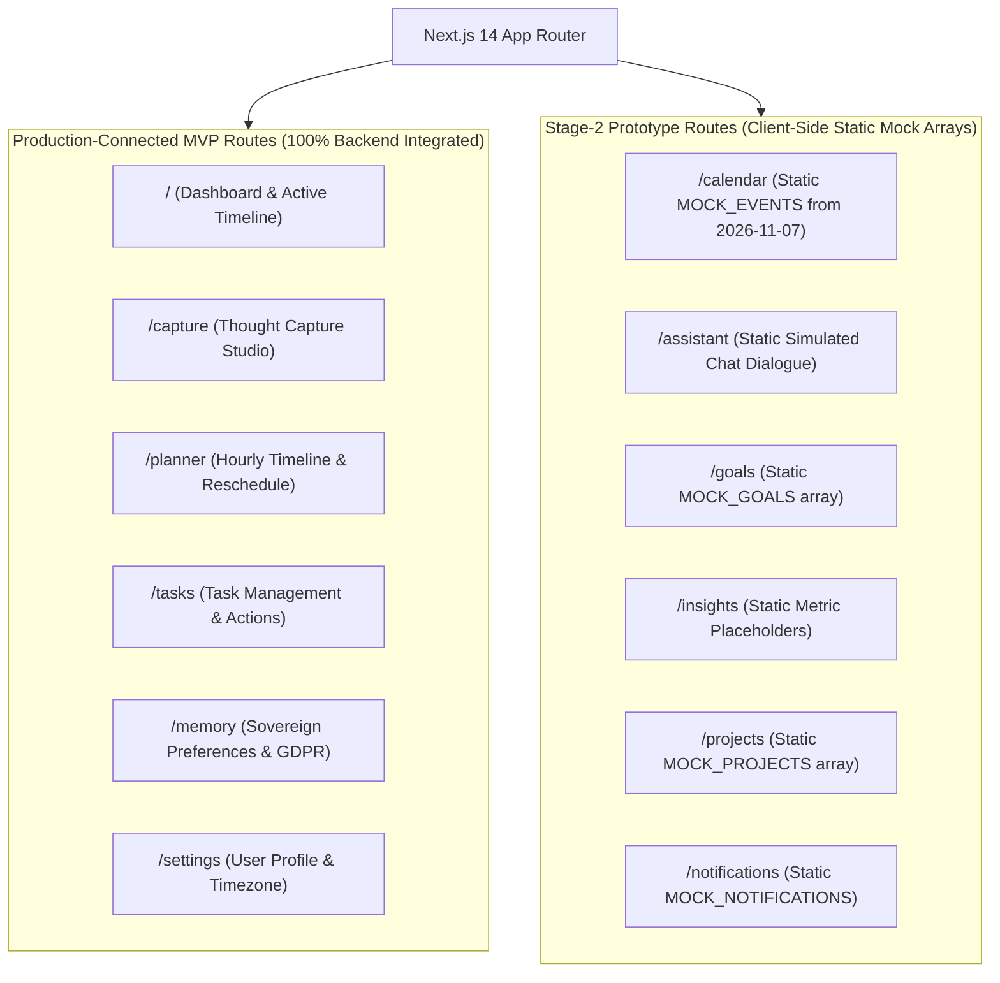

# THOZHI — Frontend Architecture & State Management Audit

## 1. Executive Summary

- **Framework:** Next.js 14.2.35 (App Router)
- **Language / UI:** TypeScript 5 + React 18 + Tailwind CSS 3.4
- **State Management:** Zustand 5.1
- **Icons / Design:** Lucide React + Neo-Brutalism Theme (`#080B11`, Obsidian Black, Blue Grid)
- **Production Build:** Passes with 0 errors across all 18 routes (`npm run build`).
- **Overall Assessment:** The core MVP routes (`/`, `/capture`, `/planner`, `/tasks`, `/memory`, `/settings`) are tightly integrated with the backend API and offer real-time persistence. However, six secondary routes remain static mock prototypes from Stage 2, several unneeded dependencies exist in `package.json`, and an abandoned component remains in the layout directory.

---

## 2. Route Classification Matrix



---

## 3. Detailed Frontend Findings

### Finding FA-01: Dead Component `Navbar.tsx`
- **Severity:** `P1 — High`
- **Exact File Path:** [`frontend/src/components/layout/Navbar.tsx`](file:///c:/Users/moham/OneDrive%20-%20ELCOT/Projects/Thozhi/frontend/src/components/layout/Navbar.tsx)
- **Evidence:** Searching for `Navbar` across the entire `frontend/src/` directory returns zero imports. `frontend/src/app/layout.tsx` exclusively imports `Sidebar` and `TopNav`.
- **Actual Problem:** `Navbar.tsx` is an abandoned artifact from an early top-bar navigation prototype. Leaving unused components in `components/layout/` confuses developers and increases maintenance overhead.
- **Recommended Correction:** Safely remove `frontend/src/components/layout/Navbar.tsx`.
- **Code Change Necessary:** Yes (Safe cleanup).

---

### Finding FA-02: Route Disconnect Between Production Routes and Static Mock Prototypes
- **Severity:** `P1 — High`
- **Exact File Paths:**
  - [`frontend/src/app/calendar/page.tsx`](file:///c:/Users/moham/OneDrive%20-%20ELCOT/Projects/Thozhi/frontend/src/app/calendar/page.tsx)
  - [`frontend/src/app/assistant/page.tsx`](file:///c:/Users/moham/OneDrive%20-%20ELCOT/Projects/Thozhi/frontend/src/app/assistant/page.tsx)
  - [`frontend/src/app/goals/page.tsx`](file:///c:/Users/moham/OneDrive%20-%20ELCOT/Projects/Thozhi/frontend/src/app/goals/page.tsx)
  - [`frontend/src/app/insights/page.tsx`](file:///c:/Users/moham/OneDrive%20-%20ELCOT/Projects/Thozhi/frontend/src/app/insights/page.tsx)
  - [`frontend/src/app/projects/page.tsx`](file:///c:/Users/moham/OneDrive%20-%20ELCOT/Projects/Thozhi/frontend/src/app/projects/page.tsx)
  - [`frontend/src/app/notifications/page.tsx`](file:///c:/Users/moham/OneDrive%20-%20ELCOT/Projects/Thozhi/frontend/src/app/notifications/page.tsx)
- **Evidence:**
  - `/calendar` defines `MOCK_EVENTS` with hardcoded events from `2026-11-07` instead of calling `getPlanForDate()` or `listTasks()`.
  - `/assistant` runs a local `setTimeout` replying with canned responses.
  - `/goals` operates on a local `MOCK_GOALS` array.
- **Actual Problem:**
  - A user who approves tasks on `/capture` expects them to appear when navigating to `/calendar`. Instead, `/calendar` shows hardcoded mock data.
- **Recommended Correction:**
  - Connect `/calendar` directly to `getPlanForDate()` and `listTasks()` so scheduled slots render dynamically.
  - For non-MVP routes (`/goals`, `/projects`, `/assistant`), either wire them to basic backend CRUD endpoints or add a clear visual "Stage 2 Prototype Preview" badge so users and evaluators know they are design prototypes.
- **Code Change Necessary:** Yes.

---

### Finding FA-03: Unused Dependencies in `package.json` (`@tanstack/react-query`, `class-variance-authority`)
- **Severity:** `P2 — Medium`
- **Exact File Path:** [`frontend/package.json`](file:///c:/Users/moham/OneDrive%20-%20ELCOT/Projects/Thozhi/frontend/package.json#L12-L13)
- **Evidence:**
  ```json
  "dependencies": {
    "@tanstack/react-query": "^5.107.1",
    "class-variance-authority": "^0.7.1",
    ...
  }
  ```
  Neither package is imported anywhere in `frontend/src/`.
- **Actual Problem:**
  - Adds ~15MB of unnecessary dependencies to `node_modules`.
  - Potential security vulnerability footprint from packages that are not actually being executed.
- **Recommended Correction:** Remove `@tanstack/react-query` and `class-variance-authority` from `package.json`.
- **Code Change Necessary:** Yes (Safe cleanup).

---

### Finding FA-04: Custom React Hook Placed in Utility Directory (`src/lib/useUserProfile.ts`)
- **Severity:** `P3 — Low`
- **Exact File Path:** [`frontend/src/lib/useUserProfile.ts`](file:///c:/Users/moham/OneDrive%20-%20ELCOT/Projects/Thozhi/frontend/src/lib/useUserProfile.ts)
- **Evidence:** Custom React hook `useUserProfile()` is situated in `frontend/src/lib/` alongside generic utilities (`utils.ts`, `api.ts`).
- **Actual Problem:** Standard React / Next.js conventions place hooks into `frontend/src/hooks/`.
- **Recommended Correction:** Move `useUserProfile.ts` to `frontend/src/hooks/useUserProfile.ts`, leaving a re-export in `lib/` for backward compatibility.
- **Code Change Necessary:** Yes.

---

### Finding FA-05: Inconsistent Type Enums (`types/index.ts` vs Backend Schemas)
- **Severity:** `P2 — Medium`
- **Exact File Path:** [`frontend/src/types/index.ts`](file:///c:/Users/moham/OneDrive%20-%20ELCOT/Projects/Thozhi/frontend/src/types/index.ts#L93-L155)
- **Evidence:**
  - `CaptureRecord.input_type` is defined as `"VOICE" | "TEXT" | "voice" | "text" | string`, whereas backend schema defines `"AUDIO" | "TEXT"`.
  - `Task.status` contains redundant lowercase `"todo" | "in_progress" | "completed"` alongside canonical `"PENDING" | "IN_PROGRESS" | "COMPLETED"`.
- **Actual Problem:** Lax union typing prevents TypeScript from catching contract mismatches between backend payloads and UI components.
- **Recommended Correction:** Standardize on strict uppercase enums aligned with backend schemas.
- **Code Change Necessary:** Yes.
