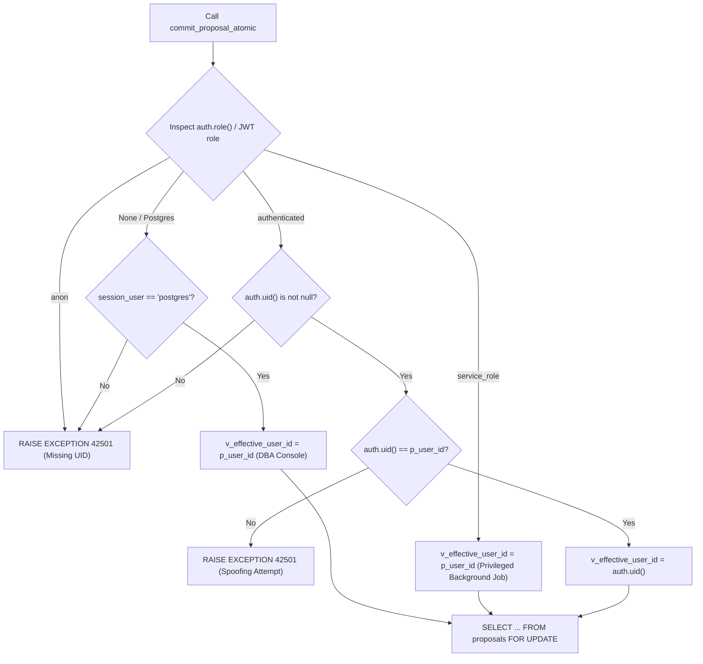

# THOZHI — Phase 1.7.5: Atomic Proposal Approval Final Specification

**Author:** Principal Software Architect, PostgreSQL Database Architect & Lead Security Auditor
**Date:** 2026-11-08
**Scope:** Final Production Specification for `commit_proposal_atomic` Stored Procedure & Error Mapping
**Status:** **FINAL SPECIFICATION COMPLETE — READY FOR IMPLEMENTATION**

---

## 1. Executive Summary

This specification formalizes the final design of `commit_proposal_atomic(p_user_id, p_proposal_id, p_idempotency_key, p_item_decisions)`.

It incorporates the findings of the Phase 1.7 security review to establish genuine, single-transaction ACID commitment guarantees for human proposal approvals.

---

## 2. Execution Identity & Access Control Architecture

The function executes under `SECURITY DEFINER` with `SET search_path = public, extensions, pg_temp;`.

### 2.1 Why `SECURITY DEFINER` is Necessary
1. **Multi-Table Coordination:** Approval atomically writes to `tasks`, `proposals`, `proposal_items`, `captures`, `approval_idempotency`, and `audit_logs`.
2. **Audit Log Protection:** Authenticated users have no `INSERT` or `UPDATE` privileges on `audit_logs`. Only `commit_proposal_atomic` can write the immutable audit log entry.
3. **Restricted Direct Writes:** Users do not need broad direct table access when operations are encapsulated in domain transactions.

### 2.2 Identity Resolution Flowchart


---

## 3. Concurrency, Serialization & Idempotency Guarantees

### 3.1 Serialization via Row-Level Exclusive Lock
```sql
SELECT * INTO v_proposal
FROM proposals
WHERE id = p_proposal_id AND user_id = v_effective_user_id
FOR UPDATE;
```
- **Scenario:** Two simultaneous HTTP approval requests (`Req-A` and `Req-B`) arrive for the same proposal.
- **Resolution:**
  1. `Req-A` acquires the `FOR UPDATE` lock on the proposal record in PostgreSQL.
  2. `Req-B` is forced into a waiting state by the PostgreSQL lock manager.
  3. `Req-A` validates state, inserts tasks, marks items committed, writes idempotency cache, updates proposal status to `'COMMITTED'`, and completes transaction commit.
  4. `Req-B` unblocks and reads the updated proposal row.
  5. `Req-B` sees `v_proposal.status = 'COMMITTED'`.
  6. `Req-B` checks `approval_idempotency` for its key:
     - If `Req-B` has the same idempotency key as `Req-A`, it immediately returns the cached response (Fast-path replay).
     - If `Req-B` has a different idempotency key, it raises `23505 Proposal has already been committed`.
- **Result:** Exactly one set of tasks is created. Race conditions are 100% eliminated.

---

## 4. Proposal-Item Full Coverage Rule (REV-03 Resolution)

In previous iterations, the procedure iterated over caller-supplied decisions, allowing unmentioned proposal items to linger in a `PENDING` state while the proposal was committed.

### 4.1 Strict Full-Coverage Requirement
The procedure validates:
```sql
SELECT COUNT(*) INTO v_db_item_count
FROM proposal_items
WHERE proposal_id = p_proposal_id AND user_id = v_effective_user_id;

v_decision_count := jsonb_array_length(p_item_decisions);

IF v_decision_count != v_db_item_count THEN
    RAISE EXCEPTION 'Incomplete decisions: proposal contains % items, but received % decisions',
        v_db_item_count, v_decision_count USING ERRCODE = '22023';
END IF;
```

### 4.2 Anti-Duplication Array Check
The procedure tracks processed item IDs:
```sql
IF v_item_id = ANY(v_seen_item_ids) THEN
    RAISE EXCEPTION 'Duplicate decision for item % in approval payload', v_item_id
        USING ERRCODE = '22023';
END IF;
v_seen_item_ids := array_append(v_seen_item_ids, v_item_id);
```

### 4.3 Guaranteed Item Outcomes
Upon completion of `commit_proposal_atomic`:
- Every approved item has `status = 'APPROVED'`, `decision_state = 'COMMITTED'`, and a corresponding row in `tasks`.
- Every rejected item has `status = 'REJECTED'`, `decision_state = 'REJECTED'`, and `rejection_reason` recorded.
- **Zero proposal items remain in `status = 'PENDING'`.**

---

## 5. Domain Exception & HTTP Error Code Mapping

The Python repository (`SupabaseRepository.approve_proposal`) maps PostgreSQL errors to FastAPI application exceptions:

| PostgreSQL Error Code | PostgreSQL Condition / Message | Python Domain Exception | HTTP Response Code |
| :--- | :--- | :--- | :--- |
| `P0002` | `Proposal % not found for user %` | `ResourceNotFoundException` | `404 Not Found` |
| `P0002` | `Proposal item % does not belong to proposal` | `ResourceNotFoundException` | `404 Not Found` |
| `23505` | `Proposal % has already been committed` | `IdempotencyConflictException` | `409 Conflict` |
| `22023` | `Proposal % has already been rejected` | `ProposalExpiredException` | `400 Bad Request` |
| `22023` | `Incomplete decisions: ...` | `ValidationException` | `422 Unprocessable Entity` |
| `22023` | `Duplicate decision for item ...` | `ValidationException` | `422 Unprocessable Entity` |
| `42501` | `Access denied: ...` | `PermissionDeniedException` | `403 Forbidden` |

---

## 6. Complete Transaction Rollback Matrix

| Failure Point | Mutation Attempted | Rollback Behavior | Database State After Rollback |
| :--- | :--- | :--- | :--- |
| **Unknown Proposal ID** | Initial `SELECT` | Function raises `P0002` | Zero rows modified. |
| **Invalid Proposal Item ID** | Task 1 inserted, Item 2 fails | Function raises `P0002` | Task 1 rolled back, Proposal remains `PENDING_REVIEW`. |
| **Duplicate Task Source Item** | Task insertion hits partial unique index | Database raises `23505` | All tasks rolled back, Proposal remains `PENDING_REVIEW`. |
| **Database Connection Blip** | Mid-loop network termination | PostgreSQL rolls back transaction | Zero partial records committed. |

---

## 7. Privilege Grants

```sql
REVOKE ALL ON FUNCTION commit_proposal_atomic(UUID, UUID, VARCHAR, JSONB) FROM PUBLIC;
GRANT EXECUTE ON FUNCTION commit_proposal_atomic(UUID, UUID, VARCHAR, JSONB) TO authenticated, service_role;
```
Execution is explicitly denied to anonymous callers (`anon`).
