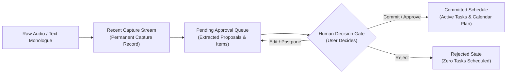
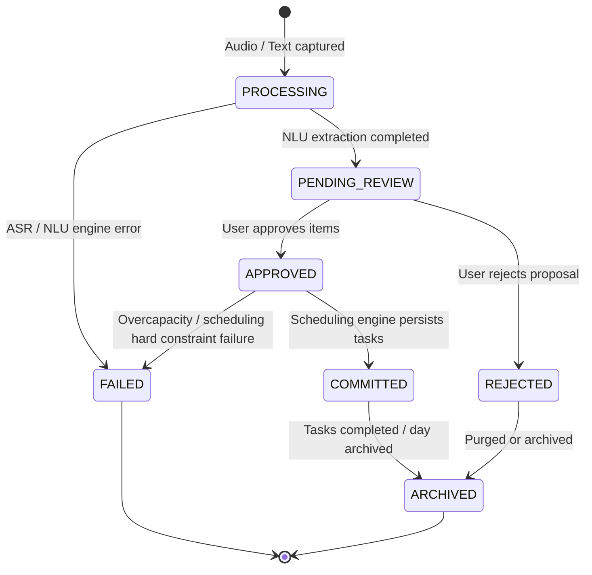
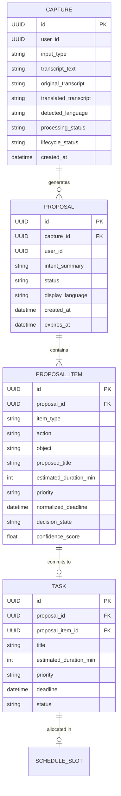

# THOZHI — Proposal Queue & Persistent Capture Architecture

## 1. Architectural Overview & Core Concepts

THOZHI establishes three distinct, decoupled concepts connected through stable identifiers:



### Concept A: Recent Capture Stream
- **Purpose:** Chronological history of all voice and text captures.
- **Attributes:** Capture ID, User ID, Input Type (`AUDIO` / `TEXT`), Original Transcript, Detected Language, Translated Transcript, Created Timestamp, Processing Status, Lifecycle Status.
- **Independence:** Clearing capture history logs only clears visible monologue logs; it never alters or deletes committed tasks or pending proposals.

### Concept B: Pending Approval Queue
- **Purpose:** All task proposals extracted from captures awaiting human review and approval.
- **Attributes:** Proposal ID, Capture ID (foreign key), Intent Summary, Items (Title, Duration, Priority, Deadline, Confidence Scores, Decision States), Clarification Questions, Status.
- **Independence:** Multiple pending proposals coexist simultaneously. Creating a new capture adds a new pending proposal to the queue without overwriting or invalidating existing proposals.

### Concept C: Committed Schedule
- **Purpose:** Finalized, user-approved tasks actively placed into the scheduling engine and daily plan.
- **Attributes:** Task ID, Proposal ID, Title, Estimated Duration, Priority, Normalized Deadline, Scheduled Slot (`start_time`, `end_time`), Dependencies.
- **Independence:** Tasks live in the persistent `tasks` store. Once committed, tasks remain fully operational even if parent captures are cleared from history logs.

---

## 2. Proposal Lifecycle State Machine



### State Definitions
1. **`PROCESSING`**: Audio received, stream transcribing via Gnani Prisma v3, or NLU semantic parsing in progress.
2. **`PENDING_REVIEW`**: Extraction complete. Proposal and items awaiting human review in the queue.
3. **`APPROVED`**: User confirmed approval for items within the proposal.
4. **`COMMITTED`**: Tasks committed to database and scheduled by Kahn's topological sort scheduler into the daily plan.
5. **`REJECTED`**: User explicitly rejected proposal. Zero tasks are added to the schedule.
6. **`FAILED`**: Audio decode failed, NLU parser error, or critical scheduling conflict.
7. **`ARCHIVED`**: Completed tasks or resolved queue records past active planning horizon.

> [!IMPORTANT]
> **Difference between APPROVED and COMMITTED:**
> `APPROVED` is the user decision state recorded in the approval transaction.
> `COMMITTED` is the schedule state confirming that tasks were successfully persisted, assigned slot intervals, and integrated into the user's active timeline.

---

## 3. Entity-Relationship Model



---

## 4. API Specification & Contracts

| Endpoint | Method | Request Payload | Response Model | Description |
|---|---|---|---|---|
| `/api/v1/captures` | `GET` | `user_id?: UUID` | `List[CaptureResponse]` | Chronological capture stream with proposals and lifecycle statuses. |
| `/api/v1/captures/{id}` | `GET` | - | `CaptureResponse` | Detailed capture record with all linked proposals. |
| `/api/v1/captures/{id}` | `DELETE` | - | `{"message": str}` | Deletes capture record while strictly preserving committed tasks. |
| `/api/v1/captures/clear` | `POST` | `user_id?: UUID` | `{"message": str}` | Clears stream history logs; leaves committed tasks and pending proposals intact. |
| `/api/v1/proposals` | `GET` | `status?: str, capture_id?: UUID` | `List[ProposalResponse]` | Lists proposals filtered by status (`PENDING_REVIEW`, `COMMITTED`, `REJECTED`). |
| `/api/v1/proposals/{id}` | `GET` | - | `ProposalResponse` | Fetches proposal with all extracted items and decisions. |
| `/api/v1/proposals/{id}/approve` | `POST` | `ProposalApproveRequest` | `ProposalApproveResponse` | Commits approved items into tasks and schedules them idempotently. |
| `/api/v1/proposals/{id}/reject` | `POST` | `ProposalRejectRequest` | `ProposalResponse` | Explicitly rejects proposal without creating tasks. |
| `/api/v1/proposals/batch/approve` | `POST` | `ProposalBatchApproveRequest` | `ProposalBatchActionResponse` | Batch commits multiple proposals in a single transaction. |
| `/api/v1/proposals/batch/reject` | `POST` | `ProposalBatchRejectRequest` | `ProposalBatchActionResponse` | Batch rejects multiple proposals from the queue. |

---

## 5. Frontend State Management (`proposalStore.ts`)

```typescript
interface ProposalState {
  captures: CaptureRecord[];
  proposals: Proposal[];
  activeProposalId: string | null;
  activeCaptureId: string | null;
  activeProposal: Proposal | null;
  itemDecisions: Record<string, ProposalItemDecision>;
  filterStatus: "ALL" | "PENDING_REVIEW" | "COMMITTED" | "REJECTED";
  isLoadingQueue: boolean;
  isSubmitting: boolean;

  // Key Queue Lifecycle Actions
  loadInitialQueue: () => Promise<void>;
  selectCapture: (captureId: string) => Promise<void>;
  selectProposal: (proposalId: string) => Promise<void>;
  commitActiveProposal: () => Promise<ApprovalResponse | null>;
  rejectActiveProposal: (reason?: string) => Promise<Proposal | null>;
  clearHistory: () => Promise<void>;
}
```

### Invariant Preservation
1. **Non-destructive additions:** `setProposal` inserts or updates without wiping other proposals or existing `itemDecisions`.
2. **Seamless queue progression:** On committing or rejecting `activeProposal`, the store automatically searches for the next `PENDING_REVIEW` proposal and activates it.
3. **Complete state recovery:** Refreshing the browser or navigating between `/capture`, `/planner`, and `/` hydrates the queue from `/captures` and `/proposals`.
