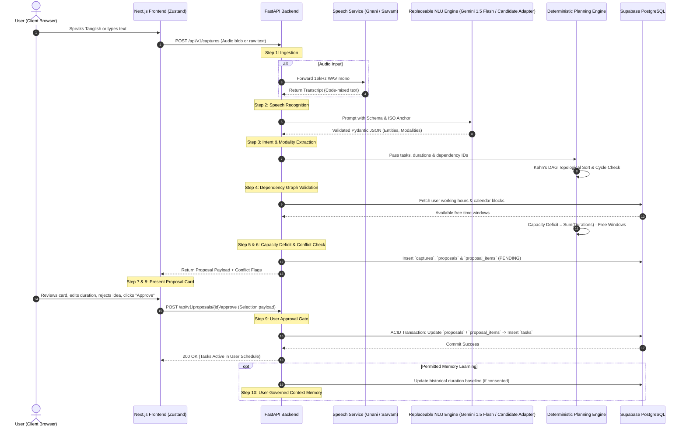
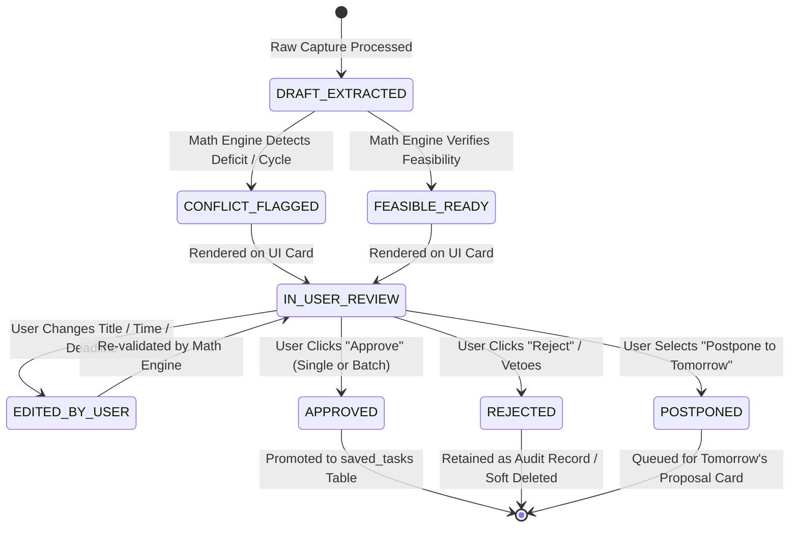

# 02 — Product Workflow Specification & Entity Lifecycle

## 1. Executive Summary & Core Principle
This document specifies the complete operational lifecycle and state machine governing **THOZHI**. 

The lifecycle enforces the non-negotiable architectural boundary:
$$\mathbf{Raw\ Input} \longrightarrow \mathbf{Parsed\ Intent} \longrightarrow \mathbf{Proposed\ Task} \overset{\text{User Approval Gate}}{\Longrightarrow} \mathbf{Approved\ Task} \longrightarrow \mathbf{Executed\ Action}$$

**Axiom:** An unapproved proposal can **never** spontaneously transition into an approved task. Every transition across the approval boundary requires an explicit cryptographic/session-bound human authorization payload.

---

## 2. End-to-End 10-Step Workflow Specification



---

## 3. Strict Entity Separation Across the Pipeline

To prevent data corruption, state confusion, or accidental execution, the data model isolates information into five distinct immutable or state-managed entities:

```
┌────────────────────────────────────────────────────────────────────────┐
│ ENTITY 1: RawUserInput                                                │
│ - Ephemeral audio buffer or raw string. Zero semantic structure.      │
│ - Storage: Audio deleted immediately post-ASR; text saved in capture. │
└────────────────────────────────────┬───────────────────────────────────┘
                                     │ (via ASR + LLM)
                                     ▼
┌────────────────────────────────────────────────────────────────────────┐
│ ENTITY 2: ParsedIntent                                                 │
│ - Ephemeral JSON structure generated by LLM.                           │
│ - Modality tags: COMMITMENT, IDEA, WISH, CONDITIONAL, COMPLETED.       │
│ - Relative dates mapped to ISO-8601; dependency references resolved.  │
└────────────────────────────────────┬───────────────────────────────────┘
                                     │ (via Deterministic Engine)
                                     ▼
┌────────────────────────────────────────────────────────────────────────┐
│ ENTITY 3: ProposedItem (Database Table: `proposal_items`)              │
│ - Stored with status: PENDING. Parent container in `proposals`.        │
│ - Carries mathematical conflict flags, warnings, and dependencies.    │
│ - CANNOT be synced to calendar or treated as an active commitment.    │
└────────────────────────────────────┬───────────────────────────────────┘
                                     │ (via EXPLICIT HUMAN APPROVAL)
                                     ▼
┌────────────────────────────────────────────────────────────────────────┐
│ ENTITY 4: ActiveTask (Database Table: `tasks`)                         │
│ - Legitimate, active task owned by the user.                           │
│ - Status: PENDING, IN_PROGRESS, COMPLETED, POSTPONED, CANCELLED.      │
│ - Linked to parent `source_proposal_item_id` for audit traceability.  │
└────────────────────────────────────┬───────────────────────────────────┘
                                     │ (via External Sync / Webhook)
                                     ▼
┌────────────────────────────────────────────────────────────────────────┐
│ ENTITY 5: ExecutedAction (e.g. Google Calendar Event Creation)         │
│ - External artifact generated only after task is approved.            │
│ - Retains external calendar event ID for bi-directional link.         │
└────────────────────────────────────────────────────────────────────────┘
```

---

## 4. State Transitions & The Proposal State Machine

### 4.1 Proposal Lifecycle States
A proposed item in `task_proposals` obeys the following finite state machine:



### 4.2 State Transition Invariants
1. **Invariant 1 (No Unilateral State Promotion):** No background worker, cron job, or LLM agent can transition a proposal from `IN_USER_REVIEW` to `APPROVED`. Only an authenticated HTTP request signed by the user session can trigger this transition.
2. **Invariant 2 (Immutable Audit Link):** When an `ApprovedTask` is created, its `proposal_id` foreign key is permanently locked. This allows historical audit comparison: *"What the AI originally proposed vs. what the user actually approved."*
3. **Invariant 3 (Idempotency & Duplicate Prevention):** Repeatedly clicking "Approve All" must not generate duplicate tasks. The backend enforces idempotency using `idempotency_key = sha256(user_id + proposal_id)`.

---

## 5. Detailed Exception & Error Handling Workflows

| Failure Mode / Exception | Pipeline Stage | Detection Mechanism | System Action & User Recovery Workflow |
| :--- | :--- | :--- | :--- |
| **ASR Provider Outage / Rate Limit** | Step 2 (ASR) | HTTP 401, 429, 504 from Gnani Prisma. | **Automated Failover:** Backend automatically dispatches audio to Sarvam AI Saaras. If both fail, user is prompted with: *"Audio transcription failed. Would you like to type your thoughts?"* |
| **Garbled Audio / Low Acoustic SNR** | Step 2 (ASR) | ASR confidence score $<0.4$ or empty transcript. | UI alerts user: *"Audio was unclear or too quiet. Please re-record closer to the microphone or type below."* |
| **LLM Schema Validation Crash** | Step 3 (NLU) | Pydantic `ValidationError` on LLM JSON output. | Retry once with `temperature=0.0`. If retry fails, fallback to basic regex task parser; alert engineering monitoring. |
| **Circular Task Dependency** | Step 4 (DAG Math) | Kahn’s algorithm detects cycle ($A \rightarrow B \rightarrow A$). | Backend flags proposal with `CIRCULAR_DEPENDENCY_ERROR`. Proposal card displays: *"Task A and Task B block each other. Which one must happen first?"* |
| **Calendar Deficit (Overload)** | Step 5 & 6 (Capacity) | $\sum \text{Durations} > \text{Free Capacity}$. | **Non-Blocking Warning:** System displays amber alert: *"You have 5.5 hours of tasks but only 3.0 hours open today. Proposed: Move Task C and D to tomorrow?"* User can accept recommendation or force-schedule. |
| **Ambiguous Relative Dates** | Step 3 (NLU) | Date expression lacks exact day (*"sometime next week"*). | Task assigned to general Backlog. Card displays a clarification pill: *"Set deadline for Monday, Wednesday, or Friday?"* |

---

## 6. Audit Logging & Human Correction Tracking

To support Step 10 (Contextual Memory Learning) without violating user privacy:
1. When a user edits a proposed duration (e.g., AI proposed 30 minutes, user changes it to 60 minutes), an operational log entry is recorded:
   ```json
   {
     "event": "USER_CORRECTION_DURATION",
     "task_category": "CODING_REVIEW",
     "proposed_duration": 30,
     "corrected_duration": 60,
     "timestamp": "2026-11-07T13:32:00Z"
   }
   ```
2. If and only if the user has enabled **"Learn from my edits"** in personal settings, the heuristic engine updates the user's localized duration prior for that task keyword.
3. Users retain a one-click button in Settings: **"Purge Learned Duration Preferences"**.

