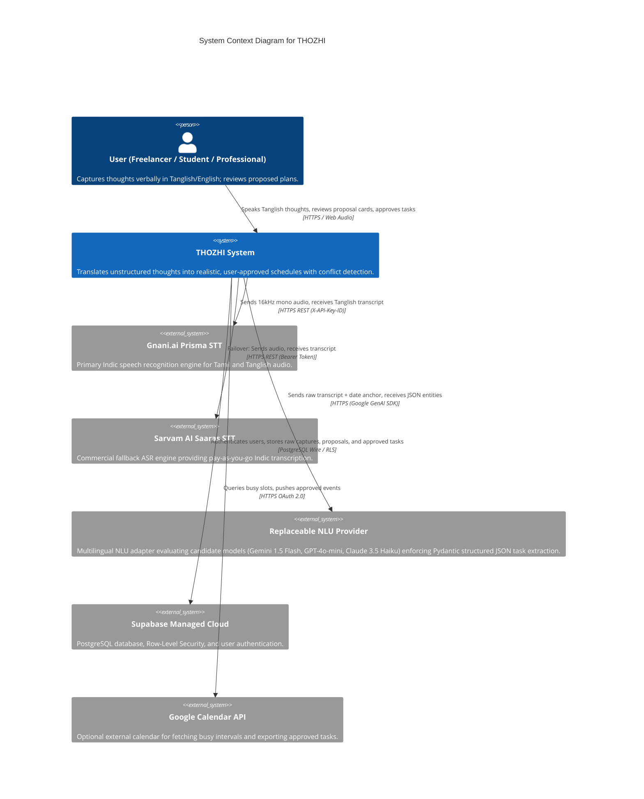
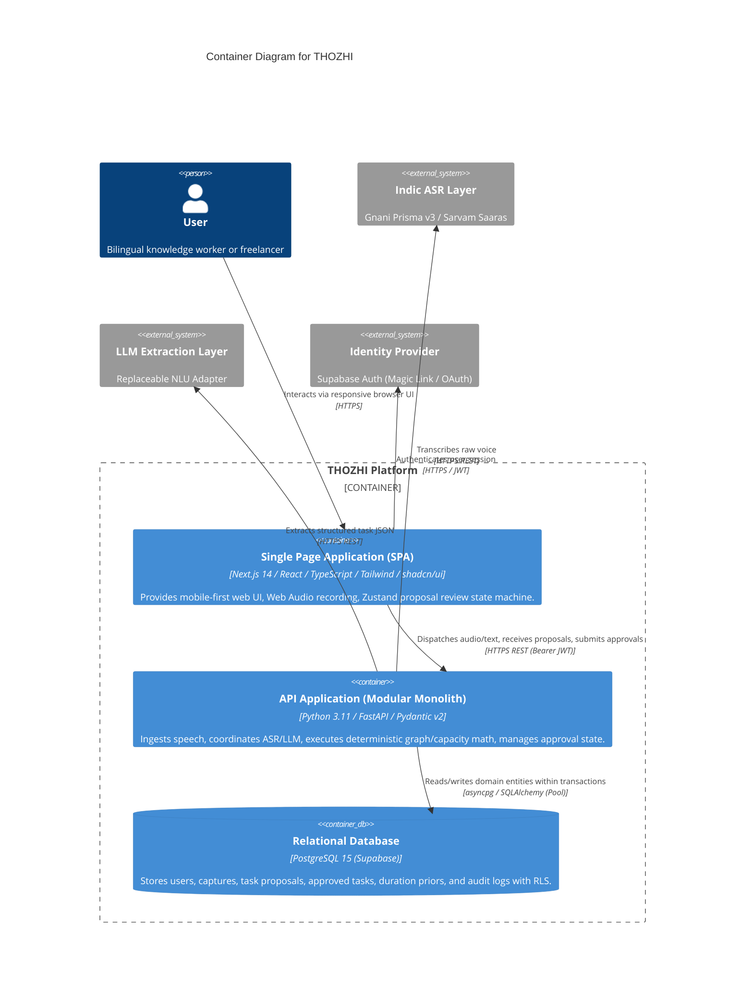
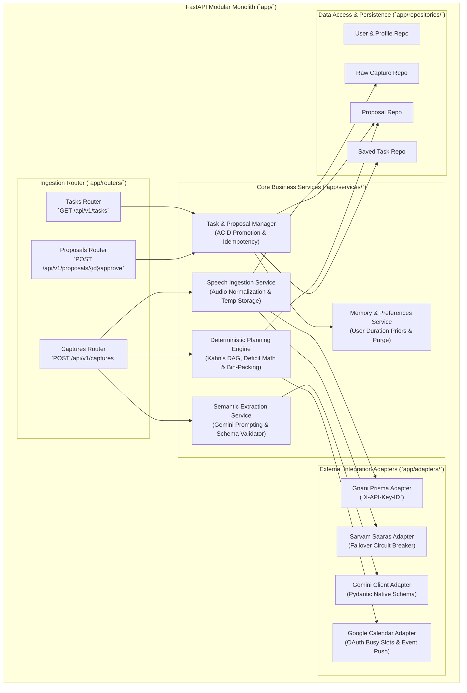

# 05 — System Architecture & C4 Structural Design

## 1. Architectural Principles & Philosophy
THOZHI is designed as a **Modular Monolith** optimized for developer ergonomics, minimal infrastructure overhead, and extreme reliability.

In strict adherence to Section 9 of the Master Execution Prompt:
- **NO Kubernetes:** Replaced by single-container Docker or PaaS hosting.
- **NO Microservices:** All backend services operate within a single, cleanly modularized FastAPI application package.
- **NO Redis / Kafka:** Ephemeral state is managed in-memory or in PostgreSQL transactions.
- **NO LangChain / Multi-Agent Frameworks:** Prompting and structured schema enforcement use the official, native Google GenAI SDK with Pydantic.
- **Strict Decoupling:** AI providers (Gnani, Sarvam, Gemini) are isolated behind abstract Python interfaces.

---

## 2. C4 Architecture Level 1: System Context Diagram

The System Context diagram illustrates how THOZHI interacts with human users and external third-party software systems.



---

## 3. C4 Architecture Level 2: Container Diagram

The Container diagram decomposes THOZHI into its runtime executable environments, storage repositories, and boundary protocols.



---

## 4. C4 Architecture Level 3: Component Diagram (FastAPI Modular Monolith)

The Component diagram details the internal modular structure of the backend application. Every domain module is self-contained with clear interface boundaries:



---

## 5. End-to-End Dataflow Pipelines

### 5.1 Pipeline 1: Voice Ingestion to Proposal Assembly
1. **Audio Capture:** Client browser captures audio via `navigator.mediaDevices.getUserMedia()`, encodes stream into a 16kHz Mono WAV blob client-side using a lightweight WebAssembly encoder, and dispatches a multipart `POST` to `/api/v1/captures/audio`.
2. **ASR Dispatch:** `SpeechIngestionService` writes audio to volatile memory (`io.BytesIO`) and calls `GnaniPrismaAdapter`.
3. **Circuit-Breaker Failover:** If Gnani returns an error code or times out ($>3\text{s}$), the service dispatches immediately to `SarvamSaarasAdapter`.
4. **Transcript Forwarding:** Raw transcript (e.g., *"Naalaiki morning 10 AM-ku client meeting, draft ready pannanum"*) is forwarded to `SemanticExtractionService`. Audio buffer is immediately deallocated from RAM.
5. **NLU Schema Extraction:** `GeminiClientAdapter` sends prompt with server timestamp anchor (`Asia/Kolkata`) and Pydantic `ExtractionResponse` schema.
6. **Constraint Checking:** `DeterministicPlanningEngine` receives parsed tasks:
   - Evaluates task dependencies via Kahn’s DAG algorithm.
   - Calculates available working hours free windows from database/calendar.
   - Computes capacity deficit ($\sum \text{Durations} - \text{Free Capacity}$).
   - Assigns provisional start/end slots.
7. **Proposal Storage:** A draft record is committed to `task_proposals` with status `PENDING_APPROVAL`.
8. **Client Response:** Frontend receives the complete proposal payload and renders the interactive Proposal Card.

### 5.2 Pipeline 2: Human Decision to Execution
1. **User Action:** User inspects Proposal Card. User edits a duration from 30m to 45m, clicks the "X" button to reject an aspirational idea, and clicks "Approve All Remaining".
2. **Approval Dispatch:** Client sends `POST /api/v1/proposals/{proposal_id}/approve` with payload:
   ```json
   {
     "approved_item_ids": ["item_1", "item_3"],
     "edited_items": [{ "id": "item_1", "duration_minutes": 45 }],
     "idempotency_key": "user123_prop456_20261107"
   }
   ```
3. **Atomic Transaction:** Backend opens PostgreSQL transaction:
   - Verifies `idempotency_key` (rejects duplicates).
   - Updates `task_proposals` status to `APPROVED`.
   - Inserts approved items into `saved_tasks` table with status `PENDING`.
   - Commits transaction.
4. **Calendar Push (Optional):** If user enabled calendar sync, dispatches background task to push events to Google Calendar.
5. **UI Confirmation:** Next.js UI updates to display the active Daily Plan view.

---

## 6. Hardware & Deployment Footprint

| Component | Target Deployment Environment | Runtime Specs & Resource Constraints |
| :--- | :--- | :--- |
| **Frontend UI** | Vercel Serverless / Cloudflare Pages | Node.js 18+ Edge Runtime; memory cap 512 MB. |
| **Backend API** | Single Container PaaS (Render / Fly.io / Cloud Run) | Python 3.11, 1 vCPU, 1 GB RAM (scales to zero when idle). |
| **Database** | Supabase Managed Cloud (PostgreSQL 15) | Hosted in `ap-south-1` (Mumbai); 500 MB storage tier sufficient for MVP pilot. |
| **Local Dev** | Single Developer Machine (macOS / Windows / Linux) | Docker Compose or native virtualenv + Next.js dev server; total active RAM $\le 3.5\text{ GB}$. |

