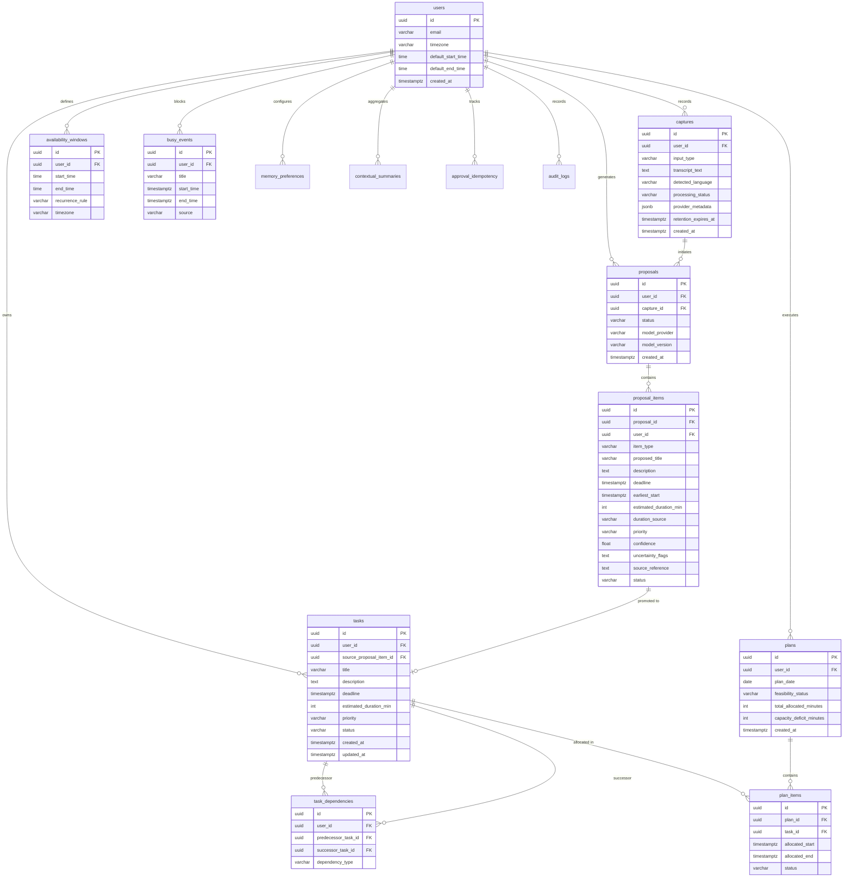

# 06 — Database Architecture & Relational Schema Specification

## 1. Executive Summary & Technology Stack
- **Database Engine:** PostgreSQL 15+ hosted on Supabase Cloud (`ap-south-1` Mumbai Region).
- **ORM / Driver:** SQLAlchemy 2.0 (Async) + `asyncpg` for high-throughput asynchronous I/O in FastAPI.
- **Security Paradigm:** 100% Multi-Tenant Isolation enforced via PostgreSQL **Row-Level Security (RLS)** keyed to `auth.uid()`.
- **Reference Document:** Master Product Requirements Document ([`Masterprd.md`](file:///c:/Users/moham/OneDrive - ELCOT/Projects/Thozhi/Masterprd.md) Section 10).

---

## 2. Evaluation of Vector Storage (`pgvector`)

In accordance with Section 8.7 of `Masterprd.md`:
> *"Use PostgreSQL initially. Do not introduce Redis, Pinecone, Weaviate, or a separate vector database in the MVP. pgvector only if proven necessary."*

### Architectural Verdict:
$$\mathbf{DEFERRED\ TO\ STAGE\ 2\ POST-MVP.}$$
The core planning and commitment extraction loop is entirely relational. Tasks and schedules are queried by user ID, date ranges, and statuses. Introducing vector embeddings adds unnecessary latency, embedding API costs, and RAM footprint without solving the immediate planning problem.

---

## 3. Entity Relationship Diagram (ERD)

The relational schema strictly implements the 14 core entities specified in `Masterprd.md` Section 10:



---

## 4. Complete PostgreSQL DDL Specification

```sql
-- ====================================================================
-- THOZHI MASTER PRODUCTION SCHEMA (PostgreSQL 15+)
-- Aligned 100% with Masterprd.md Section 10
-- ====================================================================

CREATE EXTENSION IF NOT EXISTS "uuid-ossp";

-- ENUMS
CREATE TYPE input_type_enum AS ENUM ('AUDIO', 'TEXT');
CREATE TYPE capture_status_enum AS ENUM ('RECEIVED', 'TRANSCRIBED', 'PROCESSED', 'FAILED');
CREATE TYPE proposal_status_enum AS ENUM ('DRAFT', 'PRESENTED', 'APPROVED', 'REJECTED', 'EXPIRED');
CREATE TYPE item_type_enum AS ENUM (
    'TASK', 'COMMITMENT', 'IDEA', 'WISH', 'CONDITIONAL_INTENTION', 
    'QUESTION', 'REMINDER', 'COMPLETED', 'CANCELLED', 'INFORMATIONAL'
);
CREATE TYPE proposal_item_status_enum AS ENUM ('PENDING', 'APPROVED', 'REJECTED', 'POSTPONED');
CREATE TYPE task_priority_enum AS ENUM ('P1_CRITICAL', 'P2_MEDIUM', 'P3_LOW', 'BACKBURNER');
CREATE TYPE task_status_enum AS ENUM ('PENDING', 'IN_PROGRESS', 'COMPLETED', 'POSTPONED', 'CANCELLED');
CREATE TYPE plan_feasibility_enum AS ENUM ('FEASIBLE', 'INFEASIBLE', 'NEEDS_CLARIFICATION', 'INCOMPLETE_INFORMATION');

-- 1. USERS / PROFILES (Mirrors Supabase auth.users)
CREATE TABLE users (
    id UUID PRIMARY KEY REFERENCES auth.users(id) ON DELETE CASCADE,
    email VARCHAR(255) NOT NULL UNIQUE,
    timezone VARCHAR(64) DEFAULT 'Asia/Kolkata' NOT NULL,
    default_start_time TIME DEFAULT '09:00:00' NOT NULL,
    default_end_time TIME DEFAULT '18:00:00' NOT NULL,
    created_at TIMESTAMPTZ DEFAULT NOW() NOT NULL,
    updated_at TIMESTAMPTZ DEFAULT NOW() NOT NULL
);

-- 2. CAPTURES
CREATE TABLE captures (
    id UUID PRIMARY KEY DEFAULT uuid_generate_v4(),
    user_id UUID NOT NULL REFERENCES users(id) ON DELETE CASCADE,
    input_type input_type_enum NOT NULL,
    transcript_text TEXT NOT NULL,
    detected_language VARCHAR(64) DEFAULT 'Tanglish' NOT NULL,
    processing_status capture_status_enum DEFAULT 'RECEIVED' NOT NULL,
    provider_metadata JSONB DEFAULT '{}'::JSONB NOT NULL,
    retention_expires_at TIMESTAMPTZ,
    created_at TIMESTAMPTZ DEFAULT NOW() NOT NULL
);

-- 3. PROPOSALS (Parent proposal container)
CREATE TABLE proposals (
    id UUID PRIMARY KEY DEFAULT uuid_generate_v4(),
    user_id UUID NOT NULL REFERENCES users(id) ON DELETE CASCADE,
    capture_id UUID REFERENCES captures(id) ON DELETE SET NULL,
    status proposal_status_enum DEFAULT 'DRAFT' NOT NULL,
    model_provider VARCHAR(64) NOT NULL,
    model_version VARCHAR(64) NOT NULL,
    created_at TIMESTAMPTZ DEFAULT NOW() NOT NULL,
    expires_at TIMESTAMPTZ DEFAULT (NOW() + INTERVAL '7 days') NOT NULL
);

-- 4. PROPOSAL_ITEMS (Extracted individual items)
CREATE TABLE proposal_items (
    id UUID PRIMARY KEY DEFAULT uuid_generate_v4(),
    proposal_id UUID NOT NULL REFERENCES proposals(id) ON DELETE CASCADE,
    user_id UUID NOT NULL REFERENCES users(id) ON DELETE CASCADE,
    item_type item_type_enum NOT NULL,
    proposed_title VARCHAR(255) NOT NULL,
    description TEXT,
    deadline TIMESTAMPTZ,
    earliest_start TIMESTAMPTZ,
    estimated_duration_min INT DEFAULT 30,
    duration_source VARCHAR(64) DEFAULT 'MODEL_ESTIMATE' NOT NULL,
    priority task_priority_enum DEFAULT 'P2_MEDIUM' NOT NULL,
    confidence FLOAT DEFAULT 0.85 NOT NULL,
    uncertainty_flags TEXT[] DEFAULT '{}'::TEXT[] NOT NULL,
    source_reference TEXT NOT NULL,
    status proposal_item_status_enum DEFAULT 'PENDING' NOT NULL,
    created_at TIMESTAMPTZ DEFAULT NOW() NOT NULL
);

-- 5. TASKS (Approved active tasks only)
CREATE TABLE tasks (
    id UUID PRIMARY KEY DEFAULT uuid_generate_v4(),
    user_id UUID NOT NULL REFERENCES users(id) ON DELETE CASCADE,
    source_proposal_item_id UUID REFERENCES proposal_items(id) ON DELETE SET NULL,
    title VARCHAR(255) NOT NULL,
    description TEXT,
    deadline TIMESTAMPTZ,
    estimated_duration_min INT DEFAULT 30 NOT NULL,
    priority task_priority_enum DEFAULT 'P2_MEDIUM' NOT NULL,
    status task_status_enum DEFAULT 'PENDING' NOT NULL,
    completed_at TIMESTAMPTZ,
    created_at TIMESTAMPTZ DEFAULT NOW() NOT NULL,
    updated_at TIMESTAMPTZ DEFAULT NOW() NOT NULL
);

-- 6. TASK_DEPENDENCIES (DAG graph edges)
CREATE TABLE task_dependencies (
    id UUID PRIMARY KEY DEFAULT uuid_generate_v4(),
    user_id UUID NOT NULL REFERENCES users(id) ON DELETE CASCADE,
    predecessor_task_id UUID NOT NULL REFERENCES tasks(id) ON DELETE CASCADE,
    successor_task_id UUID NOT NULL REFERENCES tasks(id) ON DELETE CASCADE,
    dependency_type VARCHAR(64) DEFAULT 'FINISH_TO_START' NOT NULL,
    created_at TIMESTAMPTZ DEFAULT NOW() NOT NULL,
    CONSTRAINT chk_no_self_dependency CHECK (predecessor_task_id != successor_task_id),
    CONSTRAINT uq_task_edge UNIQUE (predecessor_task_id, successor_task_id)
);

-- 7. AVAILABILITY_WINDOWS (Working hour blocks)
CREATE TABLE availability_windows (
    id UUID PRIMARY KEY DEFAULT uuid_generate_v4(),
    user_id UUID NOT NULL REFERENCES users(id) ON DELETE CASCADE,
    start_time TIME NOT NULL,
    end_time TIME NOT NULL,
    recurrence_rule VARCHAR(64) DEFAULT 'DAILY_WEEKDAYS' NOT NULL,
    timezone VARCHAR(64) DEFAULT 'Asia/Kolkata' NOT NULL,
    created_at TIMESTAMPTZ DEFAULT NOW() NOT NULL
);

-- 8. BUSY_EVENTS (Calendar commitments & external meetings)
CREATE TABLE busy_events (
    id UUID PRIMARY KEY DEFAULT uuid_generate_v4(),
    user_id UUID NOT NULL REFERENCES users(id) ON DELETE CASCADE,
    title VARCHAR(255) NOT NULL,
    start_time TIMESTAMPTZ NOT NULL,
    end_time TIMESTAMPTZ NOT NULL,
    source VARCHAR(64) DEFAULT 'MANUAL' NOT NULL,
    created_at TIMESTAMPTZ DEFAULT NOW() NOT NULL
);

-- 9. PLANS (Generated planning sessions)
CREATE TABLE plans (
    id UUID PRIMARY KEY DEFAULT uuid_generate_v4(),
    user_id UUID NOT NULL REFERENCES users(id) ON DELETE CASCADE,
    plan_date DATE NOT NULL,
    feasibility_status plan_feasibility_enum NOT NULL,
    total_allocated_minutes INT DEFAULT 0 NOT NULL,
    capacity_deficit_minutes INT DEFAULT 0 NOT NULL,
    created_at TIMESTAMPTZ DEFAULT NOW() NOT NULL
);

-- 10. PLAN_ITEMS (Scheduled time allocations)
CREATE TABLE plan_items (
    id UUID PRIMARY KEY DEFAULT uuid_generate_v4(),
    plan_id UUID NOT NULL REFERENCES plans(id) ON DELETE CASCADE,
    task_id UUID NOT NULL REFERENCES tasks(id) ON DELETE CASCADE,
    allocated_start TIMESTAMPTZ NOT NULL,
    allocated_end TIMESTAMPTZ NOT NULL,
    status VARCHAR(64) DEFAULT 'PROPOSED' NOT NULL
);

-- 11. MEMORY_PREFERENCES (User-controlled duration priors)
CREATE TABLE memory_preferences (
    id UUID PRIMARY KEY DEFAULT uuid_generate_v4(),
    user_id UUID NOT NULL REFERENCES users(id) ON DELETE CASCADE,
    preference_key VARCHAR(64) NOT NULL,
    preference_value JSONB NOT NULL,
    is_active BOOLEAN DEFAULT TRUE NOT NULL,
    updated_at TIMESTAMPTZ DEFAULT NOW() NOT NULL,
    CONSTRAINT uq_user_pref UNIQUE (user_id, preference_key)
);

-- 12. CONTEXTUAL_SUMMARIES (Aggregated analytical summaries)
CREATE TABLE contextual_summaries (
    id UUID PRIMARY KEY DEFAULT uuid_generate_v4(),
    user_id UUID NOT NULL REFERENCES users(id) ON DELETE CASCADE,
    summary_type VARCHAR(64) NOT NULL,
    summary_text TEXT NOT NULL,
    metadata JSONB DEFAULT '{}'::JSONB NOT NULL,
    expires_at TIMESTAMPTZ,
    created_at TIMESTAMPTZ DEFAULT NOW() NOT NULL
);

-- 13. APPROVAL_IDEMPOTENCY (Duplicate prevention)
CREATE TABLE approval_idempotency (
    id UUID PRIMARY KEY DEFAULT uuid_generate_v4(),
    user_id UUID NOT NULL REFERENCES users(id) ON DELETE CASCADE,
    idempotency_key VARCHAR(255) NOT NULL UNIQUE,
    proposal_id UUID NOT NULL REFERENCES proposals(id) ON DELETE CASCADE,
    response_payload JSONB NOT NULL,
    created_at TIMESTAMPTZ DEFAULT NOW() NOT NULL
);

-- 14. AUDIT_LOGS
CREATE TABLE audit_logs (
    id UUID PRIMARY KEY DEFAULT uuid_generate_v4(),
    user_id UUID NOT NULL REFERENCES users(id) ON DELETE CASCADE,
    event_type VARCHAR(64) NOT NULL,
    metadata JSONB DEFAULT '{}'::JSONB NOT NULL,
    created_at TIMESTAMPTZ DEFAULT NOW() NOT NULL
);

-- ====================================================================
-- ROW LEVEL SECURITY (RLS) POLICIES
-- ====================================================================
ALTER TABLE users ENABLE ROW LEVEL SECURITY;
ALTER TABLE captures ENABLE ROW LEVEL SECURITY;
ALTER TABLE proposals ENABLE ROW LEVEL SECURITY;
ALTER TABLE proposal_items ENABLE ROW LEVEL SECURITY;
ALTER TABLE tasks ENABLE ROW LEVEL SECURITY;
ALTER TABLE task_dependencies ENABLE ROW LEVEL SECURITY;
ALTER TABLE availability_windows ENABLE ROW LEVEL SECURITY;
ALTER TABLE busy_events ENABLE ROW LEVEL SECURITY;
ALTER TABLE plans ENABLE ROW LEVEL SECURITY;
ALTER TABLE plan_items ENABLE ROW LEVEL SECURITY;
ALTER TABLE memory_preferences ENABLE ROW LEVEL SECURITY;
ALTER TABLE contextual_summaries ENABLE ROW LEVEL SECURITY;
ALTER TABLE approval_idempotency ENABLE ROW LEVEL SECURITY;
ALTER TABLE audit_logs ENABLE ROW LEVEL SECURITY;

CREATE POLICY users_isolation ON users FOR ALL USING (auth.uid() = id);
CREATE POLICY captures_isolation ON captures FOR ALL USING (auth.uid() = user_id);
CREATE POLICY proposals_isolation ON proposals FOR ALL USING (auth.uid() = user_id);
CREATE POLICY proposal_items_isolation ON proposal_items FOR ALL USING (auth.uid() = user_id);
CREATE POLICY tasks_isolation ON tasks FOR ALL USING (auth.uid() = user_id);
CREATE POLICY dependencies_isolation ON task_dependencies FOR ALL USING (auth.uid() = user_id);
CREATE POLICY availability_isolation ON availability_windows FOR ALL USING (auth.uid() = user_id);
CREATE POLICY busy_isolation ON busy_events FOR ALL USING (auth.uid() = user_id);
CREATE POLICY plans_isolation ON plans FOR ALL USING (auth.uid() = user_id);
CREATE POLICY memory_isolation ON memory_preferences FOR ALL USING (auth.uid() = user_id);
CREATE POLICY summaries_isolation ON contextual_summaries FOR ALL USING (auth.uid() = user_id);
CREATE POLICY idempotency_isolation ON approval_idempotency FOR ALL USING (auth.uid() = user_id);
CREATE POLICY audit_isolation ON audit_logs FOR ALL USING (auth.uid() = user_id);

-- Plan items policy (checked via plan ownership)
CREATE POLICY plan_items_isolation ON plan_items FOR ALL USING (
    EXISTS (SELECT 1 FROM plans WHERE plans.id = plan_items.plan_id AND plans.user_id = auth.uid())
);
```
