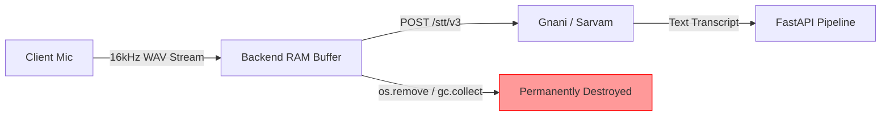

# 08 — Memory & Context Architecture Specification

## 1. Executive Summary & Design Principles
Memory in THOZHI is designed to enhance planning realism without compromising personal privacy. 

In strict adherence to Section 8D of the Master Execution Prompt:
- **Zero Raw Audio Retention:** Audio recordings are processed in volatile memory and destroyed immediately post-ASR.
- **Three Isolated Memory Layers:** Clear architectural segregation between Operational Task Memory, User-Controlled Personal Memory, and Contextual Summaries.
- **Explicit Consent & Sovereign Deletion:** No machine-learned preference is stored without explicit user consent. Users possess a one-click purge action for all learned priors.

---

## 2. The Three-Layer Memory Model

```
┌────────────────────────────────────────────────────────────────────────┐
│ LAYER 1: Operational Task Memory (Short-Term Execution)               │
│ - Scope: Active daily agenda, pending proposals, completed items.     │
│ - Purpose: Drives the immediate daily planning view.                   │
│ - Storage: Relational tables (`saved_tasks`, `task_proposals`).       │
│ - Retention: Rolling 90 days operational active state; archived after. │
└────────────────────────────────────┬───────────────────────────────────┘
                                     │
┌────────────────────────────────────▼───────────────────────────────────┐
│ LAYER 2: User-Controlled Personal Memory (Consensual Preferences)     │
│ - Scope: Task duration priors, working hours, preferred buffer times.  │
│ - Purpose: Personalizes default duration estimates based on past edits.│
│ - Storage: `user_duration_priors`, `user_settings` tables.             │
│ - Retention: Permanent until explicitly edited or purged by the user.  │
│ - Governance: STRICT OPT-IN ("Learn from my edits" toggle).            │
└────────────────────────────────────┬───────────────────────────────────┘
                                     │
┌────────────────────────────────────▼───────────────────────────────────┐
│ LAYER 3: Contextual Summaries (Aggregated Planning Analytics)          │
│ - Scope: Historical completion rates, recurring day-of-week deficits.  │
│ - Purpose: Generates warnings (e.g. "You are typically overbooked      │
│   on Thursdays").                                                      │
│ - Storage: Compact JSONB aggregates in `user_context_summaries`.       │
│ - Governance: Read-only analytical heuristic; NEVER overrides inputs.  │
└────────────────────────────────────────────────────────────────────────┘
```

---

## 3. Layer 1: Operational Task Memory Specification

### 3.1 Data Stored & Rationale
- Stores active commitments, due dates, scheduled start/end times, and completion timestamps.
- **Lifecycle Invariant:** When a task transitions to `COMPLETED`, it remains visible on today's agenda with a strike-through. At midnight, completed tasks are moved to the historical archive view (`scheduled_date < CURRENT_DATE`).
- **Rollover Invariant:** Uncompleted tasks (`status = 'PENDING'`) from yesterday trigger an explicit morning prompt: *"You have 2 rollover tasks from yesterday. Move to today?"* They are **never** silently rescheduled.

---

## 4. Layer 2: User-Controlled Personal Memory (Duration Priors)

### 4.1 The Duration Prior Learning Algorithm
Default duration estimates generated by LLMs are generic (e.g., 30 minutes). When a user repeatedly adjusts a specific category of task, the system calculates an updated prior:

$$\bar{D}_{\text{new}} = \frac{(\bar{D}_{\text{old}} \times N) + D_{\text{user}}}{N + 1}$$

Where:
- $\bar{D}_{\text{old}}$ is the existing rolling average duration in minutes.
- $N$ is the sample count ($\le 20$ to prevent anchor stagnation).
- $D_{\text{user}}$ is the duration manually entered by the user.

### 4.2 Consent & Transparency Protocol
1. **Opt-In Requirement:** The feature defaults to `learn_durations_opt_in = FALSE` in `user_settings`.
2. **Transparent Inspection UI:** The Settings screen renders a table of all learned priors:
   | Task Keyword | Current Learned Baseline | Samples Recorded | Action |
   | :--- | :--- | :--- | :--- |
   | *Code Review* | 45 minutes | 6 | [Reset to 30m] |
   | *Client Deck* | 90 minutes | 4 | [Reset to 60m] |
3. **One-Click Memory Purge:** User can tap **"Purge All Learned Durations"**, which executes:
   ```sql
   DELETE FROM user_duration_priors WHERE user_id = :auth_uid;
   ```

---

## 5. Layer 3: Contextual Summaries Specification

### 5.1 Analytics Schema (Provisional Specification)
Contextual summaries compute non-PII aggregate behavioral heuristics stored in a single JSONB row per user:
```json
{
  "user_id": "9b1deb4d-3b7d-4bad-9bdd-2b0d7b3dcb6d",
  "historical_metrics": {
    "avg_daily_planned_hours": 6.2,
    "avg_daily_completed_hours": 4.5,
    "planning_fallacy_ratio": 1.38,
    "peak_overload_day": "Thursday",
    "avg_completion_rate_pct": 72.5
  },
  "last_aggregated_at": "2026-11-07T00:00:00Z"
}
```

### 5.2 Behavioral Utilization
When Kahn's math engine calculates a proposed plan for Thursday, the frontend displays an empathetic insight badge:
> *"Insight: Historically, your Thursday schedules run 38% longer than planned. We've added a 15-minute buffer between your afternoon tasks."*

---

## 6. Audio & Transcript Retention Policies

### 6.1 Raw Audio Ephemerality (Zero-Retention)

- **Policy:** Raw audio is **never written to persistent disk storage** or cloud buckets. If temporarily buffered in `/tmp` due to memory constraints, the file descriptor is deleted inside a `finally:` block immediately after ASR returns.

### 6.2 Transcript Retention Policy
- Transcripts contain user thoughts and may hold sensitive client/financial details.
- `user_settings.transcript_retention_days` controls the automated purging of `raw_captures.transcript_text`:
  - **Option A (Default):** 30 days rolling retention.
  - **Option B (Strict Privacy):** Immediate deletion upon task approval (transcript text replaced with `[REDACTED_POST_APPROVAL]`).
  - **Option C (Permanent):** Indefinite retention for searchability.
- A nightly database cron job executes:
  ```sql
  UPDATE raw_captures 
  SET transcript_text = '[PURGED_BY_POLICY]' 
  WHERE created_at < NOW() - (SELECT transcript_retention_days || ' days')::INTERVAL;
  ```

