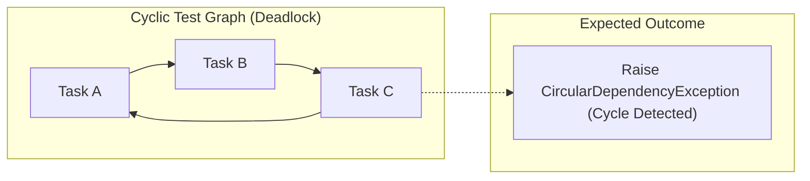

# 11 — Testing & Evaluation Strategy

## 1. Document Control & Objective
- **Document Stage:** Stage 1 — Testing & Evaluation Strategy
- **Product:** THOZHI
- **Status:** Architecture Specification (Implementation Prohibited)
- **Objective:** Establish measurable, automated verification protocols across the ASR pipeline, LLM extraction engine, deterministic constraint mathematics, and human-in-the-loop security boundaries.

> **CRITICAL DIRECTIVE:** In accordance with Section 10 of the Master Execution Prompt, **all benchmark protocols specified herein are test harness specifications.** No benchmark results or test outcomes are fabricated.

---

## 2. Test Dimension 1: ASR Transcription & Concept Error Rate (CER)

Standard Word Error Rate (WER) is an inadequate metric for conversational code-mixing because phonetic Latin transliterations vary (e.g., `naalaiki` vs. `naalaki`). We evaluate ASR primarily using **Concept Error Rate (CER)**.

### 2.1 Concept Error Rate (CER) Metric Definition
$$\text{CER} = \frac{\text{Incorrect or Missing Key Entities (Verbs, Nouns, Dates)}}{\text{Total Ground Truth Key Entities}} \times 100\%$$
- **Target Threshold:** $\text{CER} \le 10.0\%$ on conversational Tanglish audio.
- **Latency Threshold:** $95\text{th percentile (P95)} \le 1,800\text{ ms}$ for a 15-second audio clip.

### 2.2 Test Harness Design
- **Acoustic Dataset:** 20 pre-recorded audio files corresponding to the 18 synthetic scenarios in [`11-synthetic-test-scenarios.md`](file:///c:/Users/moham/OneDrive - ELCOT/Projects/Thozhi/research/stage-0/11-synthetic-test-scenarios.md), spoken across three regional accents (Chennai, Coimbatore, Madurai).
- **Execution Script:** `pytest tests/test_asr_providers.py`
  - Sends identical audio streams to `GnaniPrismaAdapter` and `SarvamSaarasAdapter`.
  - Asserts HTTP 200 response.
  - Verifies presence of essential semantic keywords (e.g., meeting, draft, tomorrow, 3 PM).

---

## 3. Test Dimension 2: LLM Intent Extraction & Schema Integrity

### 3.1 Evaluation Matrix across the 18 Synthetic Scenarios

| Test Case Category | Target Capability Tested | Expected Failure Mode if Broken | Automated Assertion |
| :--- | :--- | :--- | :--- |
| **TC-MOD-01** (Scenario 08) | Isolating `CASUAL_IDEA` from `HARD_COMMITMENT`. | Aspirational podcast idea scheduled as a today task. | `assert item.modality == ModalityEnum.CASUAL_IDEA` |
| **TC-MOD-02** (Scenario 10) | Filtering `COMPLETED_ACTION`. | Paid electricity bill scheduled on tomorrow's calendar. | `assert item.modality == ModalityEnum.COMPLETED_ACTION` |
| **TC-NEG-01** (Scenario 11) | Enforcing negative constraints (*"Do not schedule on Wed"*). | Task placed on Wednesday calendar slot. | `assert "2026-11-11" not in task.allowed_dates` |
| **TC-REP-01** (Scenario 12) | Acoustic self-repair (*"Thursday 4 PM... no, Friday 11 AM"*). | Two tasks created (one Thursday, one Friday). | `assert len(extracted_tasks) == 1 and task.start == "11:00"` |
| **TC-TEM-01** (Scenario 14) | Tamil temporal idiom (*"naalaiki marunaal"*). | Off-by-one error (scheduled tomorrow instead of day after). | `assert task.deadline.day == CURRENT_DAY + 2` |

### 3.2 Syntactic Schema Test (Pydantic Firewall)
- **Assertion:** $100\%$ of LLM responses must parse into `ExtractionResponse` without raising `pydantic.ValidationError`.
- **Fuzzing Test:** Pass 50 malformed, truncated, or adversarial text strings; assert that the API raises a clean 422 Unprocessable Entity instead of crashing with a 500 internal server error.

---

## 4. Test Dimension 3: Deterministic Planning Engine Math

The deterministic planning engine must be tested against pure mathematical and algorithmic edge cases using standard unit test fixtures:

### 4.1 Unit Test Specifications
1. **Topological Sort Correctness (`test_kahn_topological_sort`):**
   - *Input:* Linear chain $A \prec B \prec C \prec D$.
   - *Assertion:* Output sequence must strictly equal $[A, B, C, D]$.
2. **Circular Dependency Cycle Detection (`test_cycle_detection`):**
   - *Input:* Graph with circular edges: $A \rightarrow B \rightarrow C \rightarrow A$.
   - *Assertion:* Algorithm terminates immediately; asserts `has_cycle == True`; returns cycle node IDs `[A, B, C]`.
3. **Capacity Deficit Calculation (`test_capacity_deficit`):**
   - *Input:* Free working hours $= 3.0\text{ hours}$ (180 min). Tasks $= [90\text{ min}, 60\text{ min}, 60\text{ min}]$ (Total: 210 min).
   - *Assertion:* `deficit_minutes == 30`; proposal carries `CAPACITY_DEFICIT` flag.
4. **Zero Interval Overlap Invariant (`test_bin_packing_overlap`):**
   - *Input:* Feasible set of 4 tasks scheduled into calendar gaps.
   - *Assertion:* For every pair of scheduled tasks $(T_i, T_j)$, assert that:
     $$\max(t_{\text{start}}(T_i), t_{\text{start}}(T_j)) \ge \min(t_{\text{end}}(T_i), t_{\text{end}}(T_j))$$
     (Zero overlapping minutes).

---

## 5. Test Dimension 4: Security, Isolation & Human Agency

### 5.1 The "Zero-Silent-Task" Agency Test (`test_agency_enforcement`)
- **Objective:** Architecturally prove that no task is ever written to `saved_tasks` without an explicit human approval transaction.
- **Test Procedure:**
  1. Trigger `/api/v1/captures/audio` with an urgent task prompt.
  2. Query `saved_tasks` table directly via SQL.
  3. **Assertion:** `SELECT COUNT(*) FROM saved_tasks WHERE user_id = :uid` must equal `0`.
  4. Dispatch POST to `/api/v1/proposals/{id}/approve`.
  5. Query `saved_tasks` again.
  6. **Assertion:** `COUNT` now equals `1`.

### 5.2 Multi-Tenant RLS Penetration Test (`test_tenant_isolation`)
- **Test Procedure:**
  1. Authenticate Client as User A. Create Proposal A.
  2. Authenticate Client as User B. Attempt to send `POST /api/v1/proposals/{Proposal_A_id}/approve`.
  3. **Assertion:** Server returns `404 Not Found` or `403 Forbidden`. Database records zero state modification.

### 5.3 Idempotency Duplicate Prevention Test (`test_approval_idempotency`)
- **Test Procedure:**
  1. Dispatch 5 concurrent identical HTTP requests to `/api/v1/proposals/{id}/approve` using the same `idempotency_key`.
  2. **Assertion:** All 5 requests return HTTP 200/201, but exactly one set of tasks is inserted into `saved_tasks`.

